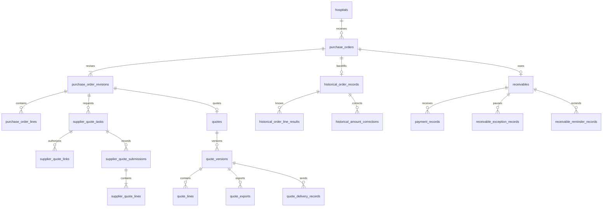

# 开发设计说明书第二部分数据库与事务设计

- 日期：2026-10-15
- 状态：方案已于 2026-10-15 经用户确认；本文件未创建数据库、迁移或应用代码。
- 业务基线：[PRD v3](quote-system-prd-v3.md)，重点对应第 7、8、12 节。
- 已确认路线：[第一部分架构与技术选型](development-design-v1.md)。

本部分将采购修订、厂家提交、医院报价、历史补录与应收回款整理为关系模型，明确数据权威来源、唯一约束、并发控制及导出的一致性。同单锁与幂等、首次导出占用和查询快照方案已确认，日期截止和通知发送时刻等业务边界见已确认的 [第四部分](state-time-boundary-design-v1.md)。

## 一 关系模型

采购单根对象代表一次医院采购需求，采购修订和报价换版都不新建一次业务订单。普通询价和历史补录共用根订单，但保留各自的金额来源。

普通应收只关联已确认报价版本，历史应收只关联已核实历史资料；两种来源互斥。图中省略部分商品、文件、审计与人员关联，具体对象沿用 PRD 第 8 节。

### 1.1 数据权威来源

| 业务事实 | 唯一权威来源 | 不能混用的值 |
| --- | --- | --- |
| 医院新单默认负责人 | hospitals.salesUserId | 不覆盖旧订单负责人。 |
| 订单当前操作和提醒负责人 | purchase_orders.salesUserId | 不用报价制作人或系统初始负责人代替。 |
| 系统初始负责人及历史操作者 | originalSalesUserId 与各 createdBy/recordedBy 字段 | 专项交接不改历史署名；未知纸单原经办人不伪造。 |
| 当前业务采购修订 | purchase_orders.currentRevisionNo 对应的修订 | 创建新草稿后，旧修订报价不能成为当前单最终确认。 |
| 正常单统计需求 | 该单最新实际冻结的采购修订 | 不直接取未冻结的 currentRevisionNo，也不因旧版 superseded 而归零。 |
| 普通单最终确认报价 | quotes.confirmedVersionId | 不按最大版本号或最近导出文件推定。 |
| 已核实历史最终金额 | historicalConfirmedAmountOverride 非空时取该值，否则取原核实金额 | 原核实金额保留；0 与空值必须区分。 |
| 累计已收 | payment_records 中 active 记录之和 | 历史累计已收也在此求和，不再额外加核实快照。 |
| 当前到期日 | 根单实际接收日期加当前有效账期，显式调整时同步应收 | 医院默认账期修改不重新计算旧单。 |
| 历史未知确认结果 | 可空的逐行核实结果及已知覆盖信息 | 不按金额倒推单价，不用需求差额推缺货。 |

### 1.2 对 PRD 字段建议的技术补充

- 对可编辑的采购根对象、修订和报价草稿增加递增的 `row_version`。它表示保存冲突版本，不是 R1/R2 或 V1/V2 业务版本号。
- 修改一条采购/报价行也必须递增所属可编辑聚合对象的 row_version；不能只更新子行时间戳，让另一端继续按旧版本保存。仅实时读取后到比价候选不改写草稿版本，主动采用或影响业务状态的变化另行更新版本。
- 保留 `currentRevisionNo`。正常单统计用带索引的查询选择最大 revisionNo 且 frozenAt 非空的修订；不要仅筛选 `status=frozen`。整单作废先排除；按第四部分已确认规则，MVP 不提供单独作废新修订并回退旧版，不能复活旧报价。
- 历史资料增加 `verifiedRevisionId`，核实时封存本次已补齐需求行及可选逐行结果，指向同订单修订。该封存不生成厂家任务、医院报价或虚假的发送记录。
- 报价导出增加准备快照、快照哈希、输入版本和任务租约标识，供第六节的两阶段处理使用。这些是执行元数据，不能成为第二套报价价格来源。
- 表名和物理列名统一 snake_case，接口仍可使用 PRD 的 camelCase 名称；转换由服务端契约层完成。
- 用户增加 `access_scope_version`。医院归属、订单专项交接或角色/账号权限变化时，事务内更新受影响用户的范围版本，用于使旧查询快照失效；它不改历史订单内容。

## 二 字段类型与数据保留

| 类别 | 推荐存储与校验 |
| --- | --- |
| 主键和外键 | UUID，所有业务引用必须属于正确父对象；未知历史关联允许为空，不造假 ID。 |
| 数量、单价、金额 | 按 PRD 字段精度使用 NUMERIC(12,2)，单位 kg；计算过程采用十进制运算，落库前校验有限数、范围和精度。 |
| 加价参数 | NUMERIC(12,2)，按方法分别校验固定额非负、百分比非负或倍率至少 1.00。 |
| 实际接收日、有效至日、到期日、回款日 | DATE；historical_opening 的支付日期未知时为空，普通新增回款必须有实际日期。 |
| 提交、冻结、作废、录入和审计时间 | TIMESTAMPTZ，保存时间点，按 Asia/Shanghai 展示与业务日期归期。 |
| 状态 | 文本列配 CHECK 或等价受控枚举，使用 PRD 已确认状态；任务执行状态与业务状态分开。 |
| 快照和补充信息 | JSONB；用于不可变抬头、准备导出快照和审计摘要，不替代应收、有效回款等主关系。 |
| 核实原因和说明 | 文字字段去除首尾空白后校验非空；依据、核实说明、更正原因分别保存。 |

接口金额、数量采用明确的十进制字符串表示。拒绝 NaN、Infinity、超出存储范围或超过输入允许小数位的值，不能依赖 NUMERIC 自动舍入接收不合法输入。推荐价按公式舍入至两位；行金额按“数量乘最终单价”舍入至两位；总金额再累加已舍入的可供货行，服务端结果用于数据库和文件。

NUMERIC(12,2) 的非负值上限为 9999999999.99；数量与单价各自合法不代表乘积或整单总额一定可存储。派生金额也要在生成文件及写入前检查上限，超限明确拒绝，不能截断或靠数据库异常留下半成品。

主数据采用停用，业务记录采用状态与审计保留。存在订单、报价或回款引用时不级联物理删除；冻结采购行、厂家原始报价、已导出报价内容和首次历史核实依据禁止普通 UPDATE/DELETE。允许的状态变化及专用留痕更正不改原始内容。

PostgreSQL 的 NUMERIC、外键和 CHECK 分别提供精确数值及行内/引用约束；跨行有效回款合计不能写成普通 CHECK，须按第四节的事务协议校验。[数值类型](https://www.postgresql.org/docs/current/datatype-numeric.html)、[约束说明](https://www.postgresql.org/docs/current/ddl-constraints.html)。

## 三 唯一约束与引用一致性

| 对象 | 约束 |
| --- | --- |
| 用户 | login_name、手机号按 PRD 唯一；微信身份按 app_id 与 open_id 唯一绑定内部用户，不能靠昵称认人。 |
| 采购修订 | purchase_order_id 与 revision_no 唯一。当前修订引用必须属于同一采购单。 |
| 厂家任务 | slot_no 仅 1 或 2；未取消任务按“修订＋slot_no”和“修订＋manufacturer_id”分别唯一，因此同一修订最多两个有效厂家任务。 |
| 厂家链接 | token_hash 唯一；同一任务最多一个 active 链接。过期仍在使用时重新校验 expires_at，不能只信清理任务是否执行。 |
| 厂家提交及行 | task_id 与 submission_no 唯一，同任务最多一个 current 提交；submission_id 与 purchase_order_line_id 唯一，全部行属于任务对应冻结修订。 |
| 报价单 | quote_no 唯一，purchase_order_revision_id 唯一；根订单与修订必须一致。 |
| 报价版本及行 | quote_id 与 version_no 唯一；同报价单最多一个 draft、一个 confirmed；版本与采购行的关联不得跨修订。 |
| 供货行与价格 | 单位固定 kg、采购数量大于 0；quoted 厂家行单价必须大于 0，unavailable 单价为空。医院缺货行单价/基准价格引用为空，正常有价行须追溯本采购修订下的厂家行；冻结规格和数量不能被提交内容改写。 |
| 最终确认引用 | confirmed_version_id 属于本报价单，且对应状态为 confirmed；指针、版本状态、报价及根订单完成状态同事务维护。 |
| 应收 | purchase_order_id 唯一；source_type 决定且仅决定一个非空来源外键，来源还须属于同单且满足确认/核实状态。全缺货单不建应收，历史结果未知时不能凭金额为 0 反推全缺货。 |
| 历史资料与逐行结果 | historical_order_records.purchase_order_id 唯一；同历史资料与采购行最多一条结果，关联行属于 verifiedRevisionId 对应修订。 |
| 历史累计回款 | 同应收最多一条 active 的 historical_opening；累计为 0 不造回款行，后续更正仍保留同一类型。 |
| 催收异常 | 同应收最多一条 pending_verification 异常；active_exception_record_id 须指向该单当前待处理异常。 |
| 每日提醒 | receivable_id、reminder_date、channel 唯一；接手人改变不新增同单同渠道当天第二条提醒。 |
| 编号 | 使用 document_number_counters 按编号种类、业务日期及医院等编号范围分配流水，最终业务编号另设唯一约束；重试不重复占业务号，达到格式上限明确报错，不回绕。 |

“最多一个 active/current/draft”等约束采用带状态条件的部分唯一索引。跨父对象引用使用复合外键等方式约束；涉及状态和多表一致性的条件仍须事务内复核，不能误以为部分唯一索引已覆盖全部业务规则。[部分索引说明](https://www.postgresql.org/docs/current/indexes-partial.html)。

## 四 并发与幂等方案

### 4.1 方案选择

推荐使用 Read Committed 隔离级别，关键业务写入先锁采购单根行，再读取最新状态与金额；草稿编辑叠加 row_version 冲突检测。相比所有写入统一采用 Serializable，此方案的业务冲突点更明确；Serializable 可用于确有跨订单一致性需求的独立操作，并实现整笔事务重试。

两种隔离级别都不能代替业务校验。下面的行锁方案以所有相关写入口遵守同一协议为前提；不能只给 PC 回款入口加锁，而让小程序或历史更正走另一条路径。[事务隔离](https://www.postgresql.org/docs/current/transaction-iso.html)、[显式锁](https://www.postgresql.org/docs/current/explicit-locking.html)。

### 4.2 锁与保存冲突

1. 先鉴权并确定根订单，在事务中取得根订单 FOR UPDATE 锁；随后重新检查当前负责人、账号状态、采购版本和业务状态。转交与原销售写入也使用该根锁，避免交接后仍以旧归属提交。
   需要保护账号停用并发时，先按统一顺序对涉及的用户行取得共享锁，停用账号取得冲突的写锁；已有业务事务完成后才停用，新事务随后读取停用状态并拒绝。不得先持有根锁再逆序锁用户。
2. 同一操作需要额外锁时遵循固定次序：用户/医院等归属资料 → 采购根单 → 厂家任务/报价 → 应收 → 历史资料及子记录。同类多行按 ID 排序；不得先持有子记录锁再回头等待根锁。
3. 新建订单时从受保护的医院资料读取当前负责人和账期快照。已有订单不会因为重新读取医院默认值而改账期或负责权。
4. 草稿保存提交 expectedVersion；取得根锁后比较 row_version，冲突则返回可识别的 409 和当前版本信息，不覆盖另一端结果，也不自动重放用户编辑。
5. 钱款操作取得根锁和已有应收锁后，再单独查询有效回款合计。所有新增、作废、历史累计更正及历史应收更正共用该锁顺序和重算协议。
6. 不在数据库事务中等待 OCR、COS 上传、文件生成或微信响应。锁等待超时、死锁和可重试数据库错误按有上限的整笔事务重试处理；同一幂等键保护业务结果。

### 4.3 operation_requests

新增持久化操作请求记录，按 actor_type、actor_id、operation、idempotency_key 唯一，保存请求内容哈希、业务结果引用及处理结果。敏感 token 不写入此表或公开日志。

- 相同键和相同内容重试，返回已提交结果；相同键但不同内容返回冲突，不悄悄采用新金额。
- 操作结果与业务写入同事务提交；事务回滚不留下“已成功”请求。异步操作缓存任务 ID，客户端继续查询该任务。
- 返回缓存结果前仍校验当前读取权限，不能因请求曾成功就向已失去权限的人泄露旧数据。厂家同一次成功提交的同内容重试可返回原提交回执，但不恢复链接或创建新提交。
- 最终确认、应收、提交及历史累计等业务唯一约束独立保留，防止换幂等键仍重复生成业务事实。

## 五 关键事务边界

| 操作 | 必须在一次数据库事务中完成的事项 |
| --- | --- |
| 创建采购修订 | 锁根单，检查可换版，分配 R 版本，复制明细为草稿，替代旧修订并更新 currentRevisionNo；旧链路内容保留，新草稿不覆盖统计需求。 |
| 校对冻结 | 锁根单和当前修订，校验完整明细、规格/单位/数量，封存行及冻结时间；切换状态，供后续询价和最新冻结需求查询使用。 |
| 生成/重置未提交厂家链接 | 锁根单、任务和当前链接，确认当前冻结修订及未提交状态；原子失效旧链接及其 H5 会话、创建新哈希和 48 小时期限并切换 activeLinkId。页面关闭后须明确重置，重复请求只返回元信息；厂家已先提交时拒绝普通重置，不能静默转为重询。 |
| 厂家提交 | 锁根单、任务及链接，取得锁后重新校验链接有效时间、状态和采购版本；校验逐行完整覆盖且无多余行，建立不可变提交，切换 activeSubmissionId 并关闭链接，记录审计。 |
| 重询/取消/换厂家 | 锁根单，旧提交改为 superseded，清除不再有效的 activeSubmissionId，按规则关闭链接并重询或占用任务位；同时使被选为基准的未完成冻结报价记录首次失效时间及原因。禁止发送与重询之间出现未校验窗口。 |
| 刷新采用后到价 | 锁根单及报价草稿，检查输入版本和手动基准锁；更新被主动采用的厂家快照、允许变化的基准及推荐价，保留最终价格，相关行重新确认并重算有效期上限。 |
| 标记发送 | 锁根单及报价，验证当前采购版本、成功导出记录、版本状态、未完成及未失效；新增发送记录与 sentAt，原子更新报价和订单状态。 |
| 最终确认 | 锁根单及报价，重查已发送/未作废/当前采购版本和实际确认时间；写入唯一确认版本及实际/录入时间，作废其他全部未发送版本，完成报价和根单；含价格单只建一笔应收，全缺货不建。 |
| 核实历史补录 | 锁根单及历史资料，校验完整采购需求、日期、原账期、金额、文字依据和说明；封存 verifiedRevisionId，按历史来源建立适用的一笔应收及可选一条历史累计已收，完成核实，全缺货不建应收。逐行确认结果未知不阻止核实，附件可空；已有资料互相矛盾仍须核实，不把“未知”当豁免矛盾校验。 |
| 新增回款 | 锁根单及应收，重算有效已收；验证本次正金额不超过剩余余额，插入回款及审计，更新派生结清/提醒资格。 |
| 回款作废重录 | 作废时只改变错误记录状态并留原因，重复作废不再次扣减；重录仍按新增回款校验，更正历史累计时保持类型和同单有效唯一性。两次操作分别可追溯，不替代真实退款。 |
| 历史金额更正 | 锁根单、应收及历史资料，重算有效已收，校验新应收不低于已收及原因/依据/说明非空；新增更正记录，同步当前历史金额与已有应收，原核实金额及回款不变。 |
| 单单账期调整 | 锁根单及已有应收，保留原快照，写调整记录、当前覆盖值和到期日；仅更新本单，保留异常暂停状态。 |
| 异常登记或解除 | 锁根单及应收，登记当前异常或核实仍需收款后解除指定异常；同步暂停标记和审计，不动金额、不把解除当退款或结清。 |
| 离职专项交接 | 按统一顺序锁定归属对象，重查范围并转交根单及应收当前负责人，记录前后责任及待处理事项；原报价/金额/历史不变。批量结果逐项落审计，仍有未交接事项时不得停用原账号或标全部完成。 |

已有应收的 paymentTermDaysSnapshot、dueDate 等字段作为查询投影保存，但根单账期调整与应收投影必须同事务变化。累计已收、未收及结清先按有效回款实时派生，首版不再维护一套人工可编辑余额。

## 六 异步导出与文件冻结

### 6.1 推荐的短事务与执行租约

首次导出采用“准备 → 生成文件 → 完成提交”。推荐生成期间对该草稿设置可过期的导出占用，暂时禁止编辑或继续创建报价版本，页面仍可查询和查看进度；失败或超时回收后恢复草稿操作。该取舍减少生成过程中内容变化引发的反复失败。

另一种可行方式是允许继续编辑，完成时检测输入版本变化并废弃旧结果；该方式减少等待，但增加重复生成和结果失效。本草案推荐前一种，同一草稿一次只处理一个导出尝试；不同订单可并行。

1. **准备事务。** 锁根单和草稿，完成整单校验，记录本次版本与内容哈希、厂家来源和有效期依据；在 quote_exports 保存不可变准备快照，在 background_jobs 写任务，设置 active_export_id 与递增执行代次后提交。此时报价尚未业务冻结，也不能标记发送。
2. **文件生成。** worker 读取准备快照，在事务外生成文件并上传 COS 私有临时对象。对象键带任务及尝试标识，不覆盖其他尝试。文件未绑定为成功导出前不向用户签发下载链接。
3. **完成事务。** 重取根锁，验证执行代次/租约仍有效、草稿输入版本未变、根单未换采购修订或完成/作废；重查基准有效资格和日期，并处理可能缩短的有效期。校验通过后，把同一准备快照对应的数据封存，绑定文件，写 succeeded 导出记录及首次 exportedAt，释放占用。
4. **失败与回收。** 任一检查失败时不产生可发送报价，记录失败原因并按当前执行代次释放占用；已作废或完成的业务状态不能回退成草稿。旧 worker 的迟到回调不能冻结新草稿、覆盖新执行结果或复活作废版本；未绑定对象由清理任务回收。
5. **后续格式。** 同一冻结版本的 PDF/Excel 继续使用原内容及有效期快照，不增加业务版本号、不延长有效期；是否允许当前状态重新导出仍由版本规则校验。历史已有文件保持可追溯。

COS 写入和 PostgreSQL 提交不能成为同一个本地事务；通过私有临时文件、成功绑定后才可下载及迟到回调校验，保证用户可拿到的成功文件与冻结数据一致。

## 七 后台任务与提醒

background_jobs 保存 job_type、business_id、去重键、payload_reference、状态、run_after、attempt_count、lease_token/lease_until 及错误摘要。解析、导出和提醒各保留自己的业务结果表，任务表只描述执行进度。

- worker 用短事务领取到期任务并设置租约，然后释放任务行锁，再按根订单协议执行业务；不得持有任务锁等待根锁。任务完成须比较 lease_token，失去租约的执行者不能提交旧结果。
- 领取任务可使用 FOR UPDATE SKIP LOCKED；它只用于任务队列，不用于普通业务查询或余额统计，避免跳过被锁数据造成错误结果。[SELECT 锁定说明](https://www.postgresql.org/docs/current/sql-select.html)。
- 数据库事务内写待处理任务，worker 只读取已提交任务；进程重启按任务状态和租约恢复。通知授权不足、模板不可用或任务失败不影响站内待回款列表。
- 到期提醒按应收、业务日期和渠道去重，待发送任务在派发前重查最新负责人、有效余额、到期日、异常暂停和订阅条件；已结清、暂停或归属变化的排队任务须跳过或更新收件人，不回放历史暂停期间催收。
- 第三方响应超时可能无法判断是否已送达；若接口无可靠幂等或查证能力，标记 outcome_unknown，保留派发尝试记录，不盲目自动重发。已开始向外部接口派发的请求，不能承诺与数据库之后发生的暂停/交接原子撤回，须记录派发与变更的先后时间；它与尚未派发的排队任务分开处理。

## 八 查询与索引

1. 根订单按 hospital_id/received_date、sales_user_id/status/received_date 建组合索引；采购修订按 purchase_order_id/revision_no 索引，并支持 frozen_at 非空的选择。分页采用稳定排序并包含 ID，避免同日记录顺序漂移。
2. 应收按当前负责人及 due_date 查询，关联有效回款索引 receivable_id/status；历史补录、账期调整和更正按根单外键索引。索引不代替根单读取权限。
3. 图表先得到有权限的根订单集合，再分支选正常单最新冻结修订或已核实历史修订；排除从未冻结正常单和整单作废，根单去重。需求、已知确认结果、金额及覆盖分别汇总，不直接连多张一对多表后求和，避免报价版本与回款行相乘。
4. 图表与其分页下钻采用同一短期查询快照。一次 Repeatable Read 事务中读取有权限的根单、所选冻结/核实来源及指标，保存查询结果和必要的明细投影到 analytics_query_snapshots 与 analytics_query_snapshot_items，再返回 snapshot_id。后续页面通过该 ID 分页，不把“相同截止时间参数”误当成相同数据库快照。
5. 同批对比归实际接收日期；确认趋势归实际确认日期。未知历史逐行结果不当作 0，部分已知标明覆盖；实际确认日期未知不进入确认日期趋势。金额更正归原业务期间，不新增需求次数。

查询快照保存查询人、筛选摘要、生成/到期时间、来源版本及行投影；它是临时查询结果，不是可编辑统计台账。快照绑定创建者及数据范围，下钻仍重查当前权限；归属/权限变化影响结果范围时返回“权限范围已变化，请刷新”，不得继续暴露旧快照。快照到期或用户选择刷新时整组重算图表及下钻，不悄悄混用新旧指标。历史档案查看跳转到当前业务详情时，提示它与查询快照的时间差。

快照读取同时校验账号有效及当前 access_scope_version 与生成时一致；不一致则整份快照失效，并对返回行继续执行订单读取权限校验。分页接口不能仅信任客户端传来的 snapshot_id 或订单列表。

### 8.1 新增执行与查询数据

| 表 | 主要字段和约束 |
| --- | --- |
| operation_requests | 操作者、操作种类、幂等键、内容哈希、结果业务引用；按第四节的复合键唯一。 |
| document_number_counters | 编号种类、业务日期、医院等 scope_key 及当前流水；编号范围唯一并在分配事务中锁定。 |
| background_jobs | 执行种类、业务引用、去重键、状态、调度时间、重试次数、执行租约与错误；同一业务操作的任务去重，不把业务是否成功仅藏在任务状态中。 |
| analytics_query_snapshots | 创建者、权限范围版本、筛选摘要、指标结果、生成/到期时间；仅为有期限的查询快照，绑定创建者。 |
| analytics_query_snapshot_items | 快照外键、根订单/所选修订/确认来源及必要的行投影、稳定分页序号；同快照内序号唯一，来源版本可追溯。 |

清理任务只清理过期查询快照及无业务引用的临时文件，不级联清理真实订单、导出、核实或回款历史。快照保留期限和任务超时等运行参数见已确认的第五部分试用配置，实现阶段须验证，不能据此改动业务有效期。

## 九 实现阶段的验证要求

以下为建立工程后须在真实 PostgreSQL 中验证的场景，本次文档检查不代替这些测试：

- 同单并发登记两笔各 4000 元回款、余额仅 7000 元时只能成功一笔；历史应收更正与回款并发也不能超收或负余额。
- 重复/并发确认不同报价版本，只产生一个最终确认和一笔适用应收，其他未发送草稿和已导出版本一起作废。
- 厂家提交与重询/取消、报价发送与基准失效同时发生时，按最终锁定顺序得到可追溯结果，不能引用已失效基准放行。
- 导出生成期间编辑被占用阻止；进程崩溃可回收占用；租约过期后旧回调、采购换版或最终确认不能导致旧文件错误绑定或状态复活。
- 历史核实无附件但文字依据齐全可成功，未知逐行结果仍可入账；重复核实不重复记账，普通新单冒用入口被拒绝。
- 新修订未冻结时统计仍用上一冻结需求；已核实历史需求不因可选确认结果缺失而排除；一对多联查不放大次数或金额。
- 图表生成后订单发生金额更正或需求修订，旧查询快照下钻仍与原图一致；刷新后整组取得新值。医院归属或专项交接改变读取范围时旧快照失效，不能继续读取已经失去权限的订单。
- 离职交接与原销售写入、提醒派发并发时，权限和当前归属在提交前复核，原历史署名保持。

## 十 已确认范围与下一项

本部分已确认：同单统一根锁与草稿乐观版本、数据库唯一约束配合幂等请求、两种应收来源、真实回款记录作为累计已收来源，以及首次导出期间的可回收占用和两阶段文件绑定。图表和下钻通过同一查询快照读取，权限变化使旧快照失效。

[第三部分接口与身份权限](api-identity-permission-design-v1.md) 和 [第四部分状态与时间](state-time-boundary-design-v1.md) 已确认登录、权限、日期截止与提醒派发边界；部署资源见已确认的 [第五部分](deployment-cost-design-v1.md)。本部分不扩大实际退款/核销或历史未知数据的业务范围。
