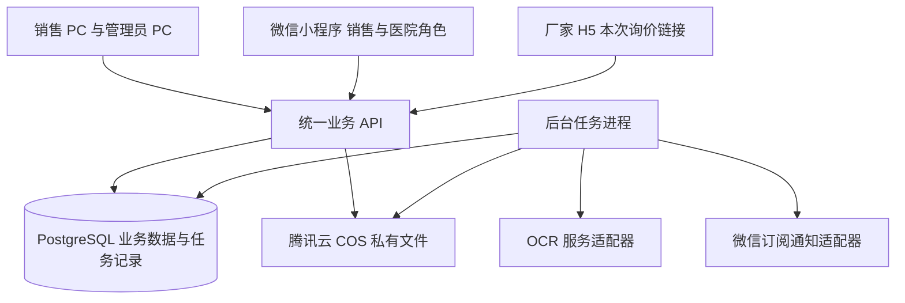

# 开发设计说明书第一部分架构与技术选型

- 日期：2026-10-15
- 业务基线：[PRD v3](quote-system-prd-v3.md) 与 [需求决策记录](requirement-consensus-2026-10-15.md)。
- 本部分状态：软件技术路线已于 2026-10-15 经用户确认；2026-10-16 已确认两名销售员按单机自建 PostgreSQL 路线试用，按 2 核 4 GB 起步评估。具体采购配置、地域、域名和预算仍待核对，见已确认的 [第五部分](deployment-cost-design-v1.md)。

本部分确定应用怎样组成、各端怎样共享数据，以及后续开发采用的技术路线。数据库与事务方案见已确认的 [第二部分](database-transaction-design-v1.md)，之后依次展开接口契约、页面原型和实施任务。

## 一 已确认的整体架构

采用模块化单体后端：业务按模块组织，在一个后端工程内维护，PC、小程序和厂家 H5 共用服务端接口、权限、状态和数据规则。文件解析、报价导出和通知由同一代码库中的后台任务进程处理。

这一选择基于本项目的业务关系：确认报价时必须同步关闭其他未发送版本并建立应收；回款登记和历史金额更正必须共同校验已收余额；PC 与小程序不能分别维护一套订单状态。将这些操作放在统一业务后端和关系型数据库内，便于在明确的事务边界中保证一致性。

图中箭头表示访问关系。三个界面都不能直接写业务数据库；API 和任务进程都必须执行各自操作对应的业务校验。

## 二 已确认技术栈

| 部分 | 推荐方案 | 在本项目中的职责 |
| --- | --- | --- |
| 销售与管理员 PC | Vue 3、TypeScript、Vite、Element Plus | 表格校对、厂家比价、报价、历史档案、回款与图表；按角色显示入口。 |
| 微信小程序 | uni-app 的 Vue 3 与 TypeScript 路线 | 同一小程序内区分销售与医院采购员，调用统一业务 API；五类图表按手机屏幕适配。 |
| 厂家 H5 | Vue 3、TypeScript、Vite | 独立的本次询价表单，通过受限 token 访问对应任务。 |
| 业务后端 | Node.js、TypeScript、NestJS | 身份绑定、权限、版本、计价、回款、统计及外部服务适配。 |
| 业务数据库 | PostgreSQL | 结构化业务关系、金额、事务、唯一约束、审计及持久化任务。 |
| 文件存储 | 腾讯云 COS 私有存储桶 | 采购原图、原表、凭证和报价文件，鉴权后提供短期下载链接。 |
| 后台任务 | 同一后端工程中的独立 worker 进程 | OCR、Excel 解析、Excel/PDF 导出、到期提醒调度与通知重试。 |
| 部署 | 腾讯云服务器、容器、HTTPS 入口 | 部署 PC/H5 静态资源、API 和任务进程；数据库部署组合见第五节。 |

具体依赖版本在建立工程时按兼容性验证后锁定。PC 与小程序共享接口契约、枚举和数据口径，各自使用适合终端的组件；Element Plus 用于 PC，不直接作为小程序组件库。

NestJS 提供模块组织机制，适合按业务边界拆分后端；uni-app 官方列出了 Vue 3 在 H5 与微信小程序中的能力差异，双端组件仍须分别验证。[NestJS 模块说明](https://docs.nestjs.com/modules)、[uni-app Vue 3 能力说明](https://uniapp.dcloud.net.cn/tutorial/vue3-api.html)。

## 三 业务模块边界

| 模块 | 负责内容 |
| --- | --- |
| 账号与权限 | PC 密码登录、小程序身份绑定、角色与订单权限、账号停用及离职专项交接。 |
| 基础资料 | 医院、采购员、厂家、商品规格、别名、模板及全品类来源批次；来源价格只作资料参考。 |
| 采购单 | 正常提交与销售代录、原文件、校对、冻结、采购修订及根订单归属。 |
| 厂家询价 | 两个任务位、48 小时填写链接、完整提交、报价有效期、重询及基准失效传播。 |
| 医院报价 | 当前有效价格、基准选择、销售确认、冻结快照、导出、发送、最终确认及其他未发送版本关闭。 |
| 历史档案 | 专用历史补录、文字核实依据与可选附件、未知结果、金额录入更正和全部版本查询。 |
| 应收与回款 | 账期快照及单独调整、分次回款、作废重录、余额校验、异常暂停与解除、到期提醒。 |
| 数据分析 | 五类图表、统一日期口径、采购单去重、最新冻结需求、历史未知覆盖及下钻。 |
| 文件与后台任务 | 私有文件访问、解析、导出、通知、失败重试、任务去重及审计。 |

模块之间通过服务方法调用；数据库事务可以覆盖需要共同提交的业务操作。与 COS、OCR 和微信的外部调用通过任务状态及重试衔接，不将网络调用成功等同于数据库提交成功。

## 四 必须保留的设计约束

1. **统一身份和权限。** PC 与小程序绑定同一内部用户。医院当前负责人、订单当前负责人、原始负责人和历史操作人分开处理；管理员的专项交接例外不扩展为普通业务写权限。
2. **金额精确计算。** 数据库存储金额和数量采用有明确精度的 NUMERIC。接口采用明确的小数表示，服务端使用十进制运算并落实 PRD 的舍入顺序，前端显示值不作为记账结果。PostgreSQL 的 NUMERIC 提供精确数值存储能力，事务隔离仍需结合具体锁和重试策略设计。[数值类型](https://www.postgresql.org/docs/current/datatype-numeric.html)、[事务隔离](https://www.postgresql.org/docs/current/transaction-iso.html)。
3. **历史快照独立。** 当前商品、厂家或医院资料变化不能改写已冻结报价。后到报价只提示差异，销售主动采用后才修改草稿；供应商基准失效与版本作废分别记录。
4. **事务内校验。** 最终确认与应收创建、回款与余额、历史金额更正与已收下限分别划定事务边界。重复请求不能重复记账，PC 和小程序并发操作不能静默覆盖。
5. **任务可恢复。** 任务持久化后才交给 worker 执行，进程重启后能继续查询、重试或明确失败；每类任务校验当前订单与版本状态，不能复活已作废报价或向已暂停订单催收。任务投递、领取及完成协议在后续事务设计中明确。
6. **文件私有。** 附件和导出文件关联业务对象，服务端鉴权后才签发短期下载链接。COS 支持用预签名 URL 临时下载私有对象；链接持有人在有效期内可以访问，因此链接和查询参数不能写入公开日志。[COS 预签名授权下载](https://cloud.tencent.com/document/product/436/14116)。
7. **业务日期统一。** 展示及日期归期按 Asia/Shanghai 处理；实际业务时间、系统录入时间分别保存。有效期、自然日账期和每日 09:00 提醒已在 [第四部分](state-time-boundary-design-v1.md) 确认。
8. **未知不是零。** 已核实历史金额可入账，逐行未知结果单独留空；图表返回覆盖信息。缺货不能从需求与已知确认量的差额推定。

## 五 腾讯云部署的两种组合

两种组合采用相同的应用代码和 PostgreSQL 逻辑模型，区别在于数据库的部署与维护责任。

| 组合 | 组成 | 取舍 |
| --- | --- | --- |
| 腾讯云服务器与自建 PostgreSQL | 在服务器上部署应用、worker 和 PostgreSQL，附件放 COS | 已选择用于两人试用；数据库补丁、磁盘、备份及恢复由项目自行维护，同机故障会同时影响应用和数据库。 |
| 腾讯云服务器与托管 PostgreSQL | 服务器运行应用和 worker，腾讯云数据库运行 PostgreSQL，附件放 COS | 保留为后续迁移备选。增加独立数据库资源费用，数据库维护和备份使用云产品能力，应用与数据库通过私网连接。 |

腾讯云支持 CVM 经内网连接云数据库 PostgreSQL，并提供数据库备份下载与恢复能力；具体能力随所购实例类型和配置核对。[连接实例](https://cloud.tencent.com/document/product/409/40429)、[备份与恢复](https://cloud.tencent.com/document/product/409/11642)。

试用组合已选定；2 核 4 GB 是资源评估起点，不是容量保证。地域、具体采购配置和月费用尚未确定，已确认的备份恢复目标及发布验收见第五部分；本次设计不涉及购买或开通云资源。

## 六 已确认范围与下一项

本部分已确认“Vue 3 与 TypeScript 前端、uni-app 小程序、NestJS 统一业务后端、PostgreSQL、私有 COS、持久化后台任务”这一技术路线，以及多端共享业务规则的架构。

第二部分细化数据库与事务设计：将 PRD 的数据对象整理为关系模型，明确唯一约束、金额精度、版本锁定、回款并发、异步导出与幂等处理。之后再依次设计接口和身份绑定、状态与时间边界、部署及验证，形成完整设计说明书，再拆实施任务。
