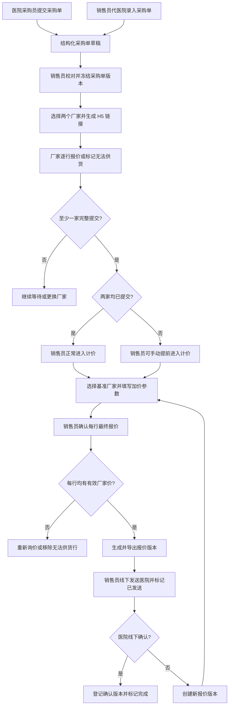

# 中药饮片报价系统 PRD v2.1（微信小程序 + 厂家 H5 本次报价）

版本：v2.1  
日期：2026-07-16  
状态：核心业务规则已确认，待 UI 设计与开发排期  
适用范围：MVP，可作为 Codex 开发输入  
产品形态：一个微信小程序 + 厂家外部 H5 报价链接

## 1. 背景与目标

### 1.1 业务背景

中药饮片销售员当前围绕医院采购单开展报价，实际流程为：

1. 医院采购员通过微信发送手写或表格采购单，或在小程序内提交采购单。
2. 销售员代医院录入采购单，或接收医院采购员自主提交的采购单。
3. 销售员校对品名、数量、单位和可选规格。
4. 销售员将校对后的采购单发送给两个厂家报价员。
5. 两个厂家针对本次采购单逐行填写含税、含抽点报价；无法供货时逐行标记。
6. 销售员比较两个厂家本次报价，选择每行基准厂家并进入加价环节。
7. 销售员通过固定金额、比例、高开倍率或手工改价形成最终医院报价。
8. 销售员生成报价单版本，导出 Excel/PDF 后通过微信线下发送医院。
9. 医院线下确认或反馈价格问题。
10. 销售员标记最终确认版本并联系厂家发货，或创建新报价版本后再次发送。

低频维护的厂家全品类报价不能代表厂家对本次采购单的真实报价，因此本系统明确区分三类数据：

1. 商品主数据：品名、别名、规格、产地、单位等，不含可用于本次报价计算的价格。
2. 厂家全品类来源批次：低频导入或手工录入，永久保留，可查询历史价格，但只作为资料参考。
3. 本次厂家报价：厂家通过本次采购单 H5 链接提交，是报价工作台唯一的厂家价格来源。

### 1.2 产品目标

MVP 覆盖从采购单录入到医院报价完成的核心链路：

- 医院采购员可在轻量小程序内提交采购单并查看状态。
- 销售员可在工作台代医院录入采购单，避免医院未使用小程序时阻断业务。
- 销售员可校对采购明细并向两个厂家发起本次询价。
- 厂家报价员通过 H5 链接完成报价，不登录、不注册、不进入小程序。
- 销售员可对比本次厂家报价、选择基准厂家、查看医院历史报价并完成加价。
- 系统生成不可覆盖的医院报价版本，支持 Excel 和 PDF 导出。
- 医院报价交付、反馈和确认继续在线下完成，系统记录发送和最终确认结果。
- 商品库独立承担选品、标准化、别名匹配和低频来源批次查询。

### 1.3 成功指标

| 指标 | MVP 目标 |
| --- | --- |
| 医院提交或销售代录后进入销售工作台 | 成功率不低于 99% |
| 图片采购单 OCR 失败后的业务连续性 | 100% 可进入人工校对或手工录入 |
| 结构化 Excel 采购单解析 | 不低于 80% 的规范样例可正确生成明细 |
| 校对完成到生成两个厂家链接 | 100 行以内 2 分钟内完成 |
| 厂家 H5 提交 | 无需登录，每行必须完成“报价/无法供货”选择 |
| 计价工作台进入 | 至少一家完整提交后可由销售员手动进入 |
| 价格来源追溯 | 最终报价每行 100% 可追溯到基准厂家报价和销售改价记录 |
| 历史报价查询 | 可查看同医院精确匹配商品最近 3 次已发送报价 |
| 版本追溯 | 厂家重新报价、医院报价导出、发送、确认均不可覆盖历史 |

## 2. 产品形态与范围边界

### 2.1 MVP 产品形态

MVP 由两部分组成：

1. 微信小程序
   - 销售员端。
   - 销售主管端。
   - 内部管理员端。
   - 医院采购员轻量端。

2. 厂家外部 H5 报价链接
   - 销售员在小程序内生成。
   - 销售员通过微信发送给厂家报价员。
   - 厂家报价员不注册、不登录、不做微信授权。
   - 一个链接只访问一个采购单版本下某一个厂家的报价表单。

### 2.2 MVP 不做 Web 管理端

- 销售员、销售主管、内部管理员和医院采购员均使用微信小程序。
- 厂家报价员只使用 H5 单表单。
- 后续可增加 Web 管理端，但不得改变本 PRD 的业务对象和状态规则。

### 2.3 价格来源边界

医院最终报价必须遵循以下链路：

```text
本次有效厂家报价
  -> 销售员选择基准厂家
  -> 销售员选择加价方式并填写参数，或直接手工改价
  -> 销售员确认最终报价
```

强制规则：

1. 商品主数据不存可用于本次计算的价格。
2. 厂家全品类来源批次价格只可查询，不得被报价工作台读取。
3. 医院历史报价只可展示，不得自动参与推荐价计算。
4. 每个可导出的采购行必须至少存在一个当前有效厂家报价。
5. 销售员最终报价可以低于基准厂家价，但必须触发亏损提示、填写原因并在导出前确认。
6. 所有价格和金额统一保留 2 位小数。

### 2.4 MVP 明确不做

- 不做厂家账号体系和厂家小程序。
- 不做医院端查看报价文件。
- 不做医院端在线确认或反馈价格。
- 不做商品库价格自动报价。
- 不做全品类来源批次价格进入计价链路。
- 不做自动通知厂家发货。
- 不做库存、物流、发票、回款和财务结算。
- 不做复杂审批流。
- 不做图片格式报价单导出。

## 3. 用户角色与权限

### 3.1 角色列表

| 角色 | 使用端 | 登录方式 | 核心职责 |
| --- | --- | --- | --- |
| 销售员 | 微信小程序 | 内部账号 + 微信登录 | 代录采购单、校对、发起询价、计价、导出、发送、确认完成。 |
| 销售主管 | 微信小程序 | 内部账号 + 微信登录 | 查看团队数据、处理异常、维护授权范围内基础资料。 |
| 内部管理员 | 微信小程序 | 内部账号 + 微信登录 | 管理用户、医院、采购员、厂家、商品库和基础配置。 |
| 医院采购员 | 微信小程序 | 微信手机号授权 | 提交采购单，查看自己提交或销售员代录给自己的采购单状态。 |
| 厂家报价员 | 外部 H5 | 无账号，凭 token | 针对链接对应采购单逐行报价或标记无法供货。 |

### 3.2 销售员权限

销售员可以：

- 查看自己负责医院的数据。
- 为指定医院和采购员代录采购单。
- 校对并冻结采购单版本。
- 选择和更换询价厂家。
- 生成、复制、重新生成和作废厂家 H5 链接。
- 查看厂家本次报价和历史提交版本。
- 在至少一家完整提交后手动提前进入计价。
- 选择每行基准厂家。
- 使用固定金额、比例、高开倍率或手工改价。
- 保存报价草稿、创建新版本、导出 Excel/PDF。
- 标记已发送医院、登记医院最终确认版本和完成状态。

销售员不可以：

- 查看无权限医院的数据。
- 修改厂家已提交的原始报价。
- 覆盖已冻结的采购单版本。
- 覆盖已导出的医院报价版本。
- 使用商品库或全品类来源批次价格生成医院报价。

### 3.3 医院采购员权限

医院采购员可以：

- 新建采购单。
- 上传采购单图片或 Excel。
- 从商品库选择中药饮片。
- 自定义输入商品。
- 编辑采购明细草稿。
- 查看自己提交的采购单。
- 查看销售员为其代录的采购单。
- 查看简化后的采购单状态和来源标签。

医院采购员不可以：

- 查看厂家报价。
- 查看销售员加价参数、推荐价或最终报价。
- 查看或下载报价文件。
- 在线确认报价。
- 在线反馈价格问题。
- 查看其他采购员或其他医院数据。

### 3.4 厂家报价员权限

厂家报价员只能：

- 通过当前有效 token 打开对应报价表。
- 查看销售员冻结后的采购明细。
- 对每行选择“可供货并报价”或“无法供货”。
- 一次性提交完整报价。

厂家报价员不能：

- 新增、删除或修改采购行。
- 推荐替代品。
- 查看另一厂家报价。
- 查看其他采购单。
- 部分提交。
- 修改已提交报价。

## 4. 核心业务流程

### 4.1 主流程总览



### 4.2 采购单录入流程

#### 4.2.1 医院采购员自主提交

1. 医院采购员使用微信手机号登录。
2. 系统校验手机号是否已绑定医院。
3. 采购员选择一种或多种录入方式：
   - 拍照或从相册上传图片。
   - 上传 Excel。
   - 从商品库搜索并选择。
   - 自定义输入。
4. 图片进入 OCR，Excel 进入解析服务。
5. 所有来源统一转为结构化采购明细草稿。
6. 采购员确认品名、数量、单位，可补充规格和备注。
7. 单位未提供时系统默认填入 `kg`，采购员可修改。
8. 提交后来源标签为“医院提交”。
9. 采购单进入销售员待处理列表。
10. 提交后医院采购员不能再编辑；如需修改，由销售员在校对阶段处理。

#### 4.2.2 销售员代医院录入

1. 销售员从工作台点击“新建采购单”。
2. 必须选择自己负责的医院和具体采购员。
3. 支持与医院端相同的图片、Excel、商品库和自定义录入方式。
4. 提交后来源标签为“销售代录”。
5. 对应医院采购员可在医院端查看该采购单及状态。
6. 对应医院采购员只能查看，不能编辑销售员代录的采购单。
7. 销售员可直接开始校对。

#### 4.2.3 采购行最低字段要求

| 字段 | 必填 | 规则 |
| --- | --- | --- |
| rawItemName | 是 | 医院原始品名或解析品名。 |
| quantity | 是 | 大于 0，最多 2 位小数。 |
| unit | 是 | 默认 kg，可修改。 |
| specification | 否 | 医院未提供时允许为空。 |
| remark | 否 | 行备注。 |

### 4.3 销售员校对和采购单冻结

1. 销售员查看来源标签、原始附件和解析结果。
2. 系统基于标准商品、别名和商品规格给出匹配候选。
3. 销售员逐行确认：
   - 原始品名。
   - 标准商品。
   - 商品规格。
   - 数量。
   - 单位。
   - 备注。
4. 无匹配商品时可：
   - 绑定已有标准商品或商品规格。
   - 新建商品或商品规格后绑定。
   - 本次保留自定义品名。
5. 销售员确认后冻结当前采购单版本。
6. 冻结后的采购行成为厂家 H5 表单和报价版本的唯一明细来源。
7. 冻结后如需修改，按 7.9 的采购单版本规则处理。

### 4.4 本次厂家询价流程

1. 销售员在冻结后的采购单版本中选择两个厂家。
2. 同一采购单版本同时最多存在两个有效厂家报价任务。
3. 同一采购单版本的两个任务必须选择不同厂家。
4. 每个厂家创建独立报价任务和独立 H5 链接。
5. 链接默认有效期为 48 小时。
6. 销售员复制链接并通过微信发送厂家。
7. 销售员可取消任务并替换厂家；已有有效提交时必须二次确认，旧提交立即退出计算但永久保留。
8. 重新生成链接需要二次确认。
9. 同一任务同时只能存在一个有效链接。

### 4.5 厂家 H5 报价流程

1. 厂家报价员打开链接。
2. 系统校验 token、任务状态和有效期。
3. H5 展示：
   - 医院名称。
   - 采购单编号。
   - 厂家名称。
   - 截止时间。
   - “报价均须为含税、含抽点单价”的固定提示。
   - 冻结后的采购明细。
4. 每行必须选择：
   - 可供货：填写大于 0、最多 2 位小数的单价。
   - 无法供货：不填写价格，可选填备注。
5. 所有行完成选择后才能提交。
6. 提交前再次确认价格口径和不可修改规则。
7. 提交成功后生成不可变的厂家报价提交版本。
8. 重复或并发提交只能有一次成功。

### 4.6 进入计价和后到报价流程

1. 两家均未完整提交时，“进入计价”按钮禁用。
2. 一家完整提交时，按钮显示“提前进入计价”。
3. 销售员点击“提前进入计价”时，系统二次提示另一厂家尚未报价。
4. 两家均完整提交时，按钮显示“进入计价”，无需额外风险确认。
5. 进入计价后，未完成的厂家任务继续独立运行。
6. 后到报价提交时：
   - 更新厂家报价对比和本次最低价。
   - 未被销售员手工锁定的基准厂家可跟随新的最低价更新。
   - 已手工选定的基准厂家不自动切换。
   - 重新计算受影响行的推荐价。
   - 不覆盖销售员已确认的最终报价。
7. 系统标记受影响行，并提供“更新未手工修改行”操作。
8. 已导出或已发送版本始终冻结；如需采用新报价，必须创建新版本。

### 4.7 重新报价流程

1. 厂家报价错误时，销售员点击“重新生成链接”。
2. 原厂家报价提交版本立即标记为“已被替代”。
3. 原报价立即退出最低价、基准价和推荐价计算。
4. 原报价数据永久保留，不允许修改或删除。
5. 厂家任务状态变为“重新报价中”。
6. 新链接提交完整报价后生成新的当前有效提交版本。
7. 报价草稿中使用过旧报价的行立即标记“基准报价已失效”，原基准厂家和基准价格不得继续用于导出。
8. 系统不自动改写销售员最终报价，但销售员必须重新选择当前有效基准厂家并再次确认该行后才能导出。
9. MVP 不支持内部人员直接修改厂家原始报价。

### 4.8 加价和最终报价流程

1. 系统对每行展示两家本次报价、本次最低价和供货状态。
2. 默认选择最低有效报价对应厂家作为基准厂家。
3. 销售员可选择另一家有效报价作为基准。
4. 加价方式和参数默认均为空。
5. 支持：
   - 固定金额加价。
   - 比例加价。
   - 高开倍率加价。
   - 直接手工改价。
6. 批量加价可作用于全部行或选中行。
7. 执行批量操作前显示方式、参数和影响行数。
8. 保存前允许撤销最近一次批量操作。
9. 计算结果写入推荐价，不自动成为最终报价。
10. 销售员确认或修改最终报价。
11. 所有存在有效厂家价的采购行均确认最终报价后，才可预览并导出当前报价版本。
12. 最终报价低于基准厂家价时必须填写原因并确认亏损风险。

### 4.9 报价导出、发送和线下确认

1. 首次进入计价工作台创建 V1 草稿。
2. 销售员确认最终报价后预览报价单。
3. 系统支持导出 Excel 和 PDF。
4. 同一版本导出不同格式不增加版本号。
5. 首次导出后版本冻结。
6. 销售员通过微信线下发送后，手动点击“标记已发送医院”。
7. 系统记录发送版本、发送时间和操作人。
8. 只有已发送且未作废版本进入医院历史报价。
9. 医院线下确认后，销售员选择最终确认版本并标记完成。
10. 医院反馈问题时创建 V2/V3，复制上一版本最终报价作为初始值。

## 5. 状态机

### 5.1 销售员端采购单状态

| 状态 | 系统值 | 进入条件 | 主要动作 |
| --- | --- | --- | --- |
| 草稿 | draft | 医院或销售正在录入。 | 编辑、删除、提交 |
| 已提交 | submitted | 采购单已提交。 | 开始校对、作废 |
| 校对中 | reviewing | 销售开始校对。 | 保存、确认冻结 |
| 待询价 | inquiry_pending | 当前采购单版本已冻结。 | 选择厂家、生成链接 |
| 厂家报价中 | supplier_quoting | 至少一个有效厂家任务已生成，暂无完整提交。 | 查看任务、换厂家、重新生成链接 |
| 可计价 | pricing_ready | 至少一家完整提交。 | 提前进入或正常进入计价 |
| 报价草稿 | quote_draft | 已创建当前报价版本草稿。 | 选择基准、加价、确认、导出 |
| 已导出 | quote_exported | 当前版本至少导出一次。 | 标记已发送、创建新版本 |
| 已发送医院 | quote_sent | 销售确认已线下发送。 | 创建新版本、确认完成 |
| 已完成 | completed | 已登记医院最终确认版本。 | 查看、归档 |
| 已作废 | voided | 采购单业务终止。 | 仅查看 |

状态流转：

| 当前状态 | 可流转到 | 触发 |
| --- | --- | --- |
| 草稿 | 已提交、已作废 | 提交、删除/作废 |
| 已提交 | 校对中、已作废 | 开始校对、作废 |
| 校对中 | 待询价、已作废 | 冻结采购单版本、作废 |
| 待询价 | 厂家报价中、已作废 | 生成厂家任务、作废 |
| 厂家报价中 | 可计价、已作废 | 至少一家完整提交、作废 |
| 可计价 | 报价草稿、已作废 | 销售员进入计价、作废 |
| 报价草稿 | 已导出、已作废 | 导出当前版本、作废 |
| 已导出 | 已发送医院、报价草稿、已作废 | 标记发送、创建新版本、作废 |
| 已发送医院 | 报价草稿、已完成、已作废 | 创建新版本、确认完成、作废 |
| 已完成 | 已作废 | 管理员作废 |
| 已作废 | 无 | 终态 |

补充规则：

- 采购单主状态进入“报价草稿”后，厂家任务继续使用自己的独立状态。
- 后到厂家报价不得回退采购单主状态。
- 创建新报价版本时采购单主状态进入“报价草稿”。
- 尚未进入计价工作台时，系统按当前有效完整提交数重算状态：从 1 家降为 0 家时由“可计价”回到“厂家报价中”，从 0 家升为至少 1 家时进入“可计价”。
- 已进入计价工作台后，重新报价或替换厂家不回退采购单主状态，而是使受影响报价行的基准失效并阻止导出。

### 5.2 医院端状态映射

| 销售员端状态 | 医院端显示 |
| --- | --- |
| submitted | 已提交 |
| reviewing/inquiry_pending/supplier_quoting/pricing_ready/quote_draft/quote_exported | 报价处理中 |
| quote_sent | 报价已发送 |
| completed | 已完成 |
| voided | 已作废 |

医院端不展示厂家报价进度、价格和内部异常。

### 5.3 采购单版本状态

| 状态 | 系统值 | 说明 |
| --- | --- | --- |
| 编辑中 | draft | 当前版本尚未冻结。 |
| 已冻结 | frozen | 已成为厂家报价和医院报价依据。 |
| 已被替代 | superseded | 新采购单版本已创建。 |
| 已作废 | voided | 版本无效但保留。 |

### 5.4 厂家报价任务状态

| 状态 | 系统值 | 说明 |
| --- | --- | --- |
| 未生成链接 | link_not_created | 已选择厂家，尚未生成链接。 |
| 待报价 | waiting_quote | 当前链接有效，等待首次提交。 |
| 已报价 | submitted | 存在当前有效报价提交版本。 |
| 重新报价中 | requote_pending | 原提交已被替代，等待新提交。 |
| 已取消 | cancelled | 厂家任务被取消或厂家被替换。 |

### 5.5 厂家 H5 链接状态

| 状态 | 系统值 | 说明 |
| --- | --- | --- |
| 有效 | active | 可访问和提交。 |
| 已提交 | submitted | 已成功产生报价提交版本。 |
| 已过期 | expired | 超过 48 小时。 |
| 已失效 | invalidated | 被重新生成或手动作废。 |

### 5.6 厂家报价提交版本状态

| 状态 | 系统值 | 说明 |
| --- | --- | --- |
| 当前有效 | current | 当前参与最低价和推荐价计算。 |
| 已被替代 | superseded | 永久保留但不参与计算。 |

### 5.7 医院报价版本状态

| 状态 | 系统值 | 说明 |
| --- | --- | --- |
| 草稿 | draft | 可修改，未导出。 |
| 已导出 | exported | 已冻结，至少存在一个导出文件。 |
| 已发送 | sent | 销售员确认已发送医院。 |
| 医院已确认 | confirmed | 被选择为医院最终确认版本。 |
| 已作废 | voided | 不再使用，永久保留。 |

## 6. 页面与功能需求

### 6.1 微信小程序登录与角色分流

功能：

- 内部账号由管理员预先创建，首次微信登录绑定 openId。
- 医院采购员通过微信手机号授权登录。
- 手机号必须预先绑定医院采购员档案。
- 登录后按角色进入对应首页。
- 未绑定医院时展示明确联系提示。

验收标准：

- 医院采购员不能进入销售工作台。
- 销售员不能访问无权限医院。
- 厂家报价员没有小程序登录入口。

### 6.2 医院端首页

功能：

- 展示医院名称和当前采购员。
- 主操作“新建采购单”。
- 展示“我的采购单”。
- 每张采购单展示来源标签：
  - 医院提交。
  - 销售代录。
- 展示简化状态、采购单编号、日期和品类数量。

验收标准：

- 只展示当前采购员提交或销售员为其代录的数据。
- 不展示报价价格、厂家名称、厂家进度或报价文件。

### 6.3 医院端新建采购单

录入方式：

1. 图片上传。
2. Excel 上传。
3. 商品库选择。
4. 自定义输入。

功能：

- 支持拍照和相册多图上传。
- 支持 xlsx/xls/csv。
- 支持商品搜索、常用商品和最近采购。
- 支持组合多种录入方式。
- 支持解析预览、行增删改和提交前检查。
- 单位默认 kg，可逐行修改。

采购行字段：

| 字段 | 必填 | 说明 |
| --- | --- | --- |
| rawItemName | 是 | 原始品名。 |
| itemId | 否 | 标准商品 ID。 |
| itemVariantId | 否 | 商品规格 ID。 |
| specification | 否 | 展示规格。 |
| quantity | 是 | 大于 0，2 位小数。 |
| unit | 是 | 默认 kg。 |
| remark | 否 | 备注。 |
| sourceType | 是 | ocr/excel/product_library/custom_input。 |

### 6.4 销售员工作台

首页必须优先展示日常主链路：

- 主按钮“新建采购单”。
- 待校对数量。
- 厂家报价中数量。
- 可计价数量。
- 报价草稿数量。
- 已导出待发送数量。
- 已发送待确认数量。
- 新采购单和新厂家报价的站内角标。

快捷入口：

- 采购单。
- 报价单。
- 商品库。
- 厂家全品类来源批次。
- 医院与采购员。
- 厂家管理。

### 6.5 销售员新建和校对采购单

销售代录功能：

- 必选医院和采购员。
- 支持图片、Excel、商品库和自定义录入。
- 自动显示“销售代录”来源标签。

校对功能：

- 查看原始附件和解析置信度。
- 编辑品名、数量、单位、规格和备注。
- 查看标准商品及规格候选。
- 创建或绑定商品。
- 标记本次自定义项。
- 冻结采购单版本。

验收标准：

- 未冻结版本不能生成厂家链接。
- 冻结后修改必须遵守采购单版本规则。
- 商品匹配不得带入任何价格。

### 6.6 本次厂家询价页

功能：

- 展示冻结的采购单版本和明细。
- 提供厂家 A、厂家 B 两个有效任务位。
- 选择、替换和取消厂家。
- 生成、复制、重新生成、作废 H5 链接。
- 展示任务状态、链接状态、过期时间和提交时间。
- 查看厂家历史提交版本。

验收标准：

- 同一任务最多一个有效链接。
- 同一采购单版本最多两个有效厂家任务。
- 两个有效任务不得选择同一厂家。
- 替换已有报价的厂家时必须二次确认，旧任务和提交版本永久保留但退出计算。
- 重新生成链接需二次确认。
- 重新报价后原提交立即退出计算。

### 6.7 厂家 H5 报价表单

页面仅包含本次报价所需信息，不提供系统导航。

每行字段：

| 字段 | 可编辑 | 必填 | 说明 |
| --- | --- | --- | --- |
| 序号 | 否 | 是 | 采购行序号。 |
| 品名 | 否 | 是 | 销售员确认的显示名。 |
| 规格 | 否 | 否 | 可为空。 |
| 数量 | 否 | 是 | 采购数量。 |
| 单位 | 否 | 是 | 采购单位。 |
| 供货选择 | 是 | 是 | 可供货/无法供货。 |
| 含税含抽点单价 | 是 | 条件必填 | 可供货时必须大于 0，2 位小数。 |
| 备注 | 是 | 否 | 行备注。 |

提交校验：

- 每行必须选择供货状态。
- 可供货行必须填写合法价格。
- 无法供货行价格必须为空。
- 提交内容必须覆盖全部采购行。
- 不允许添加、删除或替代商品。
- 提交成功后不可再次编辑。

### 6.8 厂家报价对比页

功能：

- 展示两个厂家任务和当前提交状态。
- 逐行展示供货状态和当前有效报价。
- 计算本次最低有效价。
- 显示重新报价中、已被替代等状态。
- 根据提交情况控制进入计价按钮。

按钮规则：

- 0 家完整提交：禁用。
- 1 家完整提交：显示“提前进入计价”，点击二次确认。
- 2 家完整提交：显示“进入计价”。

### 6.9 报价工作台

每行展示：

| 字段 | 说明 |
| --- | --- |
| 原始品名 | 医院提交或文件解析品名。 |
| 标准商品/规格 | 销售员校对结果或自定义项。 |
| 数量/单位 | 本次采购数量和单位。 |
| 厂家 A 报价 | 当前有效报价或无法供货状态。 |
| 厂家 B 报价 | 当前有效报价或无法供货状态。 |
| 本次最低价 | 当前有效厂家报价中的最低值。 |
| 基准厂家 | 默认最低价厂家，可由销售员选择。 |
| 基准厂家价 | 所选厂家当前有效价格。 |
| 最近历史价 | 同医院精确匹配最近一次已发送报价。 |
| 最近 3 次历史 | 日期、版本、价格和差异。 |
| 加价方式 | 固定金额/比例/高开倍率/手工。 |
| 加价参数 | 默认空，销售员填写。 |
| 推荐价 | 依据基准厂家和加价参数计算。 |
| 最终报价 | 销售员确认的医院报价。 |
| 差额/加价率 | 最终报价相对基准厂家价。 |
| 风险 | 缺厂家报价、无有效价格、低于成本、后到报价等。 |

操作：

- 选择基准厂家。
- 单行计算推荐价。
- 对全部行或选中行批量加价。
- 应用推荐价到最终报价。
- 直接手工填写最终报价。
- 确认最终报价。
- 撤销最近一次未保存批量操作。
- 保存草稿。
- 查看改价日志。
- 预览和导出。

移动端要求：

- 采购行使用紧凑列表，不强制横向展示完整桌面表格。
- 点击行进入价格编辑抽屉或详情页。
- 厂家 A/B、最低价、基准价、推荐价和最终价必须在同一编辑视图中可见。
- 顶部提供搜索、风险筛选和“仅看未确认”。
- 底部使用固定操作栏承载批量加价、保存和预览。

### 6.10 报价预览、导出和发送

系统默认模板头部：

- 销售方名称。
- 医院名称。
- 报价单编号。
- 版本号。
- 报价日期。
- 销售员姓名和联系方式。
- 固定提示“以上报价均为含税价格”。

报价单编号：

```text
BJ-{yyyyMMdd}-{hospitalCode或医院ID后6位}-{当日3位流水号}
```

示例：`BJ-20260716-HOSP01-001`。

明细字段：

| 字段 | 规则 |
| --- | --- |
| 名称 | 标准显示名或销售确认名。 |
| 规格 | 允许为空。 |
| 数量 | 2 位小数。 |
| 单位 | 默认 kg，可为其他单位。 |
| 单价 | 销售员最终报价，2 位小数。 |
| 金额 | 数量 × 单价，四舍五入到 2 位。 |
| 备注 | 销售备注。 |

导出：

- Excel `.xlsx`。
- PDF，多页报价自动分页。
- 文件名包含医院名称、报价单号和版本号。
- Excel 可由 WPS 和 Microsoft Excel 打开。
- 同一版本可分别导出 Excel 和 PDF。
- 每次导出生成独立导出记录。
- 销售方名称、可选 logo、固定备注等由系统默认报价模板配置提供。

发送：

- 导出不等于发送。
- 销售员线下发送后点击“标记已发送医院”。
- 标记时必须选择具体报价版本。
- 已发送版本不可修改。

### 6.11 商品库

数据结构：

1. 标准商品
   - 标准品名。
   - 别名。
   - 分类。
   - 启用状态。

2. 商品规格
   - 炮制/商品规格。
   - 产地。
   - 等级。
   - 包装或计价单位。
   - 启用状态。

医院端交互：

- 使用扁平搜索结果，不强制逐层选择。
- 单一常用规格可直接加入采购单。
- 多个规格时弹出规格选择。
- 产地、等级等次要信息默认折叠。
- 无合适结果时支持自定义输入。

内部功能：

- 查询、新增、编辑、启停标准商品。
- 管理别名。
- 查询、新增、编辑、启停商品规格。
- 查看关联的厂家全品类历史来源批次。
- 来源价格固定标记“仅资料参考，不参与本次报价”。

### 6.12 厂家全品类来源批次

功能：

- Excel 导入。
- 手工创建批次并逐行录入。
- 导入预览和字段映射。
- 异常行处理。
- 批次列表和详情。
- 按厂家、系统批次号、厂家原始批次号、报价日期查询。
- 查看原始文件。
- 将来源行匹配到商品规格。

强制规则：

- 每次导入或手工录入创建独立批次。
- 系统为每个批次生成唯一批次号；厂家原始批次号允许为空或重复。
- 新批次不得覆盖旧批次。
- 已确认批次和行永久保留，只可整体作废。
- 来源价格不得进入报价工作台。

### 6.13 医院与采购员管理

功能：

- 新增、编辑、启停医院。
- 维护负责销售员。
- 新增、编辑、启停采购员。
- 绑定手机号和微信 openId。
- MVP 同一采购员手机号只绑定一家医院。

说明：

- 医院不配置默认加价方式或参数。
- 每次报价进入加价环节时，加价方式和参数均为空。

### 6.14 厂家管理

功能：

- 新增、编辑、启停厂家。
- 维护联系人和联系电话。
- 作为本次询价和全品类来源批次的归属厂家。

规则：

- 停用厂家不能创建新任务。
- 历史任务、提交版本和来源批次永久可查。

### 6.15 报价历史

功能：

- 按医院、销售员、日期、状态、商品查询医院报价。
- 查看报价单所有版本、导出记录和发送记录。
- 查看最终确认版本。
- 查看单行基准厂家、加价方式和改价日志。
- 在工作台查看同医院同商品最近 3 次已发送报价。

验收标准：

- 未发送的导出版本不得进入医院历史价格。
- 已作废版本不得作为最近历史价。
- 历史详情可追溯采购单版本和本次厂家报价提交版本。

## 7. 关键业务规则

### 7.1 有效厂家报价

厂家报价行同时满足以下条件才是有效价格：

- 所属厂家任务未取消，且当前状态为 `submitted`。
- 所属提交版本状态为 `current`。
- 所属提交版本是厂家任务的 `activeSubmissionId`。
- 行供货状态为 `quoted`。
- 单价大于 0。
- 价格为 2 位小数。

`unavailable` 行不参与最低价计算。

### 7.2 本次最低价和基准厂家

```text
本次最低价 = min(当前有效厂家报价)
```

- 两家均有有效价：取最低值。
- 只有一家有效价：取该厂家价。
- 两家均无法供货：最低价为空，阻止该行导出。
- 默认基准厂家为最低价厂家。
- 销售员可以选择另一家有有效价的厂家。
- 最终报价必须保存基准厂家和对应厂家报价行 ID。

### 7.3 加价公式

固定金额：

```text
推荐价 = 基准厂家价 + 固定金额
```

比例加价：

```text
推荐价 = 基准厂家价 × (1 + 加价比例百分数 / 100)
```

高开倍率：

```text
推荐价 = 基准厂家价 × 高开倍率
```

手工改价：

```text
最终报价 = 销售员输入价格
```

规则：

- 加价方式和参数默认空。
- 固定金额可为 0 或正数。
- 加价比例以百分比输入，必须大于等于 0，最多 2 位小数。
- 高开倍率必须大于等于 1.00，最多 2 位小数。
- 推荐价计算后四舍五入到 2 位。
- 推荐价不会自动成为最终报价。
- 最终报价必须大于 0、最多 2 位小数，并由销售员确认。

### 7.4 金额和精度

- 数量最多 2 位小数。
- 厂家报价、最低价、基准价、推荐价和最终报价均为 2 位小数。
- 行金额 = 数量 × 最终报价，四舍五入到 2 位。
- 总金额 = 所有已舍入行金额之和。
- Excel 和 PDF 均展示 2 位小数。

### 7.5 批量加价

- 支持全部行和选中行。
- 只处理存在有效基准厂家价的行。
- 操作前展示方式、参数、影响行数和跳过行数。
- 执行结果先写入推荐价。
- 销售员可批量应用推荐价到最终报价。
- 保存前允许撤销最近一次批量操作。
- 已手工确认的最终报价不因后到厂家报价自动变化。

### 7.6 后到报价和基准切换

- 销售员未手工锁定基准厂家时，新的更低有效价可更新默认基准。
- 销售员手工选择基准厂家后，系统不得自动切换。
- 后到报价重新计算最低价和受影响推荐价。
- 后到报价不得覆盖已确认最终报价。
- 已导出版本不得受后到报价影响。

### 7.7 风险提示

| 风险 | 触发条件 | 处理 |
| --- | --- | --- |
| 仅一家报价 | 另一厂家尚未完整提交。 | 黄色提示，允许提前计价。 |
| 无有效厂家价 | 两家均无法供货或当前无有效提交。 | 红色提示，阻止导出。 |
| 最终报价低于基准价 | 最终报价 < 基准厂家价。 | 红色提示，填写原因并导出确认。 |
| 厂家重新报价中 | 当前厂家无有效提交。 | 提示等待或选择另一厂家。 |
| 后到报价 | 新报价影响最低价或推荐价。 | 标记受影响行，不自动覆盖最终价。 |
| 自定义商品 | 未绑定商品规格。 | 提示销售员确认品名和规格。 |
| 历史价格变化 | 最终报价与最近已发送价格不同。 | 展示差额和比例，不阻断。 |

导出前必须逐行通过以下校验：

- 存在当前有效的基准厂家报价行，且基准报价未被替代、取消或进入重新报价中。
- `baseManufacturerId`、`baseSupplierQuoteLineId` 和 `basePrice` 一致指向当前有效报价。
- 最终报价大于 0、最多 2 位小数，且 `finalConfirmed = true`。
- 最终报价低于基准价时已填写原因，并完成本次导出风险确认。
- 不存在“两家均无法供货”或“当前无有效厂家价”的采购行。

任一行不通过时整体阻止导出，并返回行 ID、错误码和可执行的修复动作。首次成功导出时，在同一事务内冻结报价版本及其厂家报价快照。

### 7.8 医院历史报价

历史记录资格：

- 报价版本状态为 `sent` 或 `confirmed`。
- 报价版本未作废。
- 发送记录有效。

匹配优先级：

1. 同医院 + 同商品规格 + 同单位。
2. 同医院 + 同标准商品 + 同规格文本 + 同单位。
3. 同医院 + 同标准商品。

展示规则：

- 精确匹配展示最近 3 次。
- 降级匹配必须标记规格或单位差异。
- 展示报价日期、版本号、最终价格和与本次差额。
- 历史报价不得自动填入推荐价或最终报价。

### 7.9 采购单修改和版本

- 链接生成前，可撤回当前采购单版本继续修改。
- 已生成任一厂家链接后修改采购明细，必须创建新采购单版本。
- 新版本复制上一版本明细作为草稿。
- 旧版本标记 `superseded`，其链接、厂家报价和医院报价永久保留。
- 旧版本未完成链接全部失效。
- 新采购单版本必须重新发起厂家询价。
- 不允许直接修改已冻结采购行。
- 创建新采购单版本后，采购单主状态回到“校对中”；旧版本下的状态、厂家报价和医院报价不变。

### 7.10 厂家链接和重新报价

- token 必须不可预测且仅存哈希。
- 默认有效期固定 48 小时。
- 同一任务同时只能有一个有效 token。
- 重新生成后旧 token 立即失效。
- 首次提交后原链接不可再次提交。
- 已提交后重新生成链接会立即替代原提交版本。
- 替换厂家时原任务置为 `cancelled`，原当前提交置为 `superseded`，同一任务位创建新厂家任务。
- 报价草稿引用被取消任务时，按重新报价失效规则清空有效基准引用并阻止导出。
- 厂家原始提交不可人工修改。

### 7.11 医院报价版本

- 首次进入工作台创建 V1 草稿。
- 草稿内保存不增加版本号。
- 首次导出后版本冻结。
- 同一版本导出 Excel 和 PDF 不增加版本号。
- 冻结后修改必须创建下一版本。
- 新版本复制上一版本最终报价、基准厂家和备注作为初始值。
- 新版本创建时重新加载当前有效厂家报价；已失效的旧基准厂家不得继续作为新版本基准。
- 标记完成时必须指定最终确认版本。
- 历史版本不得覆盖或删除，只能作废。
- 同一报价单同时最多存在一个草稿版本。
- `quotes.confirmedVersionId` 是最终确认版本的唯一权威字段，采购单不重复保存该外键。
- 版本导出、标记发送、确认、作废时，报价版本状态、报价单主状态和采购单主状态必须在同一事务内同步。
- 只有至少存在一条 `succeeded` 导出记录的 `exported` 版本可以标记发送。
- 首次标记发送时，同时创建发送记录并写入版本 `sentAt`；发送记录成功前不得将版本置为 `sent`。
- 只有状态为 `sent`、属于当前报价单且未作废的版本可以被确认。
- 确认任一历史已发送版本时，系统将其置为 `confirmed`，将更晚的未发送草稿版本置为 `voided`，并将报价单和采购单置为完成；其他已发送历史版本保持只读。

### 7.12 编号规则

采购单编号：

```text
CG-{yyyyMMdd}-{当日6位流水号}
```

医院报价单编号：

```text
BJ-{yyyyMMdd}-{hospitalCode或医院ID后6位}-{当日3位流水号}
```

规则：

- 编号由后端原子生成且全局唯一。
- 报价版本号不进入报价单编号，单独使用 V1/V2/V3 展示。
- 同一报价单的所有版本共用 quoteNo。

### 7.13 商品库和来源批次隔离

- 标准商品和商品规格不存本次报价参考价格。
- 全品类来源批次按厂家和批次永久保存。
- 来源批次价格可在商品详情查询。
- 计价服务不得调用来源批次价格接口或数据表。
- 自动化测试必须证明来源价格不能进入最低价、基准价和推荐价计算。

## 8. 数据对象建议

以下字段和约束是 MVP 最低数据要求，技术实现可按所选 ORM 等价落地。

### 8.1 users

| 字段 | 类型 | 说明 |
| --- | --- | --- |
| id | uuid | 主键。 |
| name | varchar | 姓名。 |
| phone | varchar | 手机号，唯一。 |
| role | enum | salesperson/manager/admin/hospital_purchaser。 |
| openId | varchar | 微信 openId，可为空，绑定后唯一。 |
| status | enum | active/disabled。 |
| createdAt | datetime | 创建时间。 |
| updatedAt | datetime | 更新时间。 |

### 8.2 hospitals

| 字段 | 类型 | 说明 |
| --- | --- | --- |
| id | uuid | 主键。 |
| name | varchar | 医院名称。 |
| code | varchar | 医院编码。 |
| region | varchar | 区域。 |
| salesUserId | uuid | 负责销售员。 |
| status | enum | active/inactive。 |
| createdAt | datetime | 创建时间。 |
| updatedAt | datetime | 更新时间。 |

### 8.3 hospital_purchasers

| 字段 | 类型 | 说明 |
| --- | --- | --- |
| id | uuid | 主键。 |
| hospitalId | uuid | 医院。 |
| userId | uuid | 对应用户。 |
| name | varchar | 姓名。 |
| phone | varchar | 手机号。 |
| status | enum | active/inactive。 |
| createdAt | datetime | 创建时间。 |
| updatedAt | datetime | 更新时间。 |

唯一约束：MVP 同一有效手机号只能绑定一个医院采购员档案。

### 8.4 manufacturers

| 字段 | 类型 | 说明 |
| --- | --- | --- |
| id | uuid | 主键。 |
| name | varchar | 厂家名称。 |
| contactName | varchar | 联系人。 |
| contactPhone | varchar | 联系电话。 |
| status | enum | active/inactive。 |
| createdAt | datetime | 创建时间。 |
| updatedAt | datetime | 更新时间。 |

### 8.5 items

标准商品。

| 字段 | 类型 | 说明 |
| --- | --- | --- |
| id | uuid | 主键。 |
| standardName | varchar | 标准品名。 |
| normalizedName | varchar | 归一化名称。 |
| category | varchar | 分类。 |
| status | enum | active/inactive。 |
| createdAt | datetime | 创建时间。 |
| updatedAt | datetime | 更新时间。 |

强制约束：该表不设置价格字段。

### 8.6 item_aliases

| 字段 | 类型 | 说明 |
| --- | --- | --- |
| id | uuid | 主键。 |
| itemId | uuid | 标准商品。 |
| aliasName | varchar | 别名。 |
| normalizedAlias | varchar | 归一化别名。 |
| createdAt | datetime | 创建时间。 |

### 8.7 item_variants

商品规格。

| 字段 | 类型 | 说明 |
| --- | --- | --- |
| id | uuid | 主键。 |
| itemId | uuid | 标准商品。 |
| specification | varchar | 炮制/商品规格。 |
| origin | varchar | 产地。 |
| grade | varchar | 等级。 |
| packageDescription | varchar | 包装描述。 |
| defaultUnit | varchar | 默认单位，默认 kg。 |
| status | enum | active/inactive。 |
| createdAt | datetime | 创建时间。 |
| updatedAt | datetime | 更新时间。 |

### 8.8 product_source_batches

厂家全品类来源批次，不是本次报价来源。

| 字段 | 类型 | 说明 |
| --- | --- | --- |
| id | uuid | 主键。 |
| manufacturerId | uuid | 来源厂家。 |
| batchNo | varchar | 系统批次号，全局唯一且不可修改。 |
| sourceBatchNo | varchar | 厂家原始批次号，可为空、可重复。 |
| quotedAt | date | 厂家报价日期。 |
| sourceType | enum | excel/manual。 |
| sourceFileId | uuid | 原始文件，可为空。 |
| status | enum | draft/previewing/confirmed/failed/voided。 |
| totalRows | int | 总行数。 |
| validRows | int | 有效行。 |
| invalidRows | int | 异常行。 |
| createdBy | uuid | 创建人。 |
| createdAt | datetime | 创建时间。 |

规则：创建批次时原子生成唯一 `batchNo`；批次确认后批次和行不可编辑，只可作废。

### 8.9 product_source_lines

| 字段 | 类型 | 说明 |
| --- | --- | --- |
| id | uuid | 主键。 |
| batchId | uuid | 来源批次。 |
| rawItemName | varchar | 原始品名。 |
| itemId | uuid | 标准商品，可为空。 |
| itemVariantId | uuid | 商品规格，可为空。 |
| specification | varchar | 原始规格。 |
| origin | varchar | 原始产地。 |
| grade | varchar | 原始等级。 |
| unit | varchar | 单位。 |
| referencePrice | decimal(12,2) | 来源价格，仅查询。 |
| status | enum | valid/invalid/unmatched/duplicate。 |
| remark | text | 备注。 |

### 8.10 files

| 字段 | 类型 | 说明 |
| --- | --- | --- |
| id | uuid | 主键。 |
| fileName | varchar | 原始文件名。 |
| fileType | varchar | 文件类型。 |
| fileSize | int | 文件大小。 |
| storageKey | varchar | 对象存储键。 |
| businessType | enum | purchase_image/purchase_excel/product_source/export_quote。 |
| businessId | uuid | 关联业务。 |
| uploadedBy | uuid | 上传人。 |
| createdAt | datetime | 创建时间。 |

### 8.11 parsing_jobs

| 字段 | 类型 | 说明 |
| --- | --- | --- |
| id | uuid | 主键。 |
| fileId | uuid | 原始文件。 |
| purchaseOrderRevisionId | uuid | 目标采购单版本。 |
| parserType | enum | ocr/excel。 |
| status | enum | pending/processing/succeeded/failed。 |
| errorCode | varchar | 错误码。 |
| errorMessage | text | 错误信息。 |
| idempotencyKey | varchar | 防止重复解析。 |
| createdAt | datetime | 创建时间。 |
| completedAt | datetime | 完成时间。 |

### 8.12 purchase_orders

采购单根对象。

| 字段 | 类型 | 说明 |
| --- | --- | --- |
| id | uuid | 主键。 |
| orderNo | varchar | 采购单编号。 |
| hospitalId | uuid | 医院。 |
| purchaserUserId | uuid | 采购员。 |
| salesUserId | uuid | 负责销售员。 |
| sourceActorType | enum | hospital/sales。 |
| currentRevisionNo | int | 当前采购单版本号。 |
| status | enum | draft/submitted/reviewing/inquiry_pending/supplier_quoting/pricing_ready/quote_draft/quote_exported/quote_sent/completed/voided。 |
| completedAt | datetime | 完成时间。 |
| createdAt | datetime | 创建时间。 |
| updatedAt | datetime | 更新时间。 |

唯一约束：`orderNo`。

### 8.13 purchase_order_revisions

| 字段 | 类型 | 说明 |
| --- | --- | --- |
| id | uuid | 主键。 |
| purchaseOrderId | uuid | 采购单。 |
| revisionNo | int | 版本号。 |
| status | enum | draft/frozen/superseded/voided。 |
| sourceTypes | json | image/excel/product_library/custom_input。 |
| remark | text | 采购单备注。 |
| createdBy | uuid | 创建人。 |
| frozenBy | uuid | 冻结人。 |
| frozenAt | datetime | 冻结时间。 |
| createdAt | datetime | 创建时间。 |

唯一约束：`purchaseOrderId + revisionNo`。

### 8.14 purchase_order_lines

| 字段 | 类型 | 说明 |
| --- | --- | --- |
| id | uuid | 主键。 |
| purchaseOrderRevisionId | uuid | 采购单版本。 |
| rawItemName | varchar | 原始品名。 |
| itemId | uuid | 标准商品，可为空。 |
| itemVariantId | uuid | 商品规格，可为空。 |
| displayName | varchar | 销售员确认显示名。 |
| specification | varchar | 规格，可为空。 |
| quantity | decimal(12,2) | 数量。 |
| unit | varchar | 单位，默认 kg。 |
| sourceType | enum | ocr/excel/product_library/custom_input。 |
| ocrConfidence | decimal(5,2) | OCR 置信度，可为空。 |
| remark | text | 备注。 |
| sortOrder | int | 排序。 |
| createdAt | datetime | 创建时间。 |

### 8.15 supplier_quote_tasks

| 字段 | 类型 | 说明 |
| --- | --- | --- |
| id | uuid | 主键。 |
| purchaseOrderRevisionId | uuid | 冻结采购单版本。 |
| manufacturerId | uuid | 厂家。 |
| status | enum | link_not_created/waiting_quote/submitted/requote_pending/cancelled。 |
| activeLinkId | uuid | 当前有效链接，可为空。 |
| activeSubmissionId | uuid | 当前有效提交，可为空。 |
| slotNo | int | 厂家 A/B 任务位，1 或 2。 |
| createdBy | uuid | 创建销售员。 |
| createdAt | datetime | 创建时间。 |
| updatedAt | datetime | 更新时间。 |

约束：

- 同一采购单版本同时最多两个非取消任务。
- 同一采购单版本同一 slotNo 同时只能有一个非取消任务。
- 同一采购单版本同一 manufacturerId 同时只能有一个非取消任务。
- 取消存在有效提交的任务时，该提交同步标记为 superseded。

### 8.16 supplier_quote_links

| 字段 | 类型 | 说明 |
| --- | --- | --- |
| id | uuid | 主键。 |
| taskId | uuid | 厂家任务。 |
| tokenHash | varchar | token 哈希。 |
| expiresAt | datetime | 创建后 48 小时。 |
| status | enum | active/submitted/expired/invalidated。 |
| invalidatedReason | enum | regenerated/manual_voided/task_cancelled。 |
| createdBy | uuid | 创建销售员。 |
| createdAt | datetime | 创建时间。 |
| submittedAt | datetime | 提交时间。 |

约束：同一 taskId 同时最多存在一个 `active` 链接。

### 8.17 supplier_quote_submissions

厂家每次完整提交的不可变版本。

| 字段 | 类型 | 说明 |
| --- | --- | --- |
| id | uuid | 主键。 |
| taskId | uuid | 厂家任务。 |
| linkId | uuid | 本次使用链接。 |
| submissionNo | int | 该任务第几次提交。 |
| status | enum | current/superseded。 |
| submittedAt | datetime | 提交时间。 |
| submitIp | varchar | 审计信息，可脱敏。 |
| userAgent | varchar | 审计信息。 |

唯一约束：`taskId + submissionNo`。

附加约束：同一 taskId 同时最多存在一个 `current` 提交版本。

### 8.18 supplier_quote_lines

| 字段 | 类型 | 说明 |
| --- | --- | --- |
| id | uuid | 主键。 |
| submissionId | uuid | 厂家提交版本。 |
| purchaseOrderLineId | uuid | 冻结采购行。 |
| supplyStatus | enum | quoted/unavailable。 |
| quotedUnitPrice | decimal(12,2) | 可供货时大于 0，无法供货时为空。 |
| remark | text | 厂家备注。 |
| createdAt | datetime | 创建时间。 |

唯一约束：`submissionId + purchaseOrderLineId`。

### 8.19 quotes

| 字段 | 类型 | 说明 |
| --- | --- | --- |
| id | uuid | 主键。 |
| quoteNo | varchar | 报价单编号。 |
| purchaseOrderId | uuid | 采购单。 |
| purchaseOrderRevisionId | uuid | 对应冻结版本。 |
| hospitalId | uuid | 医院。 |
| salesUserId | uuid | 销售员。 |
| currentVersionNo | int | 当前版本号。 |
| confirmedVersionId | uuid | 医院确认版本，可为空。 |
| status | enum | draft/exported/sent/completed/voided。 |
| createdAt | datetime | 创建时间。 |
| updatedAt | datetime | 更新时间。 |

约束：`quoteNo` 全局唯一；同一 `purchaseOrderRevisionId` 只能创建一个报价单。`confirmedVersionId` 必须指向属于本报价单且状态为 `confirmed` 的版本。

### 8.20 quote_versions

| 字段 | 类型 | 说明 |
| --- | --- | --- |
| id | uuid | 主键。 |
| quoteId | uuid | 报价单。 |
| versionNo | int | V1/V2/V3 对应整数。 |
| sourceVersionId | uuid | 复制来源版本，可为空。 |
| status | enum | draft/exported/sent/confirmed/voided。 |
| createdBy | uuid | 创建人。 |
| exportedAt | datetime | 首次导出时间。 |
| sentAt | datetime | 标记发送时间。 |
| confirmedAt | datetime | 确认时间。 |
| createdAt | datetime | 创建时间。 |

唯一约束：`quoteId + versionNo`。

附加约束：同一 quoteId 同时最多存在一个 `draft` 版本；`quotes.status` 由当前有效版本状态驱动。

### 8.21 quote_lines

| 字段 | 类型 | 说明 |
| --- | --- | --- |
| id | uuid | 主键。 |
| quoteVersionId | uuid | 报价版本。 |
| purchaseOrderLineId | uuid | 冻结采购行。 |
| itemId | uuid | 标准商品，可为空。 |
| itemVariantId | uuid | 商品规格，可为空。 |
| displayName | varchar | 报价显示名。 |
| specification | varchar | 规格。 |
| quantity | decimal(12,2) | 数量。 |
| unit | varchar | 单位。 |
| minSupplierPrice | decimal(12,2) | 本次最低有效价，可为空。 |
| baseManufacturerId | uuid | 销售员选择的基准厂家。 |
| baseSupplierQuoteLineId | uuid | 基准厂家报价行。 |
| basePrice | decimal(12,2) | 基准厂家价。 |
| baseSelectionMode | enum | auto/manual，默认 auto。 |
| markupMethod | enum | fixed_amount/percentage/multiplier/manual，可为空。 |
| markupParameter | decimal(12,2) | 参数，默认空。 |
| recommendedPrice | decimal(12,2) | 推荐价，可为空。 |
| finalPrice | decimal(12,2) | 最终医院报价。 |
| finalConfirmed | boolean | 销售员是否确认。 |
| belowCostReason | text | 低于基准价时必填。 |
| warningFlags | json | 风险标记。 |
| remark | text | 销售备注。 |
| sortOrder | int | 排序。 |

### 8.22 quote_line_supplier_snapshots

保存报价版本创建时两家厂家报价快照。

| 字段 | 类型 | 说明 |
| --- | --- | --- |
| id | uuid | 主键。 |
| quoteLineId | uuid | 医院报价行。 |
| manufacturerId | uuid | 厂家。 |
| supplierSubmissionId | uuid | 厂家提交版本，未提交时为空。 |
| supplierQuoteLineId | uuid | 厂家报价行，未提交或重新报价中时为空。 |
| supplyStatus | enum | quoted/unavailable/not_submitted/requote_pending。 |
| quotedPrice | decimal(12,2) | 快照价格，可为空。 |

规则：

- 草稿版本可在销售员主动刷新后更新厂家快照。
- 报价版本导出后，厂家快照永久冻结。

### 8.23 quote_exports

| 字段 | 类型 | 说明 |
| --- | --- | --- |
| id | uuid | 主键。 |
| quoteVersionId | uuid | 报价版本。 |
| format | enum | xlsx/pdf。 |
| fileId | uuid | 导出文件。 |
| exportedBy | uuid | 操作人。 |
| exportedAt | datetime | 导出时间。 |
| status | enum | processing/succeeded/failed。 |
| errorMessage | text | 失败原因。 |

### 8.24 quote_delivery_records

| 字段 | 类型 | 说明 |
| --- | --- | --- |
| id | uuid | 主键。 |
| quoteVersionId | uuid | 发送版本。 |
| channel | enum | wechat/offline_other。 |
| sentBy | uuid | 操作人。 |
| sentAt | datetime | 发送时间。 |
| remark | text | 备注。 |

### 8.25 price_change_logs

| 字段 | 类型 | 说明 |
| --- | --- | --- |
| id | uuid | 主键。 |
| quoteLineId | uuid | 报价行。 |
| oldBaseManufacturerId | uuid | 修改前基准厂家，可为空。 |
| newBaseManufacturerId | uuid | 修改后基准厂家，可为空。 |
| oldRecommendedPrice | decimal(12,2) | 修改前推荐价。 |
| newRecommendedPrice | decimal(12,2) | 修改后推荐价。 |
| oldFinalPrice | decimal(12,2) | 修改前最终价。 |
| newFinalPrice | decimal(12,2) | 修改后最终价。 |
| changeType | enum | base_change/fixed_amount/percentage/multiplier/manual/new_version_copy/late_quote_refresh。 |
| parameterValue | decimal(12,2) | 加价参数，可为空。 |
| reason | text | 修改原因。 |
| changedBy | uuid | 操作人。 |
| changedAt | datetime | 修改时间。 |

### 8.26 audit_logs

| 字段 | 类型 | 说明 |
| --- | --- | --- |
| id | uuid | 主键。 |
| actorType | enum | user/vendor_link/system。 |
| actorId | varchar | 操作人或链接标识。 |
| action | varchar | 操作类型。 |
| businessType | varchar | 业务对象类型。 |
| businessId | uuid | 业务对象 ID。 |
| beforeSnapshot | json | 修改前摘要，可为空。 |
| afterSnapshot | json | 修改后摘要，可为空。 |
| createdAt | datetime | 时间。 |

### 8.27 quote_template_settings

MVP 使用一套系统默认模板，不做可视化模板设计器。

| 字段 | 类型 | 说明 |
| --- | --- | --- |
| id | uuid | 单例配置主键。 |
| sellerName | varchar | 销售方名称，必填。 |
| logoFileId | uuid | 可选 logo。 |
| contactPhone | varchar | 默认联系电话，可为空。 |
| taxNote | varchar | 默认“以上报价均为含税价格”。 |
| footerRemark | text | 固定页脚备注，可为空。 |
| updatedBy | uuid | 最后修改人。 |
| updatedAt | datetime | 修改时间。 |

## 9. 接口能力建议

接口可按后端框架调整，但请求语义、权限和状态校验必须一致。

### 9.1 认证与用户

- `POST /api/auth/wechat-login`
- `POST /api/auth/wechat-phone-bind`
- `POST /api/auth/logout`
- `GET /api/auth/me`
- `GET /api/users`
- `POST /api/users`
- `PATCH /api/users/:id`
- `POST /api/users/:id/disable`

### 9.2 医院与采购员

- `GET /api/hospitals`
- `POST /api/hospitals`
- `GET /api/hospitals/:id`
- `PATCH /api/hospitals/:id`
- `GET /api/hospitals/:id/purchasers`
- `POST /api/hospitals/:id/purchasers`
- `PATCH /api/hospital-purchasers/:id`
- `POST /api/hospital-purchasers/:id/disable`

### 9.3 医院端采购单

- `GET /api/hospital/purchase-orders`
- `POST /api/hospital/purchase-orders`
- `GET /api/hospital/purchase-orders/:id`
- `POST /api/hospital/purchase-orders/:id/files`
- `POST /api/hospital/purchase-orders/:id/lines`
- `PATCH /api/hospital/purchase-orders/:id/lines/:lineId`
- `DELETE /api/hospital/purchase-orders/:id/lines/:lineId`
- `POST /api/hospital/purchase-orders/:id/submit`

后端必须忽略前端传入的 hospitalId/purchaserUserId，并使用当前登录绑定关系。

### 9.4 销售员采购单

- `GET /api/sales/purchase-orders`
- `POST /api/sales/purchase-orders`
- `GET /api/sales/purchase-orders/:id`
- `POST /api/sales/purchase-orders/:id/files`
- `POST /api/sales/purchase-orders/:id/start-review`
- `POST /api/sales/purchase-orders/:id/revisions/:revisionId/lines`
- `PATCH /api/sales/purchase-orders/:id/revisions/:revisionId/lines/:lineId`
- `DELETE /api/sales/purchase-orders/:id/revisions/:revisionId/lines/:lineId`
- `POST /api/sales/purchase-orders/:id/revisions/:revisionId/freeze`
- `POST /api/sales/purchase-orders/:id/create-revision`
- `POST /api/sales/purchase-orders/:id/void`

销售代录创建请求必须包含 hospitalId 和 purchaserUserId，并校验销售员权限。

### 9.5 解析服务

- `POST /api/parsing/jobs`
- `GET /api/parsing/jobs/:jobId`
- `POST /api/parsing/jobs/:jobId/retry`
- `POST /api/parsing/jobs/:jobId/apply-lines`

要求：

- 创建解析任务必须带 idempotencyKey。
- 重复应用同一任务不得生成重复采购行。
- 失败时保留原文件和错误信息。

### 9.6 商品库

- `GET /api/items/search`
- `GET /api/items/:id`
- `POST /api/items`
- `PATCH /api/items/:id`
- `POST /api/items/:id/disable`
- `POST /api/items/:id/aliases`
- `DELETE /api/items/:id/aliases/:aliasId`
- `GET /api/items/:id/variants`
- `POST /api/items/:id/variants`
- `PATCH /api/item-variants/:variantId`
- `POST /api/item-variants/:variantId/disable`
- `GET /api/item-variants/:variantId/source-history`

商品接口不得返回“可用于本次报价”的价格字段。

### 9.7 厂家全品类来源批次

- `GET /api/product-source-batches`
- `POST /api/product-source-batches`
- `POST /api/product-source-batches/:id/upload`
- `POST /api/product-source-batches/:id/lines`
- `PATCH /api/product-source-batches/:id/lines/:lineId`
- `POST /api/product-source-batches/:id/preview`
- `POST /api/product-source-batches/:id/confirm`
- `GET /api/product-source-batches/:id`
- `POST /api/product-source-batches/:id/void`

已确认批次不得调用行编辑接口。

### 9.8 厂家任务与链接

- `GET /api/manufacturers`
- `POST /api/manufacturers`
- `PATCH /api/manufacturers/:id`
- `POST /api/sales/purchase-order-revisions/:revisionId/supplier-tasks`
- `GET /api/sales/purchase-order-revisions/:revisionId/supplier-tasks`
- `POST /api/supplier-tasks/:taskId/generate-link`
- `POST /api/supplier-tasks/:taskId/regenerate-link`
- `POST /api/supplier-tasks/:taskId/cancel`
- `POST /api/supplier-tasks/:taskId/replace-manufacturer`
- `GET /api/supplier-tasks/:taskId/submissions`

### 9.9 厂家 H5

- `GET /api/h5/supplier-quotes/:token`
- `POST /api/h5/supplier-quotes/:token/submit`

提交示例：

```json
{
  "lines": [
    {
      "purchaseOrderLineId": "pol_001",
      "supplyStatus": "quoted",
      "quotedUnitPrice": 12.50,
      "remark": ""
    },
    {
      "purchaseOrderLineId": "pol_002",
      "supplyStatus": "unavailable",
      "quotedUnitPrice": null,
      "remark": "暂时无货"
    }
  ]
}
```

提交校验：

- token 有效、未过期、未提交。
- lines 精确覆盖全部采购行，不多不少。
- quoted 行价格大于 0 且最多 2 位小数。
- unavailable 行价格必须为空。
- 提交使用事务和幂等约束。

### 9.10 计价工作台

- `POST /api/quotes/from-purchase-order-revision`
- `GET /api/quotes/:id/versions/:versionId/workbench`
- `POST /api/quotes/:id/versions/:versionId/lines/:lineId/select-base`
- `POST /api/quotes/:id/versions/:versionId/markup/preview`
- `POST /api/quotes/:id/versions/:versionId/markup/apply`
- `POST /api/quotes/:id/versions/:versionId/markup/undo`
- `PATCH /api/quotes/:id/versions/:versionId/lines/:lineId/final-price`
- `POST /api/quotes/:id/versions/:versionId/confirm-final-prices`
- `POST /api/quotes/:id/versions/:versionId/save-draft`
- `POST /api/quotes/:id/versions/:versionId/refresh-late-quotes`

批量加价请求示例：

```json
{
  "scope": "selected",
  "quoteLineIds": ["ql_001", "ql_002"],
  "method": "multiplier",
  "parameter": 1.30
}
```

### 9.11 报价版本、导出和发送

- `GET /api/quotes`
- `GET /api/quotes/:id`
- `POST /api/quotes/:id/create-version`
- `POST /api/quotes/:id/versions/:versionId/export`
- `GET /api/quotes/:id/versions/:versionId/exports`
- `POST /api/quotes/:id/versions/:versionId/mark-sent`
- `POST /api/quotes/:id/versions/:versionId/confirm`
- `POST /api/quotes/:id/versions/:versionId/void`
- `GET /api/settings/quote-template`
- `PATCH /api/settings/quote-template`

导出请求：

```json
{
  "format": "xlsx"
}
```

确认接口是登记医院最终确认版本和完成采购单的唯一入口；不得通过采购单通用更新接口直接写入 `completed`。该接口只接受已发送版本，并按 7.11 的事务规则处理更晚草稿版本。

### 9.12 报价历史

- `GET /api/quote-history`
- `GET /api/hospitals/:hospitalId/items/:itemId/history?itemVariantId={id}&specification={text}&unit={unit}&limit=3`
- `GET /api/quotes/:id/versions`
- `GET /api/quotes/:id/versions/:versionId/change-logs`

历史接口必须执行医院和销售员权限校验；`itemVariantId`、`specification`、`unit` 用于精确匹配和降级标记，`limit` 在 MVP 中最大为 3。

## 10. 文件、性能与安全

### 10.1 文件类型

| 场景 | 格式 |
| --- | --- |
| 采购单图片 | jpg/jpeg/png |
| 采购单表格 | xlsx/xls/csv |
| 厂家全品类来源批次 | xlsx/xls/csv |
| 医院报价导出 | xlsx/pdf |

### 10.2 文件规则

- 单文件不超过 20MB。
- 图片支持多张，MVP 每张采购单最多 20 张。
- 只允许白名单扩展名和 MIME 类型。
- Excel 解析不得执行宏和外部链接。
- 文件必须绑定上传人和业务对象。
- 下载使用短期签名 URL，不允许永久公开 URL。
- 导出失败保留报价草稿并支持重试。

### 10.3 性能要求

| 场景 | 要求 |
| --- | --- |
| 小程序首页 | 2 秒内返回首屏核心数据 |
| 采购单 200 行以内 | 3 秒内加载首屏 |
| 报价工作台 200 行以内 | 3 秒内加载首屏 |
| 厂家 H5 200 行以内 | 3 秒内加载首屏 |
| Excel 1000 行以内解析 | 20 秒内返回结果或异步任务状态 |
| 单医院历史报价查询 | 2 秒内返回最近记录 |

### 10.4 安全要求

- 内部用户和医院采购员必须鉴权。
- 厂家 token 使用密码学安全随机数，只存哈希。
- 厂家链接固定 48 小时过期。
- H5 页面禁止搜索引擎索引。
- H5 接口限制请求频率。
- 后端校验医院、采购员、销售员和采购单版本权限。
- H5 不展示医院采购员手机号、另一厂家价格或内部加价信息。
- 价格提交、改价、导出和状态变化全部审计。
- 敏感日志不得记录原始 token。

### 10.5 可用性要求

- 手机端所有价格输入使用数字键盘。
- 离开未保存页面前提示。
- 批量操作必须显示影响行数。
- 高风险操作使用二次确认。
- H5 长表单支持返回后保留本地未提交输入，但服务端不保存部分报价。
- 空状态、加载状态、解析失败、链接失效和导出失败均有明确处理入口。

## 11. 核心服务职责

### 11.1 PurchaseOrderParsingService

- 图片 OCR。
- Excel 解析。
- 生成结构化采购行候选。
- 返回置信度和异常。
- 使用幂等键避免重复生成行。

### 11.2 ItemMatchingService

- 标准品名归一化。
- 别名匹配。
- 商品规格候选。
- 自定义商品标记。
- 不读取或返回价格计算数据。

### 11.3 PurchaseOrderRevisionService

- 创建、冻结和替代采购单版本。
- 冻结后禁止修改。
- 新版本复制上一版本明细。
- 作废旧版本未完成链接。

### 11.4 SupplierQuoteLinkService

- 创建厂家任务。
- 生成、校验和失效 token。
- 固定 48 小时有效期。
- 保证每任务一个有效链接。
- 处理重新报价状态。
- 原子处理厂家任务取消和同任务位替换，并保留历史任务。

### 11.5 SupplierQuoteSubmissionService

- 校验全部采购行覆盖。
- 校验供货状态和价格。
- 原子化创建厂家提交版本和报价行。
- 处理并发、幂等和历史替代。

### 11.6 QuoteWorkbenchService

- 加载本次当前有效厂家提交。
- 计算最低价。
- 管理基准厂家选择。
- 计算三种推荐价。
- 管理后到报价差异。
- 校验最终报价和风险。

强制约束：

- 只允许读取 `supplier_quote_submissions` 和 `supplier_quote_lines` 作为厂家价格来源。
- 禁止读取 `product_source_lines.referencePrice` 参与计算。

### 11.7 QuoteHistoryService

- 只查询已发送或已确认且未作废版本。
- 按商品规格和单位精确匹配。
- 降级到标准商品时标记差异。
- 返回最近 3 次价格和版本来源。

### 11.8 QuoteVersionService

- 创建 V1。
- 复制新版本。
- 导出后冻结。
- 标记发送和确认。
- 保持所有历史版本不可覆盖。
- 在同一事务中同步报价版本、报价单根对象和采购单主状态。
- 以 `quotes.confirmedVersionId` 作为医院最终确认版本的唯一权威记录。
- 确认历史已发送版本时作废其后的未发送草稿版本。

### 11.9 QuoteExportService

- 生成 Excel 和 PDF。
- 执行 7.7 定义的逐行导出前校验。
- 计算行金额和总金额。
- 保存独立导出记录。
- 处理异步导出失败和重试。
- 仅在导出记录成功后冻结版本和厂家报价快照。

## 12. 测试与验收标准

### 12.1 单元测试

必须覆盖：

- 品名和别名匹配。
- 商品规格匹配。
- 单位缺失默认 kg。
- OCR/Excel 重复任务幂等。
- 厂家 H5 token 校验和 48 小时过期。
- 每行 quoted/unavailable 完整性校验。
- 0 元和负数价格拒绝。
- 重新报价后旧提交退出计算。
- 重新报价后使用旧基准的草稿行禁止导出。
- 厂家替换后原任务和提交退出计算，引用旧任务的草稿行禁止导出。
- 同一采购单版本不能创建两个相同厂家的有效任务。
- 本次最低价排除 unavailable 和 superseded。
- 基准厂家默认和手工锁定。
- 固定金额加价。
- 比例加价。
- 高开倍率加价。
- 所有价格 2 位小数舍入。
- 最终报价低于基准价校验。
- 后到报价不覆盖最终价。
- 商品来源批次价格不能进入计算。
- 采购单版本冻结和替代。
- 报价版本导出后不可修改。
- 只有成功导出的版本可以标记发送。
- 确认历史已发送版本时自动作废更晚的未发送草稿。
- 历史报价只取已发送/已确认版本。
- 采购单号和报价单号并发生成不重复。

### 12.2 集成测试

必须覆盖：

1. 医院采购员登录 -> 图片/Excel/商品库/自定义 -> 提交。
2. 销售员代录 -> 选择医院和采购员 -> 提交 -> 医院端可见“销售代录”。
3. 销售员校对 -> 冻结采购单版本 -> 生成两个厂家链接。
4. 厂家 A 部分行报价、部分行无法供货 -> 完整提交。
5. 厂家 B 未报价 -> 销售员二次确认后提前进入计价。
6. 销售员选择基准厂家 -> 高开倍率加价 -> 确认最终价。
7. 厂家 B 后到报价 -> 更新最低价和推荐价 -> 不覆盖最终价。
8. 厂家重新报价 -> 旧提交标记被替代 -> 新提交生效。
9. 两家同一行均无法供货 -> 阻止导出。
10. 最终价低于基准价 -> 要求原因和导出确认。
11. 导出 V1 Excel/PDF -> 标记已发送 -> 进入医院历史。
12. 医院反馈 -> 创建 V2 -> V1 保持冻结。
13. 修改已询价采购单 -> 创建采购单新版本 -> 旧链路保留。
14. 导入和手工录入全品类来源批次 -> 新批次不覆盖旧批次。
15. 唯一有效厂家进入重新报价 -> 未进入工作台时状态回到厂家报价中；已进入工作台时基准失效且阻止导出。
16. 替换已有报价的厂家 -> 原任务取消、原提交被替代、新任务占用原任务位、历史仍可查询。
17. V1/V2 已发送且 V3 为草稿 -> 医院确认 V2 -> V3 作废、报价单和采购单完成。

### 12.3 E2E 主路径

1. 管理员创建销售员、医院、采购员和两个厂家。
2. 销售员代医院上传手写采购单。
3. 系统 OCR 后生成结构化明细，单位默认 kg。
4. 销售员校对并冻结采购单版本。
5. 销售员生成厂家 A/B H5 链接。
6. 厂家 A 完整提交。
7. 销售员选择提前进入计价。
8. 销售员按固定金额、比例或高开倍率批量加价。
9. 销售员确认最终报价。
10. 厂家 B 后到提交，系统提示但不覆盖最终报价。
11. 销售员导出 V1 Excel 和 PDF。
12. 销售员标记 V1 已发送医院。
13. 医院线下反馈后，销售员创建 V2 并重新发送。
14. 医院确认 V2，销售员登记确认版本并完成采购单。

### 12.4 验收数据

测试环境至少准备：

- 2 个销售员。
- 1 个销售主管。
- 2 家医院。
- 每家医院至少 2 个采购员。
- 3 个厂家。
- 50 个标准商品。
- 至少 10 个标准商品包含多个商品规格。
- 每个标准商品至少部分包含别名。
- 2 个厂家全品类来源批次，包含不同批次号和日期。
- 4 张采购单样例：
  - 手写图片。
  - Excel。
  - 商品库选择。
  - 商品库选择 + 自定义输入。
- 厂家报价样例包含：
  - 两家均报价。
  - 单厂家提前计价。
  - 单行无法供货。
  - 两家均无法供货。
  - 后到报价。
  - 重新报价。

## 13. MVP 范围

### 13.1 MVP 必做

1. 微信小程序销售员、主管、管理员端。
2. 微信小程序医院采购员轻量端。
3. 医院采购员手机号绑定。
4. 医院提交和销售代录双入口。
5. 图片、Excel、商品库、自定义采购单录入。
6. OCR/Excel 解析、预览、重试和手工兜底。
7. 采购单校对、冻结和版本管理。
8. 标准商品 + 商品规格两层商品库。
9. 厂家全品类来源批次 Excel/手工录入及历史查询。
10. 两个厂家任务位和 H5 链接。
11. H5 每行报价/无法供货、完整提交。
12. 48 小时链接、重新生成、过期和失效。
13. 厂家报价不可变提交版本和重新报价。
14. 至少一家完整提交后手动提前计价。
15. 最低价、基准厂家、最近 3 次医院历史价。
16. 固定金额、比例、高开倍率、手工改价。
17. 批量加价、选中行、撤销和改价日志。
18. 最终价确认和亏损风险提示。
19. 医院报价 V1/V2/V3 版本。
20. Excel/PDF 导出。
21. 已导出、已发送、已确认状态分离。
22. 报价历史和完整审计。

### 13.2 MVP 不做

1. Web 管理端。
2. 厂家小程序和厂家账号。
3. 医院端报价查看、确认和反馈。
4. 商品库或全品类来源价格自动报价。
5. 图片格式报价导出。
6. 自动发送微信文件。
7. 自动发货通知。
8. 库存、物流、发票、回款。
9. 主管审批流。
10. 多医院组织层级和科室权限。
11. 销售业绩、提成和财务结算。

## 14. 开发里程碑建议

### M1：基础工程与身份

- 小程序和后端基础工程。
- 微信登录、手机号绑定、角色分流。
- 用户、医院、采购员、厂家管理。

### M2：商品库与来源批次

- 标准商品、别名和商品规格。
- 扁平搜索。
- 全品类批次 Excel/手工录入。
- 批次不可覆盖和历史查询。

### M3：采购单双入口

- 医院提交。
- 销售代录。
- 来源标签和医院端可见性。
- 图片、Excel、商品库、自定义输入。

### M4：解析、校对和采购单版本

- OCR/Excel 异步解析。
- 幂等和失败重试。
- 商品匹配。
- 校对、冻结和版本替代。

### M5：厂家 H5 本次报价

- 两厂家任务位。
- 48 小时 token。
- 报价/无法供货。
- 完整提交和并发幂等。
- 重新报价版本。

### M6：计价工作台

- 提前进入计价。
- A/B 报价、最低价和基准厂家。
- 后到报价处理。
- 三种加价和手工改价。
- 最终确认和风险提示。

### M7：医院报价版本与历史

- V1/V2/V3。
- Excel/PDF。
- 导出、发送、确认。
- 最近 3 次医院历史价。
- 改价和审计日志。

### M8：测试和上线准备

- 单元、集成和 E2E。
- 权限和安全检查。
- 200 行移动端体验。
- 模板、演示数据和验收。

## 15. 风险与处理策略

| 风险 | 影响 | 策略 |
| --- | --- | --- |
| 手写 OCR 准确率不足 | 采购明细错误 | 强制结构化预览、低置信度标记、人工校对。 |
| Excel 格式差异大 | 解析失败 | 字段映射、异常行提示、手工录入兜底。 |
| 厂家链接被转发 | 非目标人员提交 | 高强度 token、48 小时、重新生成失效、提交审计。 |
| 厂家无法供货 | 完整报价受阻 | 每行明确无法供货，支持换厂家；无有效价阻止导出。 |
| 厂家填错价格 | 最低价失真 | 重新报价版本、原报价立即退出计算、永久留痕。 |
| 第二家后到报价 | 销售最终价被意外改写 | 只更新候选和推荐价，不覆盖最终价。 |
| 商品来源价格被误用 | 报价口径错误 | 数据、接口、服务和测试四层隔离。 |
| 移动端行数多 | 操作效率低 | 紧凑列表、行编辑抽屉、搜索、风险筛选、固定操作栏。 |
| 导出不等于发送 | 历史价污染 | 独立“标记已发送”，历史只读取已发送/已确认版本。 |
| 版本链路复杂 | 无法追溯 | 采购单、厂家提交、医院报价分别版本化且不可覆盖。 |

## 16. 已确认的关键决策

1. 系统术语统一为“中药饮片”。
2. MVP 是一个微信小程序 + 厂家外部 H5，不做 Web 管理端。
3. 医院可自主提交，销售员也可代录；通过来源标签区分。
4. 医院采购行必填品名、数量、单位，单位默认 kg，规格选填。
5. 厂家报价统一为含税、含抽点单价。
6. 厂家每行可报价或选择无法供货。
7. 两家均未报价不能计价；至少一家完整提交后可手动提前计价。
8. 两家同一行均无法供货时阻止导出。
9. 重新报价后旧报价立即退出计算但永久保留。
10. 默认选择最低价厂家，销售员可改选基准厂家。
11. 加价参数默认空。
12. 支持固定金额、比例、高开倍率和手工改价。
13. 高开倍率公式为“基准厂家价 × 高开倍率”。
14. 最终报价由销售员确认。
15. 所有价格和金额统一 2 位小数。
16. 最终报价低于基准厂家价时提示、填原因，不做主管审批。
17. 商品库采用内部两层、医院端扁平选择。
18. 全品类来源批次支持 Excel 和手工录入，新批次不覆盖旧批次。
19. 商品详情可查询来源历史价格，但价格不参与本次报价。
20. 医院历史价展示最近 3 次已发送报价，不参与推荐价计算。
21. MVP 导出 Excel 和 PDF，不做图片。
22. 医院最终报价为含税价。
23. 导出和发送分开记录。
24. 首次导出后版本冻结，再次修改创建新版本。
25. 厂家 H5 链接默认固定 48 小时。

## 17. 后续阶段可选能力

以下事项不进入 MVP，不阻塞开发：

- Web 管理端。
- 医院端查看和在线确认报价。
- 厂家账号和常用联系人身份校验。
- 微信订阅消息和自动提醒。
- 图片格式报价导出。
- 报价审批流。
- 订单、库存、物流和财务模块。
- 多医院组织和科室权限。

## 18. MVP 交付定义

满足以下条件方可认为 MVP 完成：

- 医院采购员可使用微信手机号登录。
- 医院采购员可通过四种方式提交采购单。
- 销售员可代医院采购员录入采购单。
- 两类采购单通过来源标签区分，医院端均可见。
- 销售员可校对并冻结采购单版本。
- 销售员可生成两个厂家 H5 链接。
- 厂家可不登录完成逐行报价/无法供货选择。
- 厂家重新报价不会覆盖历史。
- 至少一家完整报价后销售员可手动提前进入计价。
- 销售员可查看 A/B、最低价、基准厂家和最近 3 次医院历史价。
- 销售员可使用三种加价方式或手工改价。
- 加价参数默认空，最终报价必须确认。
- 无有效厂家价的行不能导出。
- 低于基准厂家价时必须记录原因并确认。
- 商品库和全品类来源价格不能进入计价。
- 销售员可创建不可覆盖的 V1/V2/V3 报价版本。
- 系统可导出 Excel 和 PDF。
- 系统分别记录导出、发送和医院最终确认。
- 历史报价、厂家提交、价格修改和状态变化均可追溯。
