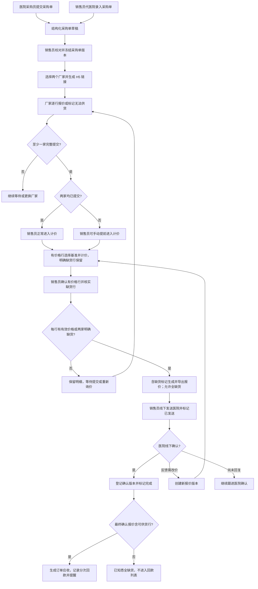

# 中药饮片报价系统 PRD v3（销售 PC + 微信小程序 + 厂家 H5）

> 本版已整合 [2026-10-15 需求决策记录](requirement-consensus-2026-10-15.md) 中的已确认规则。标记为“建议”或“待确认”的内容仍需业务确认，不作为已批准的开发规则；集中见第 19 节。仓库当前原型仍对应旧范围，本文更新不代表功能已实现。

- 版本：v3
- 日期：2026-10-15
- 最近更新：2026-10-16（前四部分设计确认及首批两名销售的部署评估）
- 状态：已合并本轮确认需求，详细设计待确认项见第 19 节
- 适用范围：MVP 需求基线；相关待确认项收敛后再进入实现
- 产品形态：销售 PC Web + 微信小程序 + 厂家外部 H5 报价链接

## 1. 背景与目标

### 1.1 业务背景

中药饮片销售员当前围绕医院采购单开展报价，实际流程为：

1. 医院采购员通过微信发送手写或表格采购单，或在小程序内提交采购单。
2. 销售员代医院录入采购单，或接收医院采购员自主提交的采购单。
3. 销售员校对品名、数量、单位和可选规格。
4. 销售员将校对后的采购单发送给两个厂家报价员。
5. 两个厂家针对本次采购单逐行填写含税、含抽点报价；无法供货时逐行标记。
6. 销售员比较两个厂家本次报价，选择每行基准厂家并进入加价环节。
7. 销售员通过固定金额、比例、高开倍率或手工改价形成最终医院报价。
8. 销售员生成报价单版本，导出 Excel/PDF 后通过微信线下发送医院。
9. 医院线下确认或反馈价格问题。
10. 销售员标记最终确认版本并联系厂家发货，或创建新报价版本后再次发送。

销售员还需要长期查找医院历史订单，避免纸单遗失；以最终确认报价金额管理每笔订单的分次回款，按医院账期提醒催收；通过图表了解各医院的要货频率、数量和最终确认结果。

低频维护的厂家全品类报价不能代表厂家对本次采购单的真实报价，因此本系统明确区分三类数据：

1. 商品主数据：品名、别名、规格、产地、单位等，不含可用于本次报价计算的价格。
2. 厂家全品类来源批次：低频导入或手工录入，永久保留，可查询历史价格，但只作为资料参考。
3. 本次厂家报价：厂家通过本次采购单 H5 链接提交，是报价工作台唯一的厂家价格来源。

### 1.2 产品目标

MVP 覆盖采购单录入、报价、历史查询、回款跟进和医院需求分析：

- 医院采购员可在轻量小程序内提交采购单并查看状态。
- 销售员可在工作台代医院录入采购单，避免医院未使用小程序时阻断业务。
- 销售员可校对采购明细并向两个厂家发起本次询价。
- 厂家报价员通过 H5 链接完成报价，不登录、不注册、不进入小程序。
- 销售员可对比本次厂家报价、选择基准厂家、查看医院历史报价并完成加价。
- 系统生成不可覆盖的医院报价版本，支持 Excel 和 PDF 导出。
- 医院报价交付、反馈和确认继续在线下完成，系统记录发送和最终确认结果。
- 商品库独立承担选品、标准化、别名匹配和低频来源批次查询。
- 销售员使用 PC Web 和小程序访问同一业务数据，支持电脑集中处理及外出跟进。
- 历史订单档案支持查找原采购资料、报价版本和回款记录，不受“最近 3 次历史价”限制。
- 回款按订单管理，以医院最终确认报价金额为应收，支持分次记录。
- 医院账期默认 90 天，由销售员逐院维护，医院端不能修改；默认值变更仅影响之后新建订单。账期从采购单实际接收日期起算，到期当天起提醒，逾期每天提醒。
- 新增图表分析页面，采购需求与最终确认结果分别展示；缺货部分仍保留在需求量中。

### 1.3 成功指标

| 指标 | MVP 目标 |
| --- | --- |
| 医院提交或销售代录后进入销售工作台 | 成功率不低于 99% |
| 图片采购单 OCR 失败后的业务连续性 | 100% 可进入人工校对或手工录入 |
| 结构化 Excel 采购单解析 | 不低于 80% 的规范样例可正确生成明细 |
| 校对完成到生成两个厂家链接 | 100 行以内 2 分钟内完成 |
| 厂家 H5 提交 | 无需登录，每行必须完成“报价/无法供货”选择 |
| 计价工作台进入 | 至少一家完整提交后可由销售员手动进入 |
| 价格来源追溯 | 正常报价有价格行追溯基准厂家报价和销售改价，缺货行追溯两家缺货；历史补录追溯经销售核实的历史资料 |
| 历史报价查询 | 最近 3 张采购单各占一条，已确认优先，否则取最近已发送版 |
| 版本追溯 | 厂家重新报价、医院报价导出、发送、确认均不可覆盖历史 |
| PC 与小程序协同 | 同一账号保存后，两端重新加载可见相同订单和回款数据 |
| 历史订单查询 | 在权限内可分页查询全部历史订单并进入原始资料和版本详情 |
| 回款跟进 | 应收与最终确认报价一致，分次回款后余额正确，到期和逾期订单可查 |
| 医院需求分析 | 图表区分采购需求和最终确认结果，数量以 kg 展示 |

## 2. 产品形态与范围边界

### 2.1 MVP 产品形态

MVP 由三部分组成：

1. 微信小程序
   - 销售员端。
   - 医院采购员轻量端。

2. 厂家外部 H5 报价链接
   - 销售员在 PC 或小程序内生成。
   - 销售员通过微信发送给厂家报价员。
   - 厂家报价员不注册、不登录、不做微信授权。
   - 一个链接只访问一个采购单版本下某一个厂家的报价表单。

3. 内部 PC Web
   - 销售员工作台与管理员管理端，按角色分流；销售员与小程序共享业务账号、后端、数据和权限规则。
   - 覆盖销售订单、询价、计价、导出、历史查询、回款和数据分析；具体页面布局待设计。
   - 销售员 PC 使用账号密码登录，与小程序绑定同一内部账号；管理员仅使用 PC 管理端，以内部账号密码登录，无管理员小程序入口。

### 2.2 PC 与小程序协同

- 销售员同步支持 PC Web 和微信小程序。
- 医院采购员继续使用轻量小程序；医院端不因此增加 PC 或在线报价确认功能。
- 厂家报价员只使用 H5 单表单。
- 两端操作同一订单和版本，不各自生成重复业务数据；保存冲突应提示刷新，不能静默覆盖另一端变更。
- PC 表格批量操作与小程序移动操作遵守相同的冻结、校验和审计规则。
- 销售 PC 与小程序均提供五类数据分析图表，统计口径和权限一致，小程序适配手机屏幕。
- 管理员仅使用 PC，维护账号和基础资料、只读查看全量业务数据；除 3.6 的离职专项交接外，不取得销售业务代操作权限。

### 2.3 价格来源边界

医院最终报价必须遵循以下链路：

```text
本次有效厂家报价
  -> 销售员选择基准厂家
  -> 销售员选择加价方式并填写参数，或直接手工改价
  -> 销售员确认最终报价
```

强制规则：

1. 商品主数据不存可用于本次计算的价格。
2. 厂家全品类来源批次价格只可查询，不得被报价工作台读取。
3. 医院历史报价只可展示，不得自动参与推荐价计算。
4. 可供货报价行必须有当前有效厂家价；两家均明确缺货的行保留并标为缺货，允许导出。待提交、过期或失效不能当作缺货。
5. 销售员最终报价可以低于基准厂家价，但必须触发亏损提示、填写原因并在导出前确认。
6. 所有价格和金额统一保留 2 位小数。

### 2.4 MVP 明确不做

- 不做厂家账号体系和厂家小程序。
- 不做医院端查看报价文件。
- 不做医院端在线确认或反馈价格。
- 不做商品库价格自动报价。
- 不做全品类来源批次价格进入计价链路。
- 不做自动通知厂家发货。
- 不做库存、物流、发票、提成和完整财务结算；订单应收、分次回款及提醒进入 MVP。
- 不做复杂审批流。
- 不做图片格式报价单导出。

## 3. 用户角色与权限

### 3.1 角色列表

| 角色 | 使用端 | 登录方式 | 核心职责 |
| --- | --- | --- | --- |
| 销售员 | PC Web、微信小程序 | PC 账号密码登录，小程序微信登录绑定同一内部账号 | 采购单、询价、计价、报价、历史订单、回款和数据分析。 |
| 内部管理员 | 仅 PC 管理端 | 内部账号密码登录 | 维护账号及基础资料、全量业务只读；另可执行留痕的离职专项交接。 |
| 医院采购员 | 微信小程序 | 微信手机号授权 | 提交采购单，查看自己提交或销售员代录给自己的采购单状态。 |
| 厂家报价员 | 外部 H5 | 无账号，凭 token | 针对链接对应采购单逐行报价或标记无法供货。 |

MVP 暂不提供销售主管角色、主管入口或团队汇总权限；订单业务继续由负责销售员操作，内部管理员角色单独保留。

### 3.2 销售员权限

销售员可以：

- 为当前负责医院创建新订单；按订单负责销售员处理已有订单。
- 为指定医院和采购员代录采购单。
- 校对并冻结采购单版本。
- 选择和更换询价厂家。
- 生成、复制、重新生成和作废厂家 H5 链接。
- 查看厂家本次报价和历史提交版本。
- 在至少一家完整提交后手动提前进入计价。
- 选择每行基准厂家。
- 使用固定金额、比例、高开倍率或手工改价。
- 保存报价草稿、创建新版本、导出 Excel/PDF。
- 标记已发送医院、登记医院最终确认版本和完成状态。
- 查询权限范围内历史订单，查看对应回款和数据分析。
- 按订单登记分次回款并查看到期、逾期提醒。
- 作废自己负责订单的错误回款记录，必填原因并保留原记录，再录入正确金额；不能删除或覆盖原记录。
- 更正自己负责的已核实历史补录单最终确认金额录入错误，必填原因、留存前后金额，新应收不得低于有效已收；不能用于正常新单改价或实际取消/退款。
- 维护权限范围内医院的默认账期，账期页面仅向具备相应权限的销售员开放。
- 单独调整自己负责订单的账期，必填原因并保留前后账期及到期日，不改变医院默认值或其他订单。
- 核实仍需正常收款时，填写结果及原因，留痕解除自己负责订单的催收异常；不能解除其他销售员订单的异常。

销售员不可以：

- 查看无权限医院的数据。
- 修改厂家已提交的原始报价。
- 覆盖已冻结的采购单版本。
- 覆盖已导出的医院报价版本。
- 使用商品库或全品类来源批次价格生成医院报价。

医院交接规则：医院从销售 A 转交 B 后，仅新订单归 B，旧订单仍归 A 处理；历史操作人不改名。B 可以只读查看该医院旧订单、历史报价和医院整体统计，不能修改 A 的旧单、登记其回款或代为确认。订单负责人与医院当前负责人分别保存，不能用当前医院归属覆盖旧订单。管理员按 3.5 只读查看全量业务，MVP 不做销售主管角色。

### 3.3 医院采购员权限

医院采购员可以：

- 新建采购单。
- 上传采购单图片或 Excel。
- 从商品库选择中药饮片。
- 自定义输入商品。
- 编辑采购明细草稿。
- 查看自己提交的采购单。
- 查看销售员为其代录的采购单。
- 查看简化后的采购单状态和来源标签。

医院采购员不可以：

- 查看厂家报价。
- 查看销售员加价参数、推荐价或最终报价。
- 查看或下载报价文件。
- 在线确认报价。
- 在线反馈价格问题。
- 查看其他采购员或其他医院数据。
- 查看历史纸单专用补录记录及其附件、核实资料或回款；即使记录属于本医院或关联本人，也不对医院端开放。
- 进入或操作账期维护页面，修改医院默认账期或订单账期。

### 3.4 厂家报价员权限

厂家报价员只能：

- 通过当前有效 token 打开对应报价表。
- 查看销售员冻结后的采购明细。
- 严格按冻结后的规格和 kg 单位填写单价，不可更改规格或单位。
- 对每行选择“可供货并报价”或“无法供货”。
- 一次性提交完整报价。

厂家报价员不能：

- 新增、删除或修改采购行。
- 推荐替代品。
- 查看另一厂家报价。
- 查看其他采购单。
- 部分提交。
- 修改已提交报价。

### 3.5 内部管理员权限（仅 PC）

- 维护内部账号、启停状态、医院及当前负责销售员、医院采购员、厂家、商品及规格、默认报价模板等基础资料。
- 可只读查看全量订单、历史报价、原始资料、已生成文件、回款、账期调整与异常处理记录，以及五类分析图表。
- 不代销售创建或修改采购单、冻结、询价、改价、生成报价版本、标记发送/确认/作废，也不登记或作废回款、修改医院默认或单笔账期、登记或解除催收异常、核实历史补录。
- 医院基础资料维护不包含账期业务字段授权；当前医院负责销售员变更不改写旧订单负责人。账号停用也不得自动转移或删除旧单。
- 管理员小程序登录或业务入口不可用；权限须由服务端校验，不能仅通过 PC 菜单隐藏写操作。
- 唯一明确的业务责任变更例外为 3.6 的离职专项交接，仅转交处理责任并停用原账号，不代销售改价格、账期或回款。

### 3.6 销售离职专项交接（管理员例外权限）

- 销售离职且名下仍有待处理订单、未结清应收或待处理异常时，允许管理员执行专项交接，再停用原账号；这是业务全量只读之外的明确例外。
- 接手人必须为有效销售员。交接前展示原负责人、接手人、关联订单及应收、异常数量，明确交接原因并保留操作记录。
- 后续业务操作及提醒转给接手销售；原始负责人、报价制作人、文件上传人和历史操作人保留。普通医院换负责人仍仅影响新订单，不能经通用医院修改接口批量改旧单。
- 仅转交当前负责权，不改变采购明细、厂家提交、已冻结报价、确认时间、账期及调整历史、金额、回款或异常暂停状态。
- 停用前须确认未完成业务已明确接手，原销售仍负责医院的新单负责人也须另行维护为有效销售；账号停用动作本身不得隐式转移旧单或使业务无人处理。
- 交接后文中“订单负责销售员”及此前“原负责人”的业务操作权限由当前接手人履行；原始负责人与历史操作人仅作审计追溯，不因曾负责而继续获得写权限。

## 4. 核心业务流程

### 4.1 主流程总览



### 4.2 采购单录入流程

#### 4.2.1 医院采购员自主提交

1. 医院采购员使用微信手机号登录。
2. 系统校验手机号是否已绑定医院。
3. 采购员选择一种或多种录入方式：
   - 拍照或从相册上传图片。
   - 上传 Excel。
   - 从商品库搜索并选择。
   - 自定义输入。
4. 图片进入 OCR，Excel 进入解析服务。
5. 所有来源统一转为结构化采购明细草稿。
6. 采购员确认品名、数量、单位，可补充规格和备注。
7. MVP 单位固定为 `kg`。其他单位必须人工核对换算为 kg 后提交，不自动猜测换算关系。
8. 提交后来源标签为“医院提交”。
9. 采购单进入销售员待处理列表。
10. 提交后医院采购员不能再编辑；如需修改，由销售员在校对阶段处理。

#### 4.2.2 销售员代医院录入

1. 销售员从工作台点击“新建采购单”。
2. 必须选择自己负责的医院和具体采购员。
3. 支持与医院端相同的图片、Excel、商品库和自定义录入方式。
4. 提交后来源标签为“销售代录”。
5. 对应医院采购员可在医院端查看该采购单及状态。
6. 对应医院采购员只能查看，不能编辑销售员代录的采购单。
7. 销售员可直接开始校对。
8. 记录采购单实际接收日期，历史补录不得以系统创建日期代替；该日期用于账期起算。

#### 4.2.3 采购行最低字段要求

| 字段 | 必填 | 规则 |
| --- | --- | --- |
| rawItemName | 是 | 医院原始品名或解析品名。 |
| quantity | 是 | 大于 0，最多 2 位小数。 |
| unit | 是 | MVP 固定 kg，不可更改为其他单位。 |
| specification | 否 | 医院未提供时允许为空。 |
| remark | 否 | 行备注。 |

### 4.3 销售员校对和采购单冻结

1. 销售员查看来源标签、原始附件和解析结果。
2. 系统基于标准商品、别名和商品规格给出匹配候选。
3. 销售员逐行确认：
   - 原始品名。
   - 标准商品。
   - 商品规格。
   - 数量。
   - 单位。
   - 备注。
4. 无匹配商品时可：
   - 绑定已有标准商品或商品规格。
   - 新建商品或商品规格后绑定。
   - 本次保留自定义品名。
5. 销售员确认后冻结当前采购单版本。
6. 冻结后的采购行成为厂家 H5 表单和报价版本的唯一明细来源。
7. 冻结后如需修改，按 7.9 的采购单版本规则处理。

### 4.4 本次厂家询价流程

1. 销售员在冻结后的采购单版本中选择两个厂家。
2. 同一采购单版本同时最多存在两个有效厂家报价任务。
3. 同一采购单版本的两个任务必须选择不同厂家。
4. 每个厂家创建独立报价任务和独立 H5 链接。
5. 链接默认有效期为 48 小时。
6. 新链接生成后，销售员在当前页面复制并通过微信发送厂家；原文只在生成响应中返回，服务端不提供原链接恢复。
7. 销售员可取消任务并替换厂家；已有有效提交时必须二次确认，旧提交立即退出计算但永久保留。
8. 页面关闭或原文丢失后再次发送，须明确重新生成新链接并二次确认，提示旧链接及已打开的旧填写页面立即失效；新链接从本次生成时间起有效 48 小时。厂家已经提交时，须按 4.7 明确确认重新询价，不能作为普通复制静默执行。
9. 同一任务同时只能存在一个有效链接。

### 4.5 厂家 H5 报价流程

1. 厂家报价员打开链接。
2. 系统校验 token、任务状态和有效期。
3. H5 展示：
   - 医院名称。
   - 采购单编号。
   - 厂家名称。
   - 截止时间。
   - “报价均须为含税、含抽点单价”的固定提示。
   - 冻结后的采购明细。
4. 每行必须选择：
   - 可供货：填写大于 0、最多 2 位小数的单价。
   - 无法供货：不填写价格，可选填备注。
5. 所有行完成选择后才能提交。
6. 提交前再次确认价格口径和不可修改规则。
7. 提交成功后生成不可变的厂家报价提交版本。
8. 重复或并发提交只能有一次成功。
9. 厂家填写本次报价有效至日期，与填写链接的 48 小时期限分别展示。规格和单位只读，必须精确按冻结行报价。

### 4.6 进入计价和后到报价流程

1. 两家均未完整提交时，“进入计价”按钮禁用。
2. 一家完整提交时，按钮显示“提前进入计价”。
3. 销售员点击“提前进入计价”时，系统二次提示另一厂家尚未报价。
4. 两家均完整提交时，按钮显示“进入计价”，无需额外风险确认。
5. 进入计价后，未完成的厂家任务继续独立运行。
6. 后到报价提交时更新实时比价候选、提示差异并标记受影响行，不自动写入草稿已采用的厂家快照、基准或推荐价，更不覆盖最终报价。
7. 销售员主动执行“刷新并采用报价”后，更新草稿快照；未手工锁定的基准可按最新有效最低价更新，手工选择的基准不自动切换。重新计算受影响推荐价，保留最终价格值；基准发生变化的行需重新确认后才能导出。
8. 已导出或已发送版本始终冻结；如需采用新报价，必须创建新版本。
9. 提前进入计价不等于可以导出或发送：若一家明确缺货、另一家未提交，整单继续等待；不得删掉该行后先发其余行。

### 4.7 重新报价流程

1. 厂家报价错误或已提交后需再次生成填写链接时，销售员点击“重新询价并生成新链接”，确认旧提交退出计算及相关医院报价失效的影响；不能以再次复制链接代替该确认。
2. 原厂家报价提交版本立即标记为“已被替代”。
3. 原报价立即退出最低价、基准价和推荐价计算。
4. 原报价数据永久保留，不允许修改或删除。
5. 厂家任务状态变为“重新报价中”。
6. 新链接提交完整报价后生成新的当前有效提交版本。
7. 报价草稿中使用过旧报价的行立即标记“基准报价已失效”，原基准厂家和基准价格不得继续用于导出。
8. 系统不自动改写销售员最终报价，但销售员必须重新选择当前有效基准厂家并再次确认该行后才能导出。
9. MVP 不支持内部人员直接修改厂家原始报价。
10. 所选基准报价被重询、取消或替换时，相关未完成的已导出/已发送医院报价同步记录失效时间；旧文件保留，但此后禁止再发送和新的医院确认。失效前已实际确认的，按 7.11 规则允许补录。

### 4.8 加价和最终报价流程

1. 系统对每行展示两家本次报价、本次最低价和供货状态。
2. 默认选择最低有效报价对应厂家作为基准厂家。
3. 销售员可选择另一家有效报价作为基准。
4. 加价方式和参数默认均为空。
5. 支持：
   - 固定金额加价。
   - 比例加价。
   - 高开倍率加价。
   - 直接手工改价。
6. 批量加价可作用于全部行或选中行。
7. 执行批量操作前显示方式、参数和影响行数。
8. 保存前允许撤销最近一次批量操作。
9. 计算结果写入推荐价，不自动成为最终报价。
10. 销售员确认或修改最终报价。
11. 有价格行均确认最终报价，且其余行均已由两家明确标记缺货后，才可导出。缺货行保留数量与规格，不参与加价和金额计算，整单全缺货也可出单。
12. 最终报价低于基准厂家价时必须填写原因并确认亏损风险。

### 4.9 报价导出、发送和线下确认

1. 首次进入计价工作台创建 V1 草稿。
2. 销售员确认最终报价后预览报价单。
3. 系统支持导出 Excel 和 PDF。
4. 同一版本导出不同格式不增加版本号。
5. 首次导出后版本冻结。
6. 销售员通过微信线下发送后，手动点击“标记已发送医院”。
7. 系统记录发送版本、发送时间和操作人。
8. 只有已发送且未作废版本进入医院历史报价。
9. 医院线下确认后，销售员选择最终确认版本并标记完成。
10. 医院反馈问题时创建 V2/V3，复制上一版本最终报价作为初始值。
11. 两家均缺货的全缺货报价仍需线下发送；医院确认已知悉缺货后，销售员登记并标记完成。
12. 只能确认当前采购版本对应的已发送、未作废报价；采购明细已换版时，不得再确认旧采购版本报价。
13. 允许补录有效期内实际发生的医院确认，必须区分实际确认时间、系统录入时间及补录原因。
14. 含价格报价的默认有效至日期为所有可供货行所选基准厂家报价中最早的到期日；销售可缩短，不得延长。全缺货单不设价格有效期，规则见 7.17。
15. 确认完成时，同一采购版本对应报价单的其余未发送版本全部作废，包括草稿和已导出未发送版本；文件及历史保留，不能以后再发送。

### 4.10 历史订单、回款与分析

1. 销售员在 PC 或小程序历史订单入口查询医院订单，进入详情查看采购资料、报价、确认和回款记录。
2. 含价格订单以医院最终确认报价金额建立订单应收，账期起点为实际接收采购单日期。医院默认账期 90 天，由销售逐院维护；新建订单保存当时账期，后续默认值变化不自动改变旧单到期日。
3. 同一订单可以分多次回款，每次登记金额和实际回款日期；回款结清状态与报价完成状态分别展示。
4. 到期当天起进入提醒，逾期每天提醒；站内列表可用，微信通知须具备实际可用模板及有效订阅授权。
5. 数据分析页用图表分别呈现医院采购需求与最终确认结果，需求量包含缺货部分；图表类型、时间口径等详细方案见 6.18 和第 19 节。

历史纸单专用补录流程：录入实际接收日期、医院最终确认金额、药品及数量和已有回款 -> 补齐明细 -> 销售核实 -> 纳入回款台账及统计。该流程无需重新跑厂家询价，不补造厂家报价、发送记录或普通报价确认版本。历史回款缺少逐笔日期时，可登记经核实的“历史累计已收”，后续新回款逐笔记录。

## 5. 状态机

### 5.1 销售员端采购单状态

| 状态 | 系统值 | 进入条件 | 主要动作 |
| --- | --- | --- | --- |
| 草稿 | draft | 医院或销售正在录入。 | 编辑、删除、提交 |
| 已提交 | submitted | 采购单已提交。 | 开始校对、作废 |
| 校对中 | reviewing | 销售开始校对。 | 保存、确认冻结 |
| 待询价 | inquiry_pending | 当前采购单版本已冻结。 | 选择厂家、生成链接 |
| 厂家报价中 | supplier_quoting | 至少一个有效厂家任务已生成，暂无完整提交。 | 查看任务、换厂家、重新生成链接 |
| 可计价 | pricing_ready | 至少一家完整提交。 | 提前进入或正常进入计价 |
| 报价草稿 | quote_draft | 已创建当前报价版本草稿。 | 选择基准、加价、确认、导出 |
| 已导出 | quote_exported | 当前版本至少导出一次。 | 标记已发送、创建新版本 |
| 已发送医院 | quote_sent | 销售确认已线下发送。 | 创建新版本、确认完成 |
| 已完成 | completed | 正常单已登记医院最终确认版本，全缺货为医院已知悉缺货；历史补录单须完成专用核实。 | 查看、归档、独立跟进回款 |
| 已作废 | voided | 采购单业务终止。 | 仅查看 |

状态流转：

| 当前状态 | 可流转到 | 触发 |
| --- | --- | --- |
| 草稿 | 已提交、已作废 | 提交、删除/作废 |
| 已提交 | 校对中、已作废 | 开始校对、作废 |
| 校对中 | 待询价、已作废 | 冻结采购单版本、作废 |
| 待询价 | 厂家报价中、已作废 | 生成厂家任务、作废 |
| 厂家报价中 | 可计价、已作废 | 至少一家完整提交、作废 |
| 可计价 | 报价草稿、已作废 | 销售员进入计价、作废 |
| 报价草稿 | 已导出、已作废 | 导出当前版本、作废 |
| 已导出 | 已发送医院、报价草稿、已作废 | 标记发送、创建新版本、作废 |
| 已发送医院 | 报价草稿、已完成、已作废 | 创建新版本、确认完成、作废 |
| 已完成 | 无直接作废流转 | 保留最终确认历史，后续回款及异常独立处理；管理员只读，不能作废业务或级联冲销删账 |
| 已作废 | 无 | 终态 |

补充规则：

- 采购单主状态进入“报价草稿”后，厂家任务继续使用自己的独立状态。
- 后到厂家报价不得回退采购单主状态。
- 创建新报价版本时采购单主状态进入“报价草稿”。
- 尚未进入计价工作台时，系统按当前有效完整提交数重算状态：从 1 家降为 0 家时由“可计价”回到“厂家报价中”，从 0 家升为至少 1 家时进入“可计价”。
- 已进入计价工作台后，重新报价或替换厂家不回退采购单主状态，而是使受影响报价行的基准失效并阻止导出。
- 离职专项交接仅改变当前负责销售员，不重置订单、报价、应收或异常状态；处理责任与历史创建/操作身份分开保存。
- 历史补录单使用独立核实状态，未补齐或未核实时只暂存档案；补齐药品、数量及金额资料并经销售核实后，可由专用核实入口从草稿转为完成、纳入台账和统计，不走普通询价状态链路。该例外不适用于正常新单。

### 5.2 医院端状态映射

| 销售员端状态 | 医院端显示 |
| --- | --- |
| submitted | 已提交 |
| reviewing/inquiry_pending/supplier_quoting/pricing_ready/quote_draft/quote_exported | 报价处理中 |
| quote_sent | 报价已发送 |
| completed | 已完成 |
| voided | 已作废 |

医院端不展示厂家报价进度、价格和内部异常。

### 5.3 采购单版本状态

| 状态 | 系统值 | 说明 |
| --- | --- | --- |
| 编辑中 | draft | 当前版本尚未冻结。 |
| 已冻结 | frozen | 已成为厂家报价和医院报价依据。 |
| 已被替代 | superseded | 新采购单版本已创建。 |
| 已作废 | voided | 版本无效但保留；MVP 不提供单独作废新修订并回退旧版的入口。 |

### 5.4 厂家报价任务状态

| 状态 | 系统值 | 说明 |
| --- | --- | --- |
| 未生成链接 | link_not_created | 已选择厂家，尚未生成链接。 |
| 待报价 | waiting_quote | 当前链接有效，等待首次提交。 |
| 已报价 | submitted | 已完整提交；价格是否可用还需单独检查报价有效日期。 |
| 重新报价中 | requote_pending | 原提交已被替代，等待新提交。 |
| 已取消 | cancelled | 厂家任务被取消或厂家被替换。 |

### 5.5 厂家 H5 链接状态

| 状态 | 系统值 | 说明 |
| --- | --- | --- |
| 有效 | active | 可访问和提交。 |
| 已提交 | submitted | 已成功产生报价提交版本。 |
| 已过期 | expired | 超过 48 小时。 |
| 已失效 | invalidated | 被重新生成或手动作废。 |

### 5.6 厂家报价提交版本状态

| 状态 | 系统值 | 说明 |
| --- | --- | --- |
| 当前提交 | current | 当前提交版本；可供货价格仅在报价有效日期内参与计算。 |
| 已被替代 | superseded | 永久保留但不参与计算。 |

### 5.7 医院报价版本状态

| 状态 | 系统值 | 说明 |
| --- | --- | --- |
| 草稿 | draft | 可修改，未导出。 |
| 已导出 | exported | 已冻结，至少存在一个导出文件。 |
| 已发送 | sent | 销售员确认已发送医院。 |
| 医院已确认 | confirmed | 被选择为医院最终确认版本。 |
| 已作废 | voided | 不再使用，永久保留。 |

最终确认后，其余未发送版本（`draft`、`exported` 且无发送记录）统一转为 `voided`，不论版本号早晚；已发送的其他历史版本保持只读，不产生第二个最终确认版本。报价单及采购单保持完成状态，不能因较大版本号已作废而回退。

### 5.8 回款状态（独立于采购单报价状态）

- 已确认含价格订单展示应收、累计已收、未收和到期日；支持未收、部分回款、已结清，并单独显示是否到期/逾期。
- 全缺货订单显示“不产生应收”，不能与“已结清”混为一谈。
- 结清、逾期和重复提醒按 7.15 及已确认的第四部分计算；误录回款按作废重录更正后重新计算状态，超过未收余额的回款拒绝录入。取消/退款待处理作为独立异常状态，暂停自动催收但不改金额、结清或报价完成状态。

## 6. 页面与功能需求

### 6.1 PC、小程序登录与角色分流

功能：

- 内部账号由管理员预先创建，销售员和管理员在 PC 通过账号密码登录，按角色进入不同工作台。
- 销售员小程序微信身份绑定既有内部账号，两端对应同一个 `users.id`，不创建两套销售员身份；管理员仅 PC，不要求绑定微信。
- 首次微信绑定验证已设置的内部账号密码及微信身份，密码初始化、重置和会话按已确认的 [第三部分接口与身份权限设计](api-identity-permission-design-v1.md) 执行。
- 医院采购员通过微信手机号授权登录。
- 手机号必须预先绑定医院采购员档案。
- 登录后按角色进入对应首页。
- 未绑定医院时展示明确联系提示。

验收标准：

- 医院采购员不能进入销售工作台。
- 销售员不能访问无权限医院。
- 厂家报价员没有小程序登录入口。
- 同一销售员在 PC 和小程序登录后，看到相同的业务身份、订单及数据权限。
- 停用内部账号后，两端均不能继续访问受保护业务数据。
- 管理员可进入 PC 管理端，不显示或开放管理员小程序入口；管理员不能经销售写接口代操作业务。

### 6.2 医院端首页

功能：

- 展示医院名称和当前采购员。
- 主操作“新建采购单”。
- 展示“我的采购单”。
- 每张采购单展示来源标签：
  - 医院提交。
  - 销售代录。
- 展示简化状态、采购单编号、日期和品类数量。

验收标准：

- 只展示当前采购员提交或销售员为其代录的数据。
- 上述范围仅限正常新单；`historical_backfill` 专用历史补录在任何核实状态下均不展示，不因属于同医院或关联本人而开放。
- 不展示报价价格、厂家名称、厂家进度或报价文件。

### 6.3 医院端新建采购单

录入方式：

1. 图片上传。
2. Excel 上传。
3. 商品库选择。
4. 自定义输入。

功能：

- 支持拍照和相册多图上传。
- 支持 xlsx/xls/csv。
- 支持商品搜索、常用商品和最近采购。
- 支持组合多种录入方式。
- 支持解析预览、行增删改和提交前检查。
- 单位固定 kg，其他单位输入提示人工核对并换算，不能直接提交。

采购行字段：

| 字段 | 必填 | 说明 |
| --- | --- | --- |
| rawItemName | 是 | 原始品名。 |
| itemId | 否 | 标准商品 ID。 |
| itemVariantId | 否 | 商品规格 ID。 |
| specification | 否 | 展示规格。 |
| quantity | 是 | 大于 0，2 位小数。 |
| unit | 是 | 固定 kg。 |
| remark | 否 | 备注。 |
| sourceType | 是 | ocr/excel/product_library/custom_input。 |

### 6.4 销售员工作台

首页必须优先展示日常主链路：

- 主按钮“新建采购单”。
- 待校对数量。
- 厂家报价中数量。
- 可计价数量。
- 报价草稿数量。
- 已导出待发送数量。
- 已发送待确认数量。
- 待回款金额、到期及逾期订单入口。
- 新采购单和新厂家报价的站内角标。

快捷入口：

- 采购单。
- 报价单。
- 商品库。
- 厂家全品类来源批次。
- 医院与采购员。
- 厂家管理。
- 历史订单。
- 回款台账。
- 医院数据分析。

### 6.5 销售员新建和校对采购单

销售代录功能：

- 必选医院和采购员。
- 维护实际接收采购单日期，区分于系统录入日期。
- 支持图片、Excel、商品库和自定义录入。
- 自动显示“销售代录”来源标签。

校对功能：

- 查看原始附件和解析置信度。
- 编辑品名、数量、规格和备注，核实数量已按 kg 表达。
- 查看标准商品及规格候选。
- 创建或绑定商品。
- 标记本次自定义项。
- 冻结采购单版本。

验收标准：

- 未冻结版本不能生成厂家链接。
- 冻结后修改必须遵守采购单版本规则。
- 商品匹配不得带入任何价格。

### 6.6 本次厂家询价页

功能：

- 展示冻结的采购单版本和明细。
- 提供厂家 A、厂家 B 两个有效任务位。
- 选择、替换和取消厂家。
- 生成、在当前页面复制新链接、重新生成、作废 H5 链接；关闭页面后不恢复原链接，改为明确重新生成。
- 展示任务状态、链接状态、过期时间和提交时间。
- 分别展示填写链接到期时间与厂家报价有效至日期；价格过期提示重新询价。
- 查看厂家历史提交版本。

验收标准：

- 同一任务最多一个有效链接。
- 同一采购单版本最多两个有效厂家任务。
- 两个有效任务不得选择同一厂家。
- 替换已有报价的厂家时必须二次确认，旧任务和提交版本永久保留但退出计算。
- 重新生成链接需二次确认，提示旧链接及其已打开页面立即失效、未提交内容需在新链接重新填写。
- 厂家已提交时入口显示“重新询价并生成新链接”，额外提示旧提交退出计算及关联医院报价的失效影响；若确认期间厂家刚完成提交，普通链接重置请求应拒绝并要求重新核对，不能自动升级成重新询价。
- 重新报价后原提交立即退出计算。

### 6.7 厂家 H5 报价表单

页面仅包含本次报价所需信息，不提供系统导航。

表单级字段：厂家填写本次报价有效至日期。链接截止时间只决定能否提交，不代替价格有效日期。

每行字段：

| 字段 | 可编辑 | 必填 | 说明 |
| --- | --- | --- | --- |
| 序号 | 否 | 是 | 采购行序号。 |
| 品名 | 否 | 是 | 销售员确认的显示名。 |
| 规格 | 否 | 否 | 可为空。 |
| 数量 | 否 | 是 | 采购数量。 |
| 单位 | 否 | 是 | 采购单位。 |
| 供货选择 | 是 | 是 | 可供货/无法供货。 |
| 含税含抽点单价 | 是 | 条件必填 | 可供货时必须大于 0，2 位小数。 |
| 备注 | 是 | 否 | 行备注。 |

提交校验：

- 每行必须选择供货状态。
- 可供货行必须填写合法价格。
- 无法供货行价格必须为空。
- 提交内容必须覆盖全部采购行。
- 不允许添加、删除或替代商品。
- 不允许改变采购行规格、数量或单位，单价统一为元/kg。
- 提交成功后不可再次编辑。

### 6.8 厂家报价对比页

功能：

- 展示两个厂家任务和当前提交状态。
- 逐行展示供货状态和当前有效报价。
- 计算本次最低有效价。
- 显示重新报价中、已被替代等状态。
- 根据提交情况控制进入计价按钮。

按钮规则：

- 0 家完整提交：禁用。
- 1 家完整提交：显示“提前进入计价”，点击二次确认。
- 2 家完整提交：显示“进入计价”。

### 6.9 报价工作台

每行展示：

| 字段 | 说明 |
| --- | --- |
| 原始品名 | 医院提交或文件解析品名。 |
| 标准商品/规格 | 销售员校对结果或自定义项。 |
| 数量/单位 | 本次采购数量和单位。 |
| 厂家 A 报价 | 当前有效报价或无法供货状态。 |
| 厂家 B 报价 | 当前有效报价或无法供货状态。 |
| 本次最低价 | 当前有效厂家报价中的最低值。 |
| 基准厂家 | 默认最低价厂家，可由销售员选择。 |
| 基准厂家价 | 所选厂家当前有效价格。 |
| 最近历史价 | 同医院精确匹配最近一张采购单的代表报价，已确认优先，否则取最近已发送版。 |
| 最近 3 次历史 | 按采购单去重，展示日期、版本、价格和差异。 |
| 加价方式 | 固定金额/比例/高开倍率/手工。 |
| 加价参数 | 默认空，销售员填写。 |
| 推荐价 | 依据基准厂家和加价参数计算。 |
| 最终报价 | 销售员确认的医院报价。 |
| 差额/加价率 | 最终报价相对基准厂家价。 |
| 风险 | 缺厂家报价、无有效价格、低于成本、后到报价等。 |

操作：

- 选择基准厂家。
- 单行计算推荐价。
- 对全部行或选中行批量加价。
- 应用推荐价到最终报价。
- 直接手工填写最终报价。
- 确认最终报价。
- 撤销最近一次未保存批量操作。
- 保存草稿。
- 查看改价日志。
- 预览和导出。
- 查看缺货行及依据；未提交不能按缺货放行，不能删行绕过整单校验。

PC 要求：使用适合宽屏的明细表格，支持搜索、选中行和批量操作；与移动端共享相同订单、计算和冻结规则，具体布局待页面设计。

移动端要求：

- 采购行使用紧凑列表，不强制横向展示完整桌面表格。
- 点击行进入价格编辑抽屉或详情页。
- 厂家 A/B、最低价、基准价、推荐价和最终价必须在同一编辑视图中可见。
- 顶部提供搜索、风险筛选和“仅看未确认”。
- 底部使用固定操作栏承载批量加价、保存和预览。

### 6.10 报价预览、导出和发送

系统默认模板头部：

- 销售方名称。
- 医院名称。
- 报价单编号。
- 版本号。
- 报价日期。
- 销售员姓名和联系方式。
- 报价有效至日期：默认取所有有价格行所选基准厂家报价的最早到期日，销售可缩短、不可延长；全缺货单标为不适用。
- 固定提示“以上报价均为含税价格”。

报价单编号：

```text
BJ-{yyyyMMdd}-{hospitalCode或医院ID后6位}-{当日3位流水号}
```

示例：`BJ-20260716-HOSP01-001`。

明细字段：

| 字段 | 规则 |
| --- | --- |
| 名称 | 标准显示名或销售确认名。 |
| 规格 | 允许为空。 |
| 数量 | 2 位小数。 |
| 单位 | 固定 kg。 |
| 供货状态 | 可供货/缺货；原采购行全部保留。 |
| 单价 | 可供货行为最终报价，2 位小数；缺货行留空。 |
| 金额 | 可供货行为数量 × 单价，四舍五入到 2 位；缺货行留空。 |
| 备注 | 销售备注。 |

导出：

- Excel `.xlsx`。
- PDF，多页报价自动分页。
- 文件名包含医院名称、报价单号和版本号。
- Excel 可由 WPS 和 Microsoft Excel 打开。
- 同一版本可分别导出 Excel 和 PDF。
- 每次导出生成独立导出记录。
- 销售方名称、可选 logo、固定备注等由系统默认报价模板配置提供。
- 全缺货也允许导出并明确“本单全部缺货”；总额展示样式待模板设计确认，不以 0 元供货表达。

发送：

- 导出不等于发送。
- 销售员线下发送后点击“标记已发送医院”。
- 标记时必须选择具体报价版本。
- 已发送版本不可修改。
- 采购版本已被替代的报价仅保留历史，不能重新标记为当前可接受报价。
- 所选基准厂家报价被重询、取消或替换导致该版本失效后，禁用再次发送及新的确认；提示取得当前有效厂家报价后创建新版本。原文件及历史发送记录保留。
- 最终确认后，其余未发送草稿及已导出未发送版本显示“已作废，其他版本已确认”，保留原文件和导出记录；关闭发送及继续制作报价的操作入口。

### 6.11 商品库

数据结构：

1. 标准商品
   - 标准品名。
   - 别名。
   - 分类。
   - 启用状态。

2. 商品规格
   - 炮制/商品规格。
   - 产地。
   - 等级。
   - 包装或计价单位。
   - 启用状态。

医院端交互：

- 使用扁平搜索结果，不强制逐层选择。
- 单一常用规格可直接加入采购单。
- 多个规格时弹出规格选择。
- 产地、等级等次要信息默认折叠。
- 无合适结果时支持自定义输入。

内部功能：

- 查询、新增、编辑、启停标准商品。
- 管理别名。
- 查询、新增、编辑、启停商品规格。
- 查看关联的厂家全品类历史来源批次。
- 来源价格固定标记“仅资料参考，不参与本次报价”。

### 6.12 厂家全品类来源批次

功能：

- Excel 导入。
- 手工创建批次并逐行录入。
- 导入预览和字段映射。
- 异常行处理。
- 批次列表和详情。
- 按厂家、系统批次号、厂家原始批次号、报价日期查询。
- 查看原始文件。
- 将来源行匹配到商品规格。

强制规则：

- 每次导入或手工录入创建独立批次。
- 系统为每个批次生成唯一批次号；厂家原始批次号允许为空或重复。
- 新批次不得覆盖旧批次。
- 已确认批次和行永久保留，只可整体作废。
- 来源价格不得进入报价工作台。

### 6.13 医院与采购员管理

功能：

- 新增、编辑、启停医院。
- 维护负责销售员。
- 销售员维护权限范围内医院的默认账期天数，初始 90 天；医院端不提供账期维护入口，也不能调用接口改写。
- 新建订单保存当时医院默认账期；销售修改默认账期只影响之后新建订单，旧单账期及到期日不自动变化。
- 医院交接仅影响新订单，旧单负责人和历史操作人保留。
- 新增、编辑、启停采购员。
- 绑定手机号和微信 openId。
- MVP 同一采购员手机号只绑定一家医院。

说明：

- 医院不配置默认加价方式或参数。
- 每次报价进入加价环节时，加价方式和参数均为空。

### 6.14 厂家管理

功能：

- 新增、编辑、启停厂家。
- 维护联系人和联系电话。
- 作为本次询价和全品类来源批次的归属厂家。

规则：

- 停用厂家不能创建新任务。
- 历史任务、提交版本和来源批次永久可查。

### 6.15 报价历史

功能：

- 按医院、销售员、日期、状态、商品查询医院报价。
- 查看报价单所有版本、导出记录和发送记录。
- 查看最终确认版本。
- 查看单行基准厂家、加价方式和改价日志。
- 在工作台查看同医院同商品最近 3 张采购单的代表报价，已确认优先，否则取最近已发送版。

验收标准：

- 未发送的导出版本不得进入医院历史价格。
- 已作废版本不得作为最近历史价。
- 历史详情可追溯采购单版本和本次厂家报价提交版本。

### 6.16 历史订单档案

已确认需求：销售员可长期查询历史订单，解决纸质单遗失、查找困难的问题，不限于最近 3 次报价。

历史补录已确认功能：

- 提供专用入口，录入医院、实际接收日期、历史最终确认金额、药品及数量和已有回款，销售核实后纳入回款台账与统计，无需重新询价。
- 必须补齐药品及数量才能纳入台账和统计；明细不完整时只能暂存待补齐，不能把缺失数量按 0 处理。
- 历史回款无逐笔日期时，可登记经核实的“历史累计已收”，后续新回款按订单逐笔记录；历史累计记录明确标识，不能伪造实际支付日期。
- 保存补录人、补录时间、核实人和核实时间，实际业务日期与系统录入日期分开。未核实数据不进入正式应收、回款提醒和统计。
- 原账期由销售按当时约定填写；未知时保留待核实，不能自动填默认 90 天或医院当前账期，也不能生成推定到期日和逾期提醒。
- 专用历史补录仅对具备业务权限的销售员及 PC 管理员可见，管理员继续只读；医院采购员端不展示补录订单及相关附件、核实和回款资料。
- 已核实历史单提供专用“金额录入更正”入口，仅订单负责销售员可用；填写新金额及原因，展示原核实金额、更正前后应收、有效已收和更正后余额，保留每次记录。低于有效已收时拒绝保存，不能直接编辑已核实原始金额。
- 历史补录核实及核实后的金额录入更正，均须填写核实依据和核实说明，附件可选；原纸单遗失时允许无附件办理，不能因缺附件阻止符合其他校验的核实或更正。
- 药品及采购数量等既有必填资料齐全后，逐行确认可供货数量或缺货状态未知不阻止核实入账；需求和已核实金额照常纳入，未知确认结果留空并提示。详情区分“未核实订单”和“已核实、部分结果未知”，不能把后者整单退回待核实或自动补为 0。

页面建议：按医院、实际接收日期、订单号、药品及状态分页检索，详情关联已有采购原图/表格、采购修订、报价、确认资料及回款记录；历史补录展示来源、原账期、核实状态、必填核实依据及说明，附件为可选上传。

验收：已有原始附件可追溯，无附件的历史单仍可按规则核实；订单修改和报价换版不覆盖历史；列表、附件下载和详情使用同一权限范围，医院交接不能把旧单自动改给新销售员。

交接后 B 可以只读查看医院旧订单及历史报价，旧单操作入口不得开放；服务端写接口同样校验原订单负责销售员，不能只隐藏前端按钮。

### 6.17 订单回款台账与提醒

已确认功能：

- 展示医院、订单、应收金额、累计已收、未收余额、实际接收日期、账期天数、到期日及负责销售员。
- 应收金额以医院最终确认报价为准；按订单登记分次回款，不做一笔款跨多订单分摊。
- 医院账期默认 90 天，由销售员逐院维护；医院端不能操作账期页面。订单按创建时保存的账期，从采购单实际接收日期起算；医院默认值改变不自动重算旧单。
- 小程序提供待回款列表；到期当天开始、逾期每天提醒，并支持具备有效订阅条件的微信通知。
- PC 与小程序共用回款数据。报价完成不代表回款结清。
- 该订单负责销售员可作废错误回款记录，必须填写原因，保留原记录及操作痕迹，再录入正确金额；不提供覆盖原金额或物理删除记录的更正方式。
- 台账同时可查有效及已作废记录，累计已收只计算有效记录；作废后更新未收余额、结清状态及待回款列表，按到期情况继续提醒。
- 本次回款金额不得超过订单当前未收余额；超出时阻止录入，提示核对金额或订单，不自动截断金额或修改应收。
- 经核实的历史补录单也可进入台账，使用历史医院最终确认金额作为应收；“历史累计已收”单独标记但计入有效已收，后续回款逐笔记账，不重复累计历史金额。
- 历史金额录入更正后，台账使用专用更正记录确定的当前有效金额，同步重算未收、结清状态及提醒；原核实金额和更正过程可查，原回款及到期日不变，异常暂停不自动解除。
- 订单负责销售员可单独调整该单账期，必填原因，记录调整前后账期、到期日、操作人和时间；只重算本单到期及提醒，不改医院默认账期、应收或回款金额。
- 已形成应收的订单收到取消或退款请求时，销售登记“取消/退款待处理”，记录原因并暂停该单自动催收，保留全部应收、回款和报价历史，由销售线下核实；MVP 不自动冲销应收或执行退款。
- 异常订单继续在台账及待处理入口可见，明确展示原金额、余额、到期情况和暂停标记，不视为已结清或已退款；异常期间调整账期或更正回款不自动恢复催收。
- 线下核实确认仍需正常收款后，原订单负责销售员可必填核实结果和解除原因，手动解除异常，保留原异常及解除记录；按当前到期日、未收余额和有效订阅条件恢复应有提醒，不改变金额或结清状态。

回款登记包含实际回款日期、金额、录入人、录入时间、备注和可选凭证；列表区分未到期、今日到期、逾期和已结清，并可查询异常待处理及解除历史。列表到期日 00:00 更新，自动催收每日 09:00 开始；实际取消/退款的后续金额处理仍见第 19 节。

微信订阅通知须按实际小程序类目、模板和用户授权验证，不能保证一次性授权支持每日长期发送。站内列表不依赖推送成功；参考 [腾讯云订阅消息说明](https://cloud.tencent.com/document/product/1301/103770)。

### 6.18 医院数据分析

已确认功能：以图表展示不同医院的要货频率、数量等；**采购需求与最终确认结果分别展示**。需求量包含缺货部分，数量单位 kg，不将确认数量称为实际发货量。

首版已确认覆盖以下五类图表，辅助指标公式及布局细节仍待细化：

| 分析内容 | 指标建议 | 图表建议 |
| --- | --- | --- |
| 医院要货次数 | 期间采购单数；平均要货间隔为可选辅助指标，公式待确认 | 医院对比柱状图 |
| 周/月趋势 | 需求按接收日期汇总；确认结果另按实际确认日期汇总 | 趋势折线图，明确标注日期口径 |
| 需求与确认结果 | 同一批订单的需求量、确认可供货数量，待确认单独提示 | 分组柱状图 |
| 常要药品 | 各医院按药品及规格的需求量排名 | 条形图 |
| 确认缺货情况 | 最终确认报价中的可供货及缺货数量 | 堆叠柱状图 |

已确认时间口径：需求与确认数量对比按采购单实际接收日期选择同一批订单，展示其需求及截至查询时的确认结果，区分已确认和待确认；另提供按实际医院确认日期的确认趋势。不能把两个不同日期范围的订单混成同批对比。

已确认修订口径：同一采购单按 `purchaseOrderId` 只计一次，正常单需求量取最新已校对冻结版本；新修订仍为草稿时沿用上一冻结版本。新版本冻结后更新原实际接收期间的需求量，不把修订当作新增要货，也不把需求移到修订月份；确认结果仍取最终确认快照。

已确认统计范围：要货次数和需求量排除从未冻结的正常单草稿及整单已作废记录；有上一冻结版本的新修订草稿仍按该冻结版本计入。全缺货完成单保留要货次数和需求量，确认可供货量为 0、不产生应收；历史补录仅在资料完整且核实生效后纳入。

已确认历史指标覆盖：符合核实条件的历史单，逐行确认数量或缺货状态未知时仍可入账，需求量和已核实金额照常纳入；确认及缺货图表只汇总有依据的数据，并展示已知/未知范围。全部未知时显示“未知”，部分已知时标明“已知部分合计”；不能把需求减去已知确认量的差额直接计为缺货。

已确认双端范围：PC 与小程序均提供全部五类图表，使用相同统计口径和权限规则；小程序适配手机屏幕，不因移动端布局减少图表类别。

筛选及核对建议：日期、医院、药品及规格筛选，图表可进入对应历史订单。辅助指标、具体布局等细节见 7.16、19 节，尚未确认为最终页面设计。

### 6.19 管理员离职专项交接页（仅 PC）

- 选择离职销售和有效接手销售，预览未完成订单、未结清应收及待处理异常/历史核实事项，并展示原销售仍负责医院的新单归属。
- 管理员填写交接原因，确认范围后执行专项交接并停用原账号；结果显示成功、失败及未交接事项，不以部分成功冒充全部完成。
- 页面只允许转交负责权，不编辑报价、数量、金额、账期和历史署名；原销售与接手销售、前后归属、管理员及操作时间均可追溯。
- 普通医院负责人编辑页不自动执行旧单交接；交接前后业务状态及异常暂停状态保持不变。

## 7. 关键业务规则

### 7.1 有效厂家报价

厂家报价行同时满足以下条件才是有效价格：

- 所属厂家任务未取消，且当前状态为 `submitted`。
- 所属提交版本状态为 `current`。
- 所属提交版本是厂家任务的 `activeSubmissionId`。
- 当前日期未超过厂家填写的报价有效至日期；价格过期后必须重新询价。
- 行供货状态为 `quoted`。
- 单价大于 0。
- 价格为 2 位小数。

`unavailable` 行不参与最低价计算。

填写链接的 48 小时到期不使已经提交且仍在报价有效期内的价格自动失效；反之，链接仍可访问也不能让过期价格继续用于新报价。

### 7.2 本次最低价和基准厂家

```text
本次最低价 = min(当前有效厂家报价)
```

- 两家均有有效价：取最低值。
- 只有一家有效价：取该厂家价。
- 两家当前提交均明确无法供货：最低价为空，保留该行并标为缺货，允许导出。
- 一家无法供货、另一家未提交或重新报价中：整单等待，不能先发送其他行。
- 仅有过期价格、被替代价格或缺少当前提交：不能视为明确缺货，须重新询价或等待。
- 首次创建草稿时默认基准厂家为当时最低有效价厂家；后到报价遵循 7.6 的主动刷新规则，不自动切换已采用基准。
- 销售员可以选择另一家有有效价的厂家。
- 有价格行的最终报价必须保存基准厂家和对应厂家报价行 ID；缺货行不填价格和基准，不进入加价。

### 7.3 加价公式

固定金额：

```text
推荐价 = 基准厂家价 + 固定金额
```

比例加价：

```text
推荐价 = 基准厂家价 × (1 + 加价比例百分数 / 100)
```

高开倍率：

```text
推荐价 = 基准厂家价 × 高开倍率
```

手工改价：

```text
最终报价 = 销售员输入价格
```

规则：

- 加价方式和参数默认空。
- 固定金额可为 0 或正数。
- 加价比例以百分比输入，必须大于等于 0，最多 2 位小数。
- 高开倍率必须大于等于 1.00，最多 2 位小数。
- 推荐价计算后四舍五入到 2 位。
- 推荐价不会自动成为最终报价。
- 可供货行最终报价必须大于 0、最多 2 位小数，并由销售员确认；缺货行价格为空。

### 7.4 金额和精度

- 数量最多 2 位小数。
- 厂家报价、最低价、基准价、推荐价和最终报价均为 2 位小数。
- 行金额 = 数量 × 最终报价，四舍五入到 2 位。
- 总金额 = 所有可供货行已舍入金额之和；缺货行不计金额，全缺货不生成应收。
- Excel 和 PDF 均展示 2 位小数。

### 7.5 批量加价

- 支持全部行和选中行。
- 只处理存在有效基准厂家价的行。
- 操作前展示方式、参数、影响行数和跳过行数。
- 执行结果先写入推荐价。
- 销售员可批量应用推荐价到最终报价。
- 保存前允许撤销最近一次批量操作。
- 已手工确认的最终报价不因后到厂家报价自动变化。

### 7.6 后到报价和基准切换

- 已确认：先提示差异，由销售主动刷新后采用，不自动更新正在编辑草稿的已采用基准和推荐价，不自动覆盖最终价；已导出版本始终不变。
- 厂家对比区可实时展示最新报价、最新最低价及差异，但必须与“本草稿已采用快照”区分，不能后台静默保存新基准或新推荐价。
- 主动刷新只作用于草稿，更新厂家快照和本版本采用时的最低价；自动选择模式可在本次明确采用时按新最低价更新基准，手工锁定模式须由销售显式改选。
- 采用后按新基准重算受影响推荐价及医院有效期上限，最终价格值保留；基准发生变化的行须重新确认最终报价和相关风险后才能导出。
- 被替代、取消或过期的旧基准仍须立即标记失效并阻止导出，不能以“未主动刷新”为由继续使用失效报价。
- 已导出或已发送版本不接受刷新；如需采用新报价，创建下一版本。

### 7.7 风险提示

| 风险 | 触发条件 | 处理 |
| --- | --- | --- |
| 仅一家报价 | 另一厂家尚未完整提交。 | 黄色提示，允许提前计价。 |
| 双厂家明确缺货 | 两家当前提交都对该行标为无法供货。 | 保留原行并标缺货，允许导出；整单均缺货也允许。 |
| 待厂家结果 | 没有有效价格，且未得到两家明确缺货结果。 | 阻止整单导出和发送，等待提交或重新询价。 |
| 厂家价格过期 | 超过厂家报价有效至日期。 | 不再用于新报价，要求重新询价；不能自动转为缺货。 |
| 最终报价低于基准价 | 最终报价 < 基准厂家价。 | 红色提示，填写原因并导出确认。 |
| 厂家重新报价中 | 当前厂家无有效提交。 | 提示等待或选择另一厂家。 |
| 后到报价 | 新报价影响实时最低价或可能影响推荐价。 | 提示差异，由销售主动刷新采用；不静默改草稿，不覆盖最终价。 |
| 自定义商品 | 未绑定商品规格。 | 提示销售员确认品名和规格。 |
| 历史价格变化 | 最终报价与最近已发送价格不同。 | 展示差额和比例，不阻断。 |

首次导出前，必须按行分类并校验整单：

- 可供货行存在当前有效的基准厂家报价行，且基准报价未被替代、取消或进入重新报价中。
- 可供货行的 `baseManufacturerId`、`baseSupplierQuoteLineId` 和 `basePrice` 一致指向当前有效报价。
- 可供货行最终报价大于 0、最多 2 位小数，且 `finalConfirmed = true`。
- 可供货行最终报价低于基准价时已填写原因，并完成本次导出风险确认。
- 缺货行必须有两家当前明确缺货记录，保留原始数量和规格，单价和金额为空。
- 不存在仍待厂家结果、无法证明缺货且无有效价的行。
- 所有原采购行均包含在报价中，不能删掉无法供货行绕过整单校验。
- 含价格报价设置合法有效至日期，不得晚于所选基准厂家报价中最早的到期日，也不得在已过期时首次导出；全缺货单不适用价格有效期校验。

任一行不通过时整体阻止导出，并返回行 ID、错误码和可执行的修复动作。首次成功导出时，在同一事务内冻结报价版本及其厂家报价快照。

已冻结版本再次导出应重用原快照及原有效期，不用今天的厂家价格改写历史，也不重新起算有效期。过期或所选基准已失效的版本仅供历史查阅，不能作为新的有效报价再次发送；需取得当前有效厂家报价并创建新版本。失效前真实发生的医院确认仍按 7.11 的时间边界补录，不重新认可失效后的确认。

### 7.8 医院历史报价

历史记录资格：

- 报价版本状态为 `sent` 或 `confirmed`。
- 报价版本未作废。
- 发送记录有效。

匹配优先级：

1. 同医院 + 同商品规格 + 同单位。
2. 同医院 + 同标准商品 + 同规格文本 + 同单位。
3. 同医院 + 同标准商品。

展示规则：

- 先按采购单去重：有有效最终确认版本则优先选该版，否则选最近已发送且未作废版，再进行商品匹配；每张采购单最多占一条。
- 精确匹配展示最近 3 张采购单的代表报价，不能让同单 V1/V2/V3 占满 3 条。
- 代表版本中该行缺货时展示缺货，不把空价格当作 0 元历史价。
- 降级匹配必须标记规格或单位差异。
- 展示报价日期、版本号、最终价格和与本次差额。
- 历史报价不得自动填入推荐价或最终报价。

### 7.9 采购单修改和版本

- 当前未冻结草稿可继续修改；已冻结后修改采购明细须创建新采购单修订，即使尚未生成厂家链接也不直接解冻覆盖。此规则取代原“链接生成前可撤回冻结版本”的处理，保持冻结明细及统计依据不可变。
- 已生成任一厂家链接后修改采购明细，同样必须创建新采购单版本。
- 新版本复制上一版本明细作为草稿。
- MVP 不提供单独作废新采购修订后回退旧修订的入口。误建的新修订尚未冻结时直接改正当前草稿；已冻结则按既有版本规则创建下一修订。旧修订、链接和报价不因该操作恢复为当前可用；整单终止另走整单作废，不以修订回退代替。
- 旧版本标记 `superseded`，其链接、厂家报价和医院报价永久保留。
- 旧版本未完成链接全部失效。
- 新采购单版本必须重新发起厂家询价。
- 不允许直接修改已冻结采购行。
- 创建新采购单版本后，采购单主状态回到“校对中”；旧版本下的状态、厂家报价和医院报价不变。
- 新版本创建后，旧采购版本对应报价仅用于历史查阅，不能再作为本订单最终确认版本，即使其曾发送且医院后来回复确认。
- 已完成订单不得通过换版或直接作废绕开最终确认和应收约束；取消/退款按 7.19 登记异常并线下核实，不自动冲销或退款。

### 7.10 厂家链接和重新报价

- token 必须不可预测且仅存哈希。
- 新链接原文只在生成响应中返回，可在当前页面复制；不在本系统的数据库、日志、幂等结果或浏览器本地存储中保存可恢复原文。页面关闭或原文丢失后，再次发送必须明确重新生成，不提供恢复原链接的接口。
- 默认有效期固定 48 小时。
- 同一任务同时只能有一个有效 token。
- 重新生成前须二次确认，明确旧链接及基于它取得的全部 H5 会话立即失效；旧页面查看、提交和凭幂等键重放均不能绕过失效校验。新链接从实际生成时间起重新计算 48 小时，不延长任何厂家价格或医院报价的有效期。
- 厂家尚未提交时，仅更换填写入口，保留任务及其原有待报价/重新报价状态，不伪造或撤销不存在的当前提交；取消任务、旧采购修订、整单已作废或已完成时不得借重发链接恢复业务。
- 首次提交后原链接不可再次提交。
- 已提交后重新生成链接按 4.7 的重新询价办理，明确确认后立即替代原提交版本并执行基准失效传播；只查看原报价应进入提交历史，不需要重新生成链接。
- 仅填写链接到期不等于厂家价格失效；已提交价格仍按 validUntil 和提交状态判断可用性，不因 48 小时到期自动撤回。
- 同一生成/重置请求重试不重复换链接；首次响应丢失时只能查询生成状态与链接元信息，不能恢复原文。需取得新原文时，销售明确再次确认生成新链接，不允许客户端遇到超时自动换键重发。
- 替换厂家时原任务置为 `cancelled`，原当前提交置为 `superseded`，同一任务位创建新厂家任务。
- 报价草稿引用被取消任务时，按重新报价失效规则清空有效基准引用并阻止导出。
- 厂家原始提交不可人工修改。
- 发起重询、取消或替换所选基准时，须同步使引用该基准的未完成冻结报价失去后续发送和新确认资格，并记录首次失效时间、原因及来源；未选用厂家的变动不使该医院报价失效。

### 7.11 医院报价版本

- 首次进入工作台创建 V1 草稿。
- 草稿内保存不增加版本号。
- 首次导出后版本冻结。
- 同一版本导出 Excel 和 PDF 不增加版本号。
- 冻结后修改必须创建下一版本。
- 新版本复制上一版本最终报价、基准厂家和备注作为初始值。
- 新版本创建时重新加载当前有效厂家报价；已失效的旧基准厂家不得继续作为新版本基准。
- 标记完成时必须指定最终确认版本。
- 历史版本不得覆盖或删除，只能作废。
- 同一报价单同时最多存在一个草稿版本。
- 正常报价业务以 `quotes.confirmedVersionId` 作为最终确认版本的唯一权威字段，采购单不重复保存该外键；历史补录的已核实最终金额独立留存，不伪造普通报价确认版本。
- 版本导出、标记发送、确认、作废时，报价版本状态、报价单主状态和采购单主状态必须在同一事务内同步。
- 只有至少存在一条 `succeeded` 导出记录的 `exported` 版本可以标记发送。
- 首次标记发送时，同时创建发送记录并写入版本 `sentAt`；发送记录成功前不得将版本置为 `sent`。
- 只有状态为 `sent`、属于本采购单当前采购版本对应报价单且未作废的版本可以被确认。
- 确认当前采购版本下任一符合条件的已发送报价版本时，将其置为 `confirmed`，并将同一报价单其余所有未发送版本统一置为 `voided`，包括草稿及已导出未发送版本，不论版本号早晚。原内容、导出文件及记录保留，审计记录作废前状态、触发确认版本、操作者和系统时间；其他已发送历史版本保持只读。
- 最终确认、其余未发送版本作废、报价单/采购单完成及适用应收建立保持事务一致；重复确认同一版本不重复作废或建账，并发确认不同版本只允许一个成功，不能覆盖已有最终确认版本。
- 完成后禁止创建新报价版本、修改或继续导出未发送版本、标记其他版本发送及另选最终版本；授权用户仍可查阅已有文件和历史。作废与已完成校验由服务端执行，异步导出回调或重试也不能把作废版本恢复为可发送。
- 含价格报价的确认校验按实际医院确认时间判断；销售在有效期过后补录有效期内的确认，应保存 `hospitalConfirmedAt`、`confirmationRecordedAt` 及 `backfillReason`，不能伪装成及时录入。
- 补录不放宽“已发送、未作废、当前采购版本”的校验；实际医院确认时间须在该冻结版本的医院报价有效期内，不能按补录当天的厂家报价重算有效期。
- 所选基准被重询、取消或替换后，该未完成冻结版本记录 `useInvalidatedAt`，不改写原报价快照，不自动物理删除或直接作废版本；UI 单独显示“已失效，需重新报价”。
- 失效时间起禁止再次发送和新的医院确认；补录须同时满足实际医院确认时间早于 `useInvalidatedAt`、位于原医院报价有效期内，且已有有效发送记录、版本未作废、采购版本仍为当前版本，并保留补录原因。
- 失效时间取首次触发时间，后续厂家再次提交不能恢复旧版本资格；须用当前有效厂家报价创建新医院报价版本。未被选为基准的厂家变动不触发该失效。
- 已登记完成的最终确认版本不因后续厂家变动自动撤销，应收和回款也不自动改写；形成应收后的取消/退款在 MVP 按 7.19 登记待处理异常并暂停催收，不自动冲销或退款。
- 全缺货版本以医院已知悉缺货作为完成依据，不产生应收。
- 首次导出占用、快照封存、失败回收及确认后未发送版本关闭的事务方案见已确认的 [第二部分数据库与事务设计](database-transaction-design-v1.md)；实现后须另做并发验收。

### 7.12 编号规则

采购单编号：

```text
CG-{yyyyMMdd}-{当日6位流水号}
```

医院报价单编号：

```text
BJ-{yyyyMMdd}-{hospitalCode或医院ID后6位}-{当日3位流水号}
```

规则：

- 编号由后端原子生成且全局唯一。
- 报价版本号不进入报价单编号，单独使用 V1/V2/V3 展示。
- 同一报价单的所有版本共用 quoteNo。

### 7.13 商品库和来源批次隔离

- 标准商品和商品规格不存本次报价参考价格。
- 全品类来源批次按厂家和批次永久保存。
- 来源批次价格可在商品详情查询。
- 计价服务不得调用来源批次价格接口或数据表。
- 自动化测试必须证明来源价格不能进入最低价、基准价和推荐价计算。

### 7.14 医院交接与订单负责销售员

- 本节“医院交接”指普通医院负责人变更；销售离职的专项旧单交接按 7.20 作为明确例外处理。
- 医院当前负责人决定新订单归属；订单创建后保存自己的负责销售员。
- 医院交接不改变旧订单负责人、未完成业务负责人或历史操作人。
- 读取与操作权限分开校验：订单负责销售员继续处理自己的订单；医院当前负责销售员可只读查看该院旧订单、历史报价和跨任期医院统计。
- B 对 A 旧单的只读权限不包含改采购明细、重新询价、改价、标记发送、登记确认、回款录入或作废；相关操作继续由 A 负责。
- 旧单提醒仍发送给 A；B 的历史查阅权限不改变订单负责人、回款负责人及历史操作署名。
- 医院归属不自动赋予旧单操作权，订单归属也不自动赋予其他销售员新单操作权。管理员全量业务只读，不代销售处理旧单，MVP 无主管审批或团队接管流程。

### 7.15 回款业务规则

已确认：

- 应收以医院最终确认报价金额为准，不改用实际发货金额；缺货部分不增加应收。
- 账期从采购单实际接收日期起算，医院默认 90 天，可逐院配置，但仅由具备医院权限的销售员维护，医院端不能操作账期页面或修改账期。
- 普通新建订单保存创建时的医院默认账期快照；默认值从 90 天变成 60 天后，仅之后新建订单采用 60 天，旧单继续使用原快照，账期及到期日不自动改变。
- 按订单记录分次回款；到期当天开始提醒，逾期后每天提醒；提供站内列表及符合订阅条件的微信通知。
- 回款误录由该订单负责销售员作废重录，作废原因必填，原金额、实际回款日期、原记录人和记录时间保留，不允许覆盖或删除原记录。
- 累计已收仅合计有效回款记录，已作废记录不参与计算；作废后重算余额和结清状态，无待核实催收异常且满足到期条件时，按当前生效到期日恢复相应提醒。正确回款以新记录补录，仍按同一订单归属校验权限。
- 作废误录仅更正台账，不表示发生实际退款，不产生资金转账。
- 单笔有效回款须满足 `0 < 本次金额 <= 当前未收余额`；超过余额时阻止录入并提示核对金额或订单，已结清单不再接受正数回款。
- MVP 不登记超收余额，不自动截断回款金额、提高应收或跨订单抵扣。并发及重试登记也不得使有效回款累计超过应收。
- 历史补录必须补齐药品与数量，并经销售核实后才进入台账和统计；应收以核实的历史医院最终确认金额为准，不要求先补造厂家报价链路。
- 历史累计已收无逐笔日期时允许以明确标识的历史累计回款记录保存；金额计入有效回款累计，后续新回款逐笔记录，不能既登记累计又重复导入其包含的历史逐笔款项。
- 历史补录按当时约定填写原账期并保存，依据实际接收日期计算到期日；原账期未知时保持待核实，不以默认 90 天或医院当前默认账期代替。
- 该订单负责销售员可单独调整已保存订单的账期，必填原因，保存调整前后账期、到期日及操作人、时间。原始账期快照保留，当前生效账期以本单明确调整为准，不影响医院默认值及其他订单。
- 到期日按原实际接收日期加当前生效账期重新计算，提醒使用新到期日；应收、已收、未收金额不因账期调整变化。已结清单不重新产生待回款，已作废单不能借调整恢复有效。
- 账期为非负整数自然日，接收日为第 0 天，0 天表示接收当天到期；到期当天显示“今天到期”，次日为逾期 1 天，不能按三个月或工作日替代 90 天。实际日期及截止校验按第四部分执行。
- 历史原账期未知的补录仍须核实当时约定，不能用单独调整绕过待核实门槛。
- 已形成应收的取消/退款请求先登记异常、暂停自动催收并保留全部金额和历史，线下核实；异常不等于结清、应收冲销或退款完成，详见 7.19。

一致性方案已在第二部分确认；日期边界和每日提醒时刻见已确认的 [第四部分](state-time-boundary-design-v1.md)：

1. 最终确认含价格报价时原子建立一笔应收，每张采购单唯一；重复确认请求、导出及发送不重复建立。
2. 当前生效账期 = 本单明确调整值（如有），否则为原始账期快照；到期日 = 实际接收日期 + 当前生效账期。普通单原始值为创建时医院账期，历史单为核实的当时约定，不能通过修改医院默认值间接改写旧单。
3. 未收余额 = 应收金额 − 有效回款累计金额；已部分回款不重置到期日，全部结清停止提醒。
4. 全缺货完成单不产生应收；报价流程完成与回款状态独立，不因“已完成”退出待回款查询。
5. 每次回款保存金额、实际回款日期、记录人和系统记录时间，重复请求使用幂等键。
6. 提醒按当前订单负责人、到期日和未收余额计算，同一订单同一渠道每天最多一条；统一 Asia/Shanghai，站内到期列表当天 00:00 起可查，自动催收每日 09:00 开始，迟到或恢复只补评估当日，不回放历史日。
7. 微信授权不足、模板不可用或发送失败不隐藏站内待回款；重试不应重复催收同一订单。
8. 经核实历史单按未收余额和到期日进入正常待回款流程；原账期未知、缺少最终确认金额依据或其他未核实资料时只暂存，不自动生成正式应收及提醒，也不能以补录日期替代实际接收日期。

默认账期及单独调整、误录回款作废重录、禁止超额登记、取消/退款先暂停催收及核实后原负责人留痕解除已经确认。解除仅适用于核实仍需收款的情形，MVP 不自动冲销或执行退款，真正取消/退款的金额处理边界仍见第 19 节。

### 7.16 数据分析统计口径

已确认：医院采购需求与最终确认结果分开统计、分别呈现。采购需求包含缺货部分；确认结果只代表报价确认，不代表实际供货。单位统一 kg。

历史补录须药品与数量齐全并经销售核实后才纳入台账和统计；历史累计已收计入订单回款，不因缺少逐笔支付日期而被丢弃，但不能把其录入日期当作实际支付日期。

已确认的图表与日期口径：

- 首版包括医院要货次数、需求与确认数量对比、周/月趋势、药品数量排名、缺货情况五类图表。
- PC 与小程序均提供上述五类图表，共用数据口径与权限；手机布局适配不改变指标含义。
- 对比需求量与最终确认数量时，按采购单实际接收日期筛选同一批订单，显示这批订单的需求及截至查询时的确认结果；未确认订单单独标识，不当作缺货。
- 另提供按实际医院确认日期归期的确认趋势，不以发送日期、系统补录日期或核实日期替代真实确认日期。
- 跨月确认仍属于原接收日期批次的确认结果，同时在实际确认月份的确认趋势中反映；两种视图属于不同统计口径，不能相加当作新增订单。
- 图表标注日期口径和数据截止时间。历史实际确认日期未知时，不分配到任何确认日期趋势分组，并提示未纳入该图的数据；不影响其按已核实原接收日期参与对应同批订单视图。

已确认的修订与计数口径：

- 正常单须至少存在一个已校对冻结版本且采购单根状态不是 `voided`，才纳入正式要货次数和需求量；从未冻结的草稿、待校对等正常单均不计入。历史补录按专用核实条件纳入，不要求伪造普通询价冻结链路；整单已作废同样排除。
- 纳入正式统计的订单按采购单根 ID `purchaseOrderId` 去重；采购明细修订、厂家重询及医院报价 V1/V2/V3 均不增加要货次数。
- 正常单需求量取最新已校对冻结的采购版本；新草稿未冻结时继续使用上一冻结版本，不叠加草稿数量，不因旧版已标记 `superseded` 而使需求归零。尚无任何冻结版本的正常单只提示待校对，不把 OCR 候选或草稿数量计入正式需求量。
- 新修订冻结后，按原采购单实际接收日期更新对应期间的需求量、药品排名及相关需求图表；不按修订日期新增订单或移动归期。历史期间数据会随正式修订更新，图表和下钻须使用同一数据截止时间及同一冻结版本。
- 最终确认数量、金额及缺货结果仍来自最终确认快照，不随需求量更新而改写；历史补录仍须明细齐全且经销售核实，不能仅有冻结明细就绕过核实纳入统计。
- 整单作废后，从原实际接收期间的正式要货次数、需求量及相关需求图表中排除，底层档案与作废历史仍保留；不能借统计过滤删除记录或自动冲销应收。单个报价版本作废、厂家任务取消或旧采购版本被替代不等于整单作废，不能据此把有效采购单整体排除。
- 全缺货且医院已知悉完成的订单仍计一次要货，采购需求数量完整保留，确认可供货量为 0，不产生应收。已冻结但待厂家/医院确认的正常单仍可计需求，待确认不算缺货；取消/退款待处理异常不等于整单作废，不因暂停催收而移除需求。

已确认的历史未知结果处理：

- 历史纸单已补齐药品、采购需求数量、实际接收日期、原约定账期、最终确认金额及核实依据/说明等既有必填资料时，逐行确认可供货数量或缺货状态未知不阻止核实生效及入账；不能因此把已核实整单排除或退为待核实。
- 经核实的需求数量、订单次数及最终确认金额按原日期口径纳入，未知最终单价不按整单金额均摊；历史最终金额仍是应收依据，不因逐行结果未知而变为 0 或丢失。
- 确认可供货数量及明确缺货数量按有依据的行/字段分别汇总，未知值保留为空，不以 0、采购需求数量或“全部供货”代替。没有任何已知结果时显示未知；部分已知时明确为已知部分合计，同时返回并展示相关已知/未知行数及覆盖范围，不能把部分合计标成完整最终总量。
- 缺货图表只汇总明确核实的缺货结果，未知与已知为 0 必须区分；禁止用需求总量减去已知确认量的差额推定缺货。药品需求排名仍使用完整已核实需求量；实际确认日期未知时延续确认日期趋势排除及覆盖提示，不伪造日期。

统计设计规则（已确认，平均要货间隔等可选辅助指标除外）：

- 待询价、待厂家提交、待医院确认不能直接计入缺货量；缺货分析以最终确认结果中的明确缺货行为准。
- 图表与其可追溯订单列表使用相同权限、筛选条件、数据时间及去重规则，图表不能绕过订单权限暴露医院数据。
- 医院当前负责销售员可只读查看该院跨任期医院统计，图表可追溯的旧订单同样只读；MVP 不提供主管团队汇总。
- 平均要货间隔仍待细化；MVP 不单独作废新修订并回退旧版，需求继续沿用最新冻结版本选择规则。历史未知结果不阻止入账、仅已知指标参与对应图表并提示覆盖，以及需求排除/修订回算规则已确认。
- 周/月分组统一北京时间：自然周从周一 00:00 至下一周一 00:00，自然月从当月 1 日至下月 1 日；日期筛选包含结束日全天，查询使用次日 00:00 的开区间上界。

### 7.17 医院报价有效期（已确认）

- 含价格报价的有效期上限 = 所有可供货行所选基准厂家报价有效至日期的最早值；未被选为基准的厂家价格和缺货行不参与计算。
- 系统默认采用该上限作为医院报价有效至日期，销售可以缩短，不可以延长。
- 全缺货单不设价格有效期，仍须登记已发送、医院已知悉缺货及实际确认时间，不能省略完成流程。
- 草稿变更基准厂家后重新计算有效期上限；已有医院有效期若超过新上限，必须调整后才能导出，不能保留较长旧日期。
- 首次成功导出时冻结医院有效至日期及对应厂家有效期依据；重复导出、线下再次发送或延迟补录确认均不延长该版本有效期。
- 含价格版本仅接受有效期内实际发生的医院确认；过期后补录可以接受，但实际确认时间必须满足冻结有效期，并保留录入时间及原因。
- 厂家和医院的“有效至日期”包含当天，统一按 Asia/Shanghai 的次日 00:00 截止；全缺货单不因未设置价格有效期而失去完成资格。账期、实际日期及精确时刻校验见第四部分。

### 7.18 历史补录与核实（已确认需求及设计约束）

- 历史纸单使用专用补录入口，与正常新单区分来源；经销售核实后纳入回款台账与统计，无需重新走厂家询价流程。
- 专用历史补录的草稿、待核实和已核实记录均仅内部可见，依现有订单/医院权限向销售员及 PC 管理员开放；医院采购员不得读取列表、详情、附件或相关核实/回款资料，不能借同医院或 purchaserUserId 关联绕过。正常医院提交及销售为采购员代录的新单仍按既有医院端权限展示。
- 药品及数量必须补齐，数量按 kg 核实；不能只补整单金额就纳入台账或统计。明细不完整、金额待核实的记录可暂存，但不计入正式业务指标。
- 核实内容包含实际接收日期、医院最终确认金额、既有回款和当时约定的账期。原账期由销售填写并核实；未知时保持待核实，不填默认 90 天、不套用医院当前账期、不推定到期日，不纳入正式台账、提醒或统计。
- 核实依据及核实说明必填，附件可选；纸单或原资料遗失时可由销售写明核实依据和说明后办理，不强制至少一份附件。草稿可先暂存，正式核实时服务端拒绝缺失或仅空白的依据/说明；有附件也不能省略文字核实记录。这不豁免药品、数量、实际接收日期、原账期和金额等既有核实校验。
- 历史最终单价、供货状态或实际确认日期缺少依据时标记未知，不按整单总额均摊单价，不把原采购数量自动当作确认可供货数量，也不以录入日期伪装实际确认日期。
- 药品及采购数量等必填核实资料齐全时，逐行确认数量或缺货状态未知允许核实入账；仅对应确认/缺货指标留空并提示覆盖，需求、订单次数、已核实最终金额及应收正常纳入，不能把未知结果当作资料不齐而整单阻止。
- 核实后同一历史订单仅建立一笔应收；重复补录、重复核实和附件重复上传不能增加应收、回款或订单统计次数。
- 已有回款可登记为“历史累计已收”；无逐笔日期时明确记为日期未知，不虚构逐笔付款。核实金额为 0 时不创建 0 元回款记录，后续新回款逐笔记录。
- 历史累计与后续逐笔回款统一按有效记录计算已收及未收，累计不得超过核实的应收金额；实际已收有矛盾时保留待核实，不能把金额自动截断。
- 历史累计误录仍由订单负责销售员作废重录，保留原因、原记录与操作时间，不直接修改或删除；作废后重新计算余额及提醒。
- 正常新单仍须经过冻结、询价、导出、发送和确认，不能冒用历史补录接口跳过该链路。已核实历史金额的录入错误按 7.21 专用留痕更正，核实依据与说明同样必填、附件可选。

### 7.19 取消/退款待处理异常（已确认范围）

- 已形成应收的订单收到取消或退款请求时，由订单负责销售员登记异常类型、原因和时间，标记“取消/退款待处理”，由销售线下核实；B 对 A 旧单的读取权限不包含登记此类写操作。
- 异常期间暂停该单自动催收，包括站内每日催收通知与微信催收推送；订单仍可在台账和异常待处理列表查询，不能因暂停通知而消失。
- 保留原报价、应收、回款、余额和操作记录，不自动冲销应收、删除记录、改变为结清或执行退款；不能用作废真实回款代替退款登记。
- 到期日和余额仍按现有规则计算，展示“异常暂停催收”及原到期情况；暂停不等于延期或免款。金额汇总需标识异常待核实部分，不把暂停余额当作已收或已核销。
- 账期调整、回款登记或误录作废均不自动解除异常；提醒任务在发送前再次校验暂停状态，排队及重试任务不能继续向已暂停订单催收。
- 已发送的报价内容和既往提醒记录保留，异常标记不自动改写历史需求、确认报价和回款来源。
- 线下核实确认仍需正常收款时，仅该订单负责销售员可以填写核实结果、解除原因，手动解除当前异常；保存解除人及系统时间，原异常记录永久保留。B 对 A 旧单的只读权限不包含解除异常。
- 解除后按当前生效到期日和有效未收余额重新判断提醒：未到期继续等待，到期/逾期按正常节奏恢复，已结清不发送催收。遵循当日提醒去重，不补发暂停期间的历史催收。
- 解除操作不改应收、回款、账期、报价确认或结清状态；重复解除不得重复改状态或触发推送。再次出现取消/退款请求时建立新的异常记录并重新暂停，旧记录保留。
- 核实结果确需取消或退款时不能以“继续收款”方式解除；保留异常及线下核实资料，后续金额处理边界见第 19 节。MVP 不提供自动应收冲销、实际退款执行或以负数回款抵退款的处理。

### 7.20 离职专项交接规则（已确认）

- 管理员可将离职销售名下的未完成业务及未结清应收专项交给有效接手销售，留存前后负责人、范围、原因、操作人和时间，完成后停用原账号。
- 待核实历史补录、待处理取消/退款异常等仍需后续处理的记录也须明确接手人；已完成且已结清、无待处理事项的历史单不因离职被批量改写原归属。
- 当前订单负责权以 `purchase_orders.salesUserId` 为准；应收后续负责人同步转交，报价制作人及全部历史操作署名不改。业务写入和未来提醒使用当前负责人，不以旧创建人授权。
- 冻结报价内容、供应商任务及价格状态不因交接自动重置，接手人按原版本规则继续跟进；交接本身不使报价失效，也不把异常暂停改为正常催收。
- 交接不改数量、金额、账期或实际日期，不删除或复制业务订单，统计次数不增加；原始负责人与每次责任变更均可追溯。
- 交接与停用之间须重查是否仍有未交接事项及负责医院的新单归属，失败时不能显示交接完成或静默停用。重复请求不得重复转交或产生重复业务数据。
- 排队提醒发送前使用最新当前负责人，交接后不继续通知原销售；微信通知使用接手人的有效订阅条件，不转移原销售的微信授权。

### 7.21 已核实历史金额录入更正（已确认）

- 仅适用于 `entryMode=historical_backfill`、已核实生效的历史单金额录入错误，由当前订单负责销售员执行；医院当前负责人对他人旧单的只读权、管理员全量只读均不包含此操作。正常新单最终确认报价不能通过此入口改价。
- 更正原因必填，记录原核实金额、每次更正前后金额、当时有效累计已收、操作者及系统时间；原核实依据、核实人及时间保持可追溯，禁止直接覆盖或删除已核实原始金额及更正历史。
- 每次金额更正还须填写本次核实依据和说明，独立保存在该次更正记录中；附件可选。不能仅填写“金额录错”等更正原因就省略核实记录，不能覆盖首次核实依据或把附件上传成功视为已填写说明。
- 新金额按人民币两位小数校验且不得为负，必须大于或等于提交事务内重新汇总的有效已收金额，包含有效历史累计已收及后续逐笔回款。低于已收时拒绝更正并提示核对，不截断真实回款、不自动退款，也不能作废真实已收来绕过限制。
- 更正只更新该历史单的当前有效最终确认金额和已有应收金额，不另建应收、回款或订单；不改采购/确认数量、缺货状态、账期、到期日及实际业务日期，不伪造普通报价版本或单价。
- 在同一事务内保存更正记录、更新历史当前金额及应收、重算余额和结清状态；与回款新增、作废及并发更正统一校验，不能形成负数余额或静默覆盖。重复请求幂等，不重复更正、记账或通知。
- 新应收等于有效已收时未收为 0、停止催收；更正后重新有未收时，按当前到期日及正常提醒条件判断。已有取消/退款异常暂停仍保留，金额更正不会自动解除，排队提醒须使用最新金额与暂停状态。
- 历史单相关金额统计及下钻采用当前有效更正金额，更新原业务期间，不把更正日期算成新确认或新订单；次数、需求/确认数量和原实际确认日期不因金额更正改变。原实际确认日期未知仍不进入确认日期趋势。
- 更正仅纠正录入事实；实际取消、退款、折让或其他业务金额变化不能冒用此入口，继续按既定异常流程线下核实，不自动冲销或执行退款。

## 8. 数据对象建议

以下为支撑业务的字段与约束建议，技术实现可按所选 ORM 等价落地。新增回款、分析及快照字段的详细规则受第 19 节待确认项约束，不应据此推定未确认的业务决策已获批准。

### 8.1 users

| 字段 | 类型 | 说明 |
| --- | --- | --- |
| id | uuid | 主键。 |
| name | varchar | 姓名。 |
| phone | varchar | 手机号，唯一。 |
| loginName | varchar | 内部账号登录名，唯一；具体格式在技术设计中确定。 |
| passwordHash | varchar | 内部账号密码的安全单向哈希，仅服务端存储，不保存或返回明文密码；医院采购员沿用微信登录。 |
| role | enum | salesperson/admin/hospital_purchaser；MVP 不提供 manager。 |
| openId | varchar | 微信 openId，可为空，绑定后唯一；管理员仅 PC，不要求绑定。 |
| status | enum | active/disabled。 |
| createdAt | datetime | 创建时间。 |
| updatedAt | datetime | 更新时间。 |

### 8.2 hospitals

| 字段 | 类型 | 说明 |
| --- | --- | --- |
| id | uuid | 主键。 |
| name | varchar | 医院名称。 |
| code | varchar | 医院编码。 |
| region | varchar | 区域。 |
| salesUserId | uuid | 医院当前负责销售员，仅决定新订单默认归属。 |
| paymentTermDays | int | 医院默认账期天数，初始 90，仅授权销售员可逐院维护；变更仅影响之后新建订单。 |
| status | enum | active/inactive。 |
| createdAt | datetime | 创建时间。 |
| updatedAt | datetime | 更新时间。 |

### 8.3 hospital_purchasers

| 字段 | 类型 | 说明 |
| --- | --- | --- |
| id | uuid | 主键。 |
| hospitalId | uuid | 医院。 |
| userId | uuid | 对应用户。 |
| name | varchar | 姓名。 |
| phone | varchar | 手机号。 |
| status | enum | active/inactive。 |
| createdAt | datetime | 创建时间。 |
| updatedAt | datetime | 更新时间。 |

唯一约束：MVP 同一有效手机号只能绑定一个医院采购员档案。

### 8.4 manufacturers

| 字段 | 类型 | 说明 |
| --- | --- | --- |
| id | uuid | 主键。 |
| name | varchar | 厂家名称。 |
| contactName | varchar | 联系人。 |
| contactPhone | varchar | 联系电话。 |
| status | enum | active/inactive。 |
| createdAt | datetime | 创建时间。 |
| updatedAt | datetime | 更新时间。 |

### 8.5 items

标准商品。

| 字段 | 类型 | 说明 |
| --- | --- | --- |
| id | uuid | 主键。 |
| standardName | varchar | 标准品名。 |
| normalizedName | varchar | 归一化名称。 |
| category | varchar | 分类。 |
| status | enum | active/inactive。 |
| createdAt | datetime | 创建时间。 |
| updatedAt | datetime | 更新时间。 |

强制约束：该表不设置价格字段。

### 8.6 item_aliases

| 字段 | 类型 | 说明 |
| --- | --- | --- |
| id | uuid | 主键。 |
| itemId | uuid | 标准商品。 |
| aliasName | varchar | 别名。 |
| normalizedAlias | varchar | 归一化别名。 |
| createdAt | datetime | 创建时间。 |

### 8.7 item_variants

商品规格。

| 字段 | 类型 | 说明 |
| --- | --- | --- |
| id | uuid | 主键。 |
| itemId | uuid | 标准商品。 |
| specification | varchar | 炮制/商品规格。 |
| origin | varchar | 产地。 |
| grade | varchar | 等级。 |
| packageDescription | varchar | 包装描述。 |
| defaultUnit | varchar | MVP 固定 kg。 |
| status | enum | active/inactive。 |
| createdAt | datetime | 创建时间。 |
| updatedAt | datetime | 更新时间。 |

### 8.8 product_source_batches

厂家全品类来源批次，不是本次报价来源。

| 字段 | 类型 | 说明 |
| --- | --- | --- |
| id | uuid | 主键。 |
| manufacturerId | uuid | 来源厂家。 |
| batchNo | varchar | 系统批次号，全局唯一且不可修改。 |
| sourceBatchNo | varchar | 厂家原始批次号，可为空、可重复。 |
| quotedAt | date | 厂家报价日期。 |
| sourceType | enum | excel/manual。 |
| sourceFileId | uuid | 原始文件，可为空。 |
| status | enum | draft/previewing/confirmed/failed/voided。 |
| totalRows | int | 总行数。 |
| validRows | int | 有效行。 |
| invalidRows | int | 异常行。 |
| createdBy | uuid | 创建人。 |
| createdAt | datetime | 创建时间。 |

规则：创建批次时原子生成唯一 `batchNo`；批次确认后批次和行不可编辑，只可作废。

### 8.9 product_source_lines

| 字段 | 类型 | 说明 |
| --- | --- | --- |
| id | uuid | 主键。 |
| batchId | uuid | 来源批次。 |
| rawItemName | varchar | 原始品名。 |
| itemId | uuid | 标准商品，可为空。 |
| itemVariantId | uuid | 商品规格，可为空。 |
| specification | varchar | 原始规格。 |
| origin | varchar | 原始产地。 |
| grade | varchar | 原始等级。 |
| unit | varchar | 单位。 |
| referencePrice | decimal(12,2) | 来源价格，仅查询。 |
| status | enum | valid/invalid/unmatched/duplicate。 |
| remark | text | 备注。 |

### 8.10 files

| 字段 | 类型 | 说明 |
| --- | --- | --- |
| id | uuid | 主键。 |
| fileName | varchar | 原始文件名。 |
| fileType | varchar | 文件类型。 |
| fileSize | int | 文件大小。 |
| storageKey | varchar | 对象存储键。 |
| businessType | enum | purchase_image/purchase_excel/product_source/export_quote；历史归档及回款凭证类型待详细设计。 |
| businessId | uuid | 关联业务。 |
| uploadedBy | uuid | 上传人。 |
| createdAt | datetime | 创建时间。 |

### 8.11 parsing_jobs

| 字段 | 类型 | 说明 |
| --- | --- | --- |
| id | uuid | 主键。 |
| fileId | uuid | 原始文件。 |
| purchaseOrderRevisionId | uuid | 目标采购单版本。 |
| parserType | enum | ocr/excel。 |
| status | enum | pending/processing/succeeded/failed。 |
| errorCode | varchar | 错误码。 |
| errorMessage | text | 错误信息。 |
| idempotencyKey | varchar | 防止重复解析。 |
| createdAt | datetime | 创建时间。 |
| completedAt | datetime | 完成时间。 |

### 8.12 purchase_orders

采购单根对象。

| 字段 | 类型 | 说明 |
| --- | --- | --- |
| id | uuid | 主键。 |
| orderNo | varchar | 采购单编号。 |
| hospitalId | uuid | 医院。 |
| purchaserUserId | uuid | 正常新单必选采购员；历史资料未知时不得伪造绑定，具体补录字段校验待设计。 |
| salesUserId | uuid | 当前订单负责销售员，普通医院交接不改变；管理员离职专项交接可明确转交。 |
| originalSalesUserId | uuid | 系统初始负责销售员，交接后保留；不代表资料未知时纸单的实际原经办人。 |
| receivedDate | date | 医院采购单实际接收日期，区别于系统创建时间，用于账期起算。 |
| paymentTermDaysSnapshot | int | 普通新单创建时保存医院默认账期；历史补录保存销售核实的当时约定，未知时允许草稿为空且保持待核实。默认值变更不自动改写旧单。 |
| paymentTermDaysOverride | int | 本单单独调整的账期，可为空；原始快照保留，当前生效值为 override（如有），否则为 snapshot。 |
| sourceActorType | enum | hospital/sales。 |
| entryMode | enum | standard/historical_backfill，区分正常新单与专用历史补录。 |
| currentRevisionNo | int | 当前采购单版本号。 |
| status | enum | draft/submitted/reviewing/inquiry_pending/supplier_quoting/pricing_ready/quote_draft/quote_exported/quote_sent/completed/voided。 |
| completedAt | datetime | 完成时间。 |
| createdAt | datetime | 创建时间。 |
| updatedAt | datetime | 更新时间。 |

唯一约束：`orderNo`。

### 8.13 purchase_order_revisions

| 字段 | 类型 | 说明 |
| --- | --- | --- |
| id | uuid | 主键。 |
| purchaseOrderId | uuid | 采购单。 |
| revisionNo | int | 版本号。 |
| status | enum | draft/frozen/superseded/voided。 |
| sourceTypes | json | image/excel/product_library/custom_input。 |
| remark | text | 采购单备注。 |
| createdBy | uuid | 创建人。 |
| frozenBy | uuid | 冻结人。 |
| frozenAt | datetime | 冻结时间。 |
| createdAt | datetime | 创建时间。 |

唯一约束：`purchaseOrderId + revisionNo`。

分析选择依据：先按采购单根对象的 entryMode、整单状态和是否满足正式统计条件筛选；正常单无冻结版本或整单 `voided` 时排除要货次数与需求量，历史补录则须核实生效且整单未作废。正常单按实际冻结记录取最新已校对冻结版本，不能直接用 `currentRevisionNo` 指向的未冻结草稿，也不能仅筛 `status=frozen` 而漏掉新草稿创建后已标为 `superseded` 的上一冻结版本。返回所用版本 ID/版本号，供图表与订单明细核对。

### 8.14 purchase_order_lines

| 字段 | 类型 | 说明 |
| --- | --- | --- |
| id | uuid | 主键。 |
| purchaseOrderRevisionId | uuid | 采购单版本。 |
| rawItemName | varchar | 原始品名。 |
| itemId | uuid | 标准商品，可为空。 |
| itemVariantId | uuid | 商品规格，可为空。 |
| displayName | varchar | 销售员确认显示名。 |
| specification | varchar | 规格，可为空。 |
| quantity | decimal(12,2) | 数量。 |
| unit | varchar | 单位，MVP 固定 kg。 |
| sourceType | enum | ocr/excel/product_library/custom_input。 |
| ocrConfidence | decimal(5,2) | OCR 置信度，可为空。 |
| remark | text | 备注。 |
| sortOrder | int | 排序。 |
| createdAt | datetime | 创建时间。 |

### 8.15 supplier_quote_tasks

| 字段 | 类型 | 说明 |
| --- | --- | --- |
| id | uuid | 主键。 |
| purchaseOrderRevisionId | uuid | 冻结采购单版本。 |
| manufacturerId | uuid | 厂家。 |
| status | enum | link_not_created/waiting_quote/submitted/requote_pending/cancelled。 |
| activeLinkId | uuid | 当前有效链接，可为空。 |
| activeSubmissionId | uuid | 当前有效提交，可为空。 |
| slotNo | int | 厂家 A/B 任务位，1 或 2。 |
| createdBy | uuid | 创建销售员。 |
| createdAt | datetime | 创建时间。 |
| updatedAt | datetime | 更新时间。 |

约束：

- 同一采购单版本同时最多两个非取消任务。
- 同一采购单版本同一 slotNo 同时只能有一个非取消任务。
- 同一采购单版本同一 manufacturerId 同时只能有一个非取消任务。
- 取消存在有效提交的任务时，该提交同步标记为 superseded。

### 8.16 supplier_quote_links

| 字段 | 类型 | 说明 |
| --- | --- | --- |
| id | uuid | 主键。 |
| taskId | uuid | 厂家任务。 |
| tokenHash | varchar | 随机 token 的哈希；原文仅生成响应返回，不持久保存或提供恢复。 |
| expiresAt | datetime | 创建后 48 小时。 |
| status | enum | active/submitted/expired/invalidated。 |
| invalidatedReason | enum | regenerated/manual_voided/task_cancelled。 |
| createdBy | uuid | 创建销售员。 |
| createdAt | datetime | 创建时间。 |
| submittedAt | datetime | 提交时间。 |

约束：同一 taskId 同时最多存在一个 `active` 链接。

### 8.17 supplier_quote_submissions

厂家每次完整提交的不可变版本。

| 字段 | 类型 | 说明 |
| --- | --- | --- |
| id | uuid | 主键。 |
| taskId | uuid | 厂家任务。 |
| linkId | uuid | 本次使用链接。 |
| submissionNo | int | 该任务第几次提交。 |
| status | enum | current/superseded。 |
| validUntil | date | 厂家填写的本次报价有效至日期，与链接 expiresAt 分开。 |
| submittedAt | datetime | 提交时间。 |
| submitIp | varchar | 审计信息，可脱敏。 |
| userAgent | varchar | 审计信息。 |

唯一约束：`taskId + submissionNo`。

附加约束：同一 taskId 同时最多存在一个 `current` 提交版本。

### 8.18 supplier_quote_lines

| 字段 | 类型 | 说明 |
| --- | --- | --- |
| id | uuid | 主键。 |
| submissionId | uuid | 厂家提交版本。 |
| purchaseOrderLineId | uuid | 冻结采购行。 |
| supplyStatus | enum | quoted/unavailable。 |
| quotedUnitPrice | decimal(12,2) | 可供货时大于 0，无法供货时为空。 |
| remark | text | 厂家备注。 |
| createdAt | datetime | 创建时间。 |

唯一约束：`submissionId + purchaseOrderLineId`。

### 8.19 quotes

| 字段 | 类型 | 说明 |
| --- | --- | --- |
| id | uuid | 主键。 |
| quoteNo | varchar | 报价单编号。 |
| purchaseOrderId | uuid | 采购单。 |
| purchaseOrderRevisionId | uuid | 对应冻结版本。 |
| hospitalId | uuid | 医院。 |
| salesUserId | uuid | 报价单初始制作销售员，历史署名保留；版本制作者见 createdBy，当前业务归属按 purchase_orders.salesUserId 判断。 |
| currentVersionNo | int | 当前版本号。 |
| confirmedVersionId | uuid | 医院确认版本，可为空。 |
| status | enum | draft/exported/sent/completed/voided。 |
| createdAt | datetime | 创建时间。 |
| updatedAt | datetime | 更新时间。 |

约束：`quoteNo` 全局唯一；同一 `purchaseOrderRevisionId` 只能创建一个报价单。`confirmedVersionId` 必须指向属于本报价单且状态为 `confirmed` 的版本。

### 8.20 quote_versions

| 字段 | 类型 | 说明 |
| --- | --- | --- |
| id | uuid | 主键。 |
| quoteId | uuid | 报价单。 |
| versionNo | int | V1/V2/V3 对应整数。 |
| sourceVersionId | uuid | 复制来源版本，可为空。 |
| status | enum | draft/exported/sent/confirmed/voided。 |
| createdBy | uuid | 创建人。 |
| exportedAt | datetime | 首次导出时间。 |
| sentAt | datetime | 标记发送时间。 |
| hospitalConfirmedAt | datetime | 医院实际确认或知悉全缺货的时间。 |
| confirmationRecordedAt | datetime | 系统记录确认的时间，不允许手工回填。 |
| confirmationRecordedBy | uuid | 登记确认的销售员。 |
| backfillReason | text | 过期后补录等延迟确认记录的原因。 |
| quoteKind | enum | priced/mixed/all_unavailable，区分有价、部分缺货和全缺货。 |
| headerSnapshot | json | 建议：冻结医院、销售方、联系信息、日期、模板等，避免历史导出随主数据改变。 |
| hospitalValidUntil | date | 医院报价有效至日期，默认采用 supplierValidityCap，可缩短不可延长；全缺货为空。 |
| supplierValidityCap | date | 所有有价格行所选基准厂家报价中最早的到期日，首次导出时冻结；全缺货为空。 |
| useInvalidatedAt | datetime | 所选基准被重询/取消/替换导致的首次使用资格失效时间，可为空；与版本作废状态分开，以支持失效前确认的补录。 |
| useInvalidatedReason | varchar | 基准重询、任务取消或厂家替换等原因。 |
| invalidatedSupplierSubmissionId | uuid | 触发失效的基准厂家提交，用于追溯；未选基准不触发。 |
| totalAmount | decimal(12,2) | 可供货行金额合计，全缺货不作为有价报价使用。 |
| createdAt | datetime | 创建时间。 |

唯一约束：`quoteId + versionNo`。

附加约束：同一 quoteId 同时最多存在一个 `draft` 版本，最多一个最终 `confirmed` 版本。有 `confirmedVersionId` 时 `quotes.status` 为 `completed`，不再由最大版本号或被作废的未发送版本回退；其余未发送版本须同时作废，既有文件与审计保留。

### 8.21 quote_lines

| 字段 | 类型 | 说明 |
| --- | --- | --- |
| id | uuid | 主键。 |
| quoteVersionId | uuid | 报价版本。 |
| purchaseOrderLineId | uuid | 冻结采购行。 |
| itemId | uuid | 标准商品，可为空。 |
| itemVariantId | uuid | 商品规格，可为空。 |
| displayName | varchar | 报价显示名。 |
| specification | varchar | 规格。 |
| quantity | decimal(12,2) | 数量。 |
| unit | varchar | 单位。 |
| supplyStatus | enum | quoted/unavailable；明确缺货行保留数量和规格。 |
| minSupplierPrice | decimal(12,2) | 本版本采用时的最低有效价快照，可为空；实时比价候选另行展示，后到报价不自动改写。 |
| baseManufacturerId | uuid | 销售员选择的基准厂家，缺货行为空。 |
| baseSupplierQuoteLineId | uuid | 基准厂家报价行，缺货行为空。 |
| basePrice | decimal(12,2) | 基准厂家价，缺货行为空。 |
| baseSelectionMode | enum | auto/manual，默认 auto。 |
| markupMethod | enum | fixed_amount/percentage/multiplier/manual，可为空。 |
| markupParameter | decimal(12,2) | 参数，默认空。 |
| recommendedPrice | decimal(12,2) | 推荐价，可为空。 |
| finalPrice | decimal(12,2) | 可供货行最终医院报价；缺货行为空，不能填 0。 |
| finalConfirmed | boolean | 销售员是否确认。 |
| belowCostReason | text | 低于基准价时必填。 |
| warningFlags | json | 风险标记。 |
| remark | text | 销售备注。 |
| sortOrder | int | 排序。 |

### 8.22 quote_line_supplier_snapshots

保存报价版本创建时两家厂家报价快照。

| 字段 | 类型 | 说明 |
| --- | --- | --- |
| id | uuid | 主键。 |
| quoteLineId | uuid | 医院报价行。 |
| manufacturerId | uuid | 厂家。 |
| supplierSubmissionId | uuid | 厂家提交版本，未提交时为空。 |
| supplierQuoteLineId | uuid | 厂家报价行，未提交或重新报价中时为空。 |
| supplyStatus | enum | quoted/unavailable/not_submitted/requote_pending。 |
| quotedPrice | decimal(12,2) | 快照价格，可为空。 |
| supplierValidUntil | date | 对应厂家提交的报价有效日期快照。 |

规则：

- 草稿仅在销售主动刷新采用时更新厂家快照；实时比价候选与已采用快照明确区分，不因新报价到达而自动写入快照、基准或推荐价。
- 报价版本导出后，厂家快照永久冻结。

### 8.23 quote_exports

| 字段 | 类型 | 说明 |
| --- | --- | --- |
| id | uuid | 主键。 |
| quoteVersionId | uuid | 报价版本。 |
| format | enum | xlsx/pdf。 |
| fileId | uuid | 导出文件。 |
| exportedBy | uuid | 操作人。 |
| exportedAt | datetime | 导出时间。 |
| status | enum | processing/succeeded/failed。 |
| errorMessage | text | 失败原因。 |

### 8.24 quote_delivery_records

| 字段 | 类型 | 说明 |
| --- | --- | --- |
| id | uuid | 主键。 |
| quoteVersionId | uuid | 发送版本。 |
| channel | enum | wechat/offline_other。 |
| sentBy | uuid | 操作人。 |
| sentAt | datetime | 发送时间。 |
| remark | text | 备注。 |

### 8.25 price_change_logs

| 字段 | 类型 | 说明 |
| --- | --- | --- |
| id | uuid | 主键。 |
| quoteLineId | uuid | 报价行。 |
| oldBaseManufacturerId | uuid | 修改前基准厂家，可为空。 |
| newBaseManufacturerId | uuid | 修改后基准厂家，可为空。 |
| oldRecommendedPrice | decimal(12,2) | 修改前推荐价。 |
| newRecommendedPrice | decimal(12,2) | 修改后推荐价。 |
| oldFinalPrice | decimal(12,2) | 修改前最终价。 |
| newFinalPrice | decimal(12,2) | 修改后最终价。 |
| changeType | enum | base_change/fixed_amount/percentage/multiplier/manual/new_version_copy/late_quote_refresh。 |
| parameterValue | decimal(12,2) | 加价参数，可为空。 |
| reason | text | 修改原因。 |
| changedBy | uuid | 操作人。 |
| changedAt | datetime | 修改时间。 |

### 8.26 audit_logs

| 字段 | 类型 | 说明 |
| --- | --- | --- |
| id | uuid | 主键。 |
| actorType | enum | user/vendor_link/system。 |
| actorId | varchar | 操作人或链接标识。 |
| action | varchar | 操作类型。 |
| businessType | varchar | 业务对象类型。 |
| businessId | uuid | 业务对象 ID。 |
| beforeSnapshot | json | 修改前摘要，可为空。 |
| afterSnapshot | json | 修改后摘要，可为空。 |
| createdAt | datetime | 时间。 |

### 8.27 quote_template_settings

MVP 使用一套系统默认模板，不做可视化模板设计器。

| 字段 | 类型 | 说明 |
| --- | --- | --- |
| id | uuid | 单例配置主键。 |
| sellerName | varchar | 销售方名称，必填。 |
| logoFileId | uuid | 可选 logo。 |
| contactPhone | varchar | 默认联系电话，可为空。 |
| taxNote | varchar | 默认“以上报价均为含税价格”。 |
| footerRemark | text | 固定页脚备注，可为空。 |
| updatedBy | uuid | 最后修改人。 |
| updatedAt | datetime | 修改时间。 |

### 8.28 receivables（新增设计建议）

按订单管理应收，不等同于完整财务账簿。

| 字段 | 类型 | 说明 |
| --- | --- | --- |
| id | uuid | 主键。 |
| purchaseOrderId | uuid | 采购单，建议唯一，避免报价版本重复产生应收。 |
| sourceType | enum | quote_confirmation/historical_verified，区分普通报价确认与已核实历史补录。 |
| confirmedQuoteVersionId | uuid | 普通应收来源的最终确认报价；历史补录来源时为空。 |
| historicalRecordId | uuid | 历史来源时关联已核实补录资料，普通报价来源时为空。 |
| hospitalId / salesUserId | uuid | 医院和当前订单负责销售员，专项交接时与采购单同步转交，不改历史回款操作人。 |
| receivableAmount | decimal(12,2) | 普通单取最终确认报价金额；历史单取经核实原金额或专用留痕更正后的当前有效金额，与历史资料当前值一致。均不取实际发货金额。 |
| receivedDateSnapshot | date | 账期起算日期快照。 |
| paymentTermDaysSnapshot | int | 普通单沿用创建时账期，历史单取经核实的当时约定；历史原账期未知不能生成正式应收，生成时不能静默重取医院当前默认值。 |
| dueDate | date | 按起算日期与当前生效账期计算，本单显式调整后重算；原始日期留在变更日志中。 |
| collectionExceptionStatus | enum | normal/pending_verification；待核实异常暂停自动催收，但保留金额和到期计算。 |
| activeExceptionRecordId | uuid | 当前未解除的取消/退款异常记录，可为空。 |
| createdAt / updatedAt | datetime | 系统记录时间。 |

累计已收、未收及是否逾期由有效回款记录及到期日计算，历史累计记录也须纳入，不独立手填多套余额。应收来源按 sourceType 二选一，历史补录须关联已核实资料，不能伪造 confirmedQuoteVersionId。全缺货单不建立应收；已形成应收的取消/退款仅先标异常暂停催收，不级联删除账务。

### 8.29 payment_records（新增设计建议）

| 字段 | 类型 | 说明 |
| --- | --- | --- |
| id | uuid | 主键。 |
| receivableId | uuid | 单笔应收，一条回款不跨订单分摊。 |
| recordType | enum | normal/historical_opening；历史累计已收使用 historical_opening，后续逐笔回款使用 normal。 |
| amount | decimal(12,2) | 本次回款金额，正数且不超过提交事务内重新校验的当前未收余额。 |
| paidDate | date | normal 记录为实际回款日期；historical_opening 缺少逐笔日期时为空，界面显示“历史累计已收，支付日期未知”。 |
| recordedBy / recordedAt | uuid / datetime | 录入人、系统录入时间。 |
| status | enum | active/voided；已作废记录永久保留，不参与累计回款。 |
| voidReason | text | 作废原因，作废时必填。 |
| voidedBy / voidedAt | uuid / datetime | 作废人、系统作废时间。 |
| correctsPaymentRecordId | uuid | 更正重录时可关联同一订单下已作废的原记录，用于追溯。 |
| remark / proofFileId | text / uuid | 备注及可选凭证。 |
| idempotencyKey | varchar | 建议用于防止重复提交。 |

更正方式已定为订单负责销售员作废后重录，原记录不可覆盖或物理删除；重复作废不得重复影响余额，作废与余额更新应保持一致。新增及更正重录均不得超过当前未收余额，须防止并发及重试导致合计超收。退款请求按 7.19 先标异常线下核实，不能用作废误录代替真实退款；凭证要求仍待细化。

历史累计记录仅通过核实补录流程建立，同单最多一条有效 historical_opening；核实为 0 时不生成回款记录。更正重录时由服务端从原记录确定类型，不允许客户端把普通回款改成历史累计。累计记录的录入时间不是实际支付日期，不能据此填入支付日期趋势。

### 8.30 receivable_reminder_records（新增设计建议）

| 字段 | 类型 | 说明 |
| --- | --- | --- |
| id | uuid | 主键。 |
| receivableId / recipientUserId | uuid | 应收及订单负责销售员。 |
| reminderDate / channel | date / enum | 业务日期，in_app/wechat。 |
| status | enum | pending/sent/failed/skipped。 |
| failureReason | text | 失败或缺少授权的原因。 |
| sentAt | datetime | 实际发送时间。 |

建议唯一键为 `receivableId + reminderDate + channel`；订阅授权状态由实际微信接入方案管理，不以本表记录假定授权仍有效。

### 8.31 历史档案与分析数据来源

- 历史档案复用采购单、附件、报价和回款关联，不因归档复制一张新的业务订单。
- 历史纸单补录保留来源标记、实际日期、已有附件及核实状态，补齐药品及数量并经销售核实后纳入台账和统计，不要求补造厂家询价过程。
- 分析从采购单去重、普通确认报价快照及已核实历史资料聚合，明细与统计使用同一权限；未核实或明细不完整补录不参与统计，无需在本轮指定新统计数据库。
- 为支持 PC/小程序并发编辑，建议写接口带乐观锁版本或等价条件；字段及冲突响应在技术设计确定。

### 8.32 historical_order_records（新增设计建议）

| 字段 | 类型 | 说明 |
| --- | --- | --- |
| id / purchaseOrderId | uuid | 补录资料及关联采购单，同单仅一份当前补录资料。 |
| originalOrderNo | varchar | 原纸单编号，未知时不编造；系统采购单号单独生成。 |
| verificationStatus | enum | draft/pending_verification/verified；不完整记录不能核实生效。 |
| historicalConfirmedAmount | decimal(12,2) | 首次核实生效的医院历史最终确认金额，原始依据保留，不因更正覆盖。 |
| historicalConfirmedAmountOverride | decimal(12,2) | 专用金额录入更正后的当前值，可为空；当前有效金额取 override（如有），否则取原核实金额，与已有应收原子同步。 |
| historicalPaidAmountSnapshot | decimal(12,2) | 核实时已有回款的来源快照；当前已收以有效 payment_records 为准，不直接编辑此字段当余额。 |
| historicalConfirmedDate | date | 有依据的实际医院确认日期，可为空；未知时不进入确认日期趋势，不以核实或补录日期代替。 |
| verificationBasis | text | 核实依据，正式核实生效时必填且不得仅空白。 |
| verificationNote | text | 核实说明，正式核实生效时必填且不得仅空白，与核实依据分别保存。 |
| evidenceFileIds | json | 原单、报价或回款等依据附件，可为空或空列表，不设置至少一份附件的核实门槛。 |
| createdBy / createdAt | uuid / datetime | 补录人及系统录入时间。 |
| verifiedBy / verifiedAt | uuid / datetime | 核实销售员及系统核实时间。 |

采购明细复用采购单修订和行，核实前须补齐药品及数量，并核实实际接收日期、当时约定账期和金额；原账期未知时不能核实生效。核实后冻结原始依据，金额录入错误仅通过专用更正记录更新当前值，保留首次核实人及时间。历史确认资料、应收及历史累计回款需在一次业务操作中保持一致并幂等，不能给普通报价表造出不存在的厂家提交或发送记录。

### 8.33 order_payment_term_adjustments（新增设计建议）

| 字段 | 类型 | 说明 |
| --- | --- | --- |
| id / purchaseOrderId | uuid | 调整记录及对应订单。 |
| oldTermDays / newTermDays | int | 调整前后的当前生效账期。 |
| oldDueDate / newDueDate | date | 调整前后的到期日，仍以实际接收日期起算。 |
| reason | text | 调整原因，必填。 |
| adjustedBy / adjustedAt | uuid / datetime | 原订单负责销售员及系统操作时间。 |
| idempotencyKey | varchar | 建议用于防止重复请求产生重复调整。 |

原始快照不覆盖，调整日志保留；当前订单调整值、已有应收到期日和日志须保持一致。已有回款不变；应收尚未建立时，后续建立应收使用原快照及本单有效调整，不重新取医院当前默认值。

### 8.34 receivable_exception_records（新增设计建议）

| 字段 | 类型 | 说明 |
| --- | --- | --- |
| id / receivableId | uuid | 异常记录及对应应收。 |
| exceptionType | enum | cancellation_request/refund_request。 |
| reason | text | 取消/退款请求及待核实说明。 |
| status | enum | pending_verification/resolved；resolved 表示已核实继续收款并解除，不表示结清或已退款。 |
| verificationResult | text | 解除时必填的线下核实结果，须确认仍需正常收款。 |
| resolveReason | text | 解除原因，必填。 |
| resolvedBy / resolvedAt | uuid / datetime | 原订单负责销售员及系统解除时间。 |
| registeredBy / registeredAt | uuid / datetime | 订单负责销售员及系统记录时间。 |
| evidenceFileIds | json | 已有线下资料，可为空，具体凭证要求待细化。 |

异常登记或解除记录、应收暂停状态及审计须一致；解除当前异常后应收回到 normal、清空当前异常引用，历史异常仍保留，金额和有效回款均不变。同单当前待处理异常须明确，解除请求不能误解除之后新登记的异常。

### 8.35 sales_handoff_records（新增设计建议）

| 字段 | 类型 | 说明 |
| --- | --- | --- |
| id / batchId | uuid | 单笔责任变更记录及专项交接批次。 |
| purchaseOrderId | uuid | 明确转交的订单，未复制新订单。 |
| fromSalesUserId / toSalesUserId | uuid | 交接前、后的当前负责销售员。 |
| reason | text | 离职专项交接原因。 |
| performedBy / performedAt | uuid / datetime | 操作管理员及系统操作时间。 |
| beforeSnapshot / afterSnapshot | json | 责任范围及关联应收/待处理事项摘要，不覆盖原业务历史。 |

交接批次保留执行结果及幂等标识，账号停用另记用户审计。订单和应收当前负责人同步更新，原始负责人及全部 createdBy/recordedBy 等历史操作字段保留；部分失败时不得跳过剩余事项直接宣告交接完成。

### 8.36 historical_amount_corrections（新增设计建议）

| 字段 | 类型 | 说明 |
| --- | --- | --- |
| id / historicalRecordId | uuid | 更正记录及已核实历史资料。 |
| purchaseOrderId / receivableId | uuid | 对应的既有采购单及应收，不新建业务根对象。 |
| oldAmount / newAmount | decimal(12,2) | 本次更正前后当前有效金额；首次核实原金额另保留。 |
| paidAmountSnapshot | decimal(12,2) | 更正提交事务内的有效累计已收，供校验与审计。 |
| reason | text | 金额录入错误的更正原因，必填。 |
| verificationBasis / verificationNote | text / text | 本次更正核实依据及说明，均必填且不得仅空白，保留首次核实记录。 |
| evidenceFileIds | json | 本次更正的可选依据附件，可为空。 |
| correctedBy / correctedAt | uuid / datetime | 当前订单负责销售员及系统更正时间。 |
| idempotencyKey | varchar | 防止重复更正；并发请求还须校验当前金额状态，不能静默覆盖。 |

记录不可覆盖或物理删除；后续再发现录错，新增一条有前后值的更正。历史当前金额、应收及更正日志事务一致，新应收不低于有效已收；不变更原回款、核实日期或异常暂停。

### 8.37 historical_order_line_results（新增设计建议）

| 字段 | 类型 | 说明 |
| --- | --- | --- |
| id / historicalRecordId | uuid | 历史逐行确认结果及所属历史资料。 |
| purchaseOrderLineId | uuid | 对应已补齐的采购需求行，不新增采购需求数量。 |
| confirmedSupplyQuantity | decimal(12,2) | 有依据的最终确认可供货数量，单位 kg；未知为空，只有明确为 0 才记录 0。 |
| confirmedUnavailableQuantity | decimal(12,2) | 明确核实的最终缺货数量，单位 kg；未知为空，不按需求减可供量自动补齐。 |
| historicalFinalUnitPrice | decimal(12,2) | 有依据的历史最终单价，未知为空，不从整单总额分摊。 |
| resultNote | text | 该行结果的来源说明或未知提示，整体核实依据和说明仍由历史资料保存。 |

同一历史资料的同一采购行最多一条结果；缺少整条结果或某字段均表示对应指标未知。结果只关联本历史单的行，有依据的数量须非负；不要求每行结果完整才允许核实，不伪造厂家提交或普通报价行。整单已核实金额独立作为应收来源，不能用部分已知行金额之和覆盖。

## 9. 接口能力建议

本节列出能力示例；统一 `/api/v1` 前缀、身份会话、十进制字符串传输及已细化路由以已确认的 [第三部分接口与身份权限设计](api-identity-permission-design-v1.md) 为准，不能把早期路径建议当作另一套可绕过权限的兼容接口。请求语义、权限和状态校验必须一致。

### 9.1 认证与用户

- `POST /api/auth/password-login`：PC 内部账号密码登录，返回与小程序相同的业务用户身份。
- `POST /api/auth/wechat-login`
- `POST /api/auth/wechat-phone-bind`
- `POST /api/auth/logout`
- `GET /api/auth/me`
- `GET /api/users`
- `POST /api/users`
- `PATCH /api/users/:id`
- `POST /api/users/:id/disable`

停用销售账号前须检查待处理订单、未结清应收/异常及其仍负责医院的新单归属；存在未明确接手事项时返回具体范围，由 9.16 的管理员专项交接流程处理，不隐式转单或删除业务。

两端登录关联同一 `users.id`；角色、订单权限和账号停用状态均以服务端账号为准。微信绑定须验证身份，不能仅凭客户端传入用户 ID 建立绑定；密码初始化、重置与会话失效细节在技术设计中确定。

### 9.2 医院与采购员

- `GET /api/hospitals`
- `POST /api/hospitals`
- `GET /api/hospitals/:id`
- `PATCH /api/hospitals/:id`
- `GET /api/hospitals/:id/purchasers`
- `POST /api/hospitals/:id/purchasers`
- `PATCH /api/hospital-purchasers/:id`
- `POST /api/hospital-purchasers/:id/disable`

医院修改接口中的 `paymentTermDays` 只允许具备该医院权限的销售员维护；医院采购员请求必须拒绝。维护页面入口控制和服务端字段权限须同时生效，不能通过通用医院更新接口绕过。

普通新单创建时由服务端保存当时医院默认账期；修改默认值仅影响之后新建订单，不批量改写旧单快照或到期日。负责人交接也只影响新订单默认归属，不批量改写旧订单。

交接后读取接口允许医院当前负责人查阅旧订单、历史报价和医院统计；旧单写接口按订单原负责人授权，不能将读取授权复用于报价、回款等写操作。管理员可读取全量业务但无销售写权限，MVP 不提供主管角色或团队汇总接口。

基础资料接口按管理员维护权限授权；`paymentTermDays` 等账期字段须独立校验为授权销售员，不能因管理员可编辑医院就放行该字段。医院负责销售员变更与账号启停均不自动改写旧单。

### 9.3 医院端采购单

- `GET /api/hospital/purchase-orders`
- `POST /api/hospital/purchase-orders`
- `GET /api/hospital/purchase-orders/:id`
- `POST /api/hospital/purchase-orders/:id/files`
- `POST /api/hospital/purchase-orders/:id/lines`
- `PATCH /api/hospital/purchase-orders/:id/lines/:lineId`
- `DELETE /api/hospital/purchase-orders/:id/lines/:lineId`
- `POST /api/hospital/purchase-orders/:id/submit`

后端必须忽略前端传入的 hospitalId/purchaserUserId，并使用当前登录绑定关系。

### 9.4 销售员采购单

- `GET /api/sales/purchase-orders`
- `POST /api/sales/purchase-orders`
- `GET /api/sales/purchase-orders/:id`
- `POST /api/sales/purchase-orders/:id/files`
- `POST /api/sales/purchase-orders/:id/start-review`
- `POST /api/sales/purchase-orders/:id/revisions/:revisionId/lines`
- `PATCH /api/sales/purchase-orders/:id/revisions/:revisionId/lines/:lineId`
- `DELETE /api/sales/purchase-orders/:id/revisions/:revisionId/lines/:lineId`
- `POST /api/sales/purchase-orders/:id/revisions/:revisionId/freeze`
- `POST /api/sales/purchase-orders/:id/create-revision`
- `POST /api/sales/purchase-orders/:id/void`

销售代录创建请求必须包含 hospitalId、purchaserUserId 及实际接收日期，并校验销售员权限；服务端设置订单负责销售员。医院端提交的实际接收日期由系统记录，历史补录不可冒用普通新单绕过核实。

### 9.5 解析服务

- `POST /api/parsing/jobs`
- `GET /api/parsing/jobs/:jobId`
- `POST /api/parsing/jobs/:jobId/retry`
- `POST /api/parsing/jobs/:jobId/apply-lines`

要求：

- 创建解析任务必须带 idempotencyKey。
- 重复应用同一任务不得生成重复采购行。
- 失败时保留原文件和错误信息。

### 9.6 商品库

- `GET /api/items/search`
- `GET /api/items/:id`
- `POST /api/items`
- `PATCH /api/items/:id`
- `POST /api/items/:id/disable`
- `POST /api/items/:id/aliases`
- `DELETE /api/items/:id/aliases/:aliasId`
- `GET /api/items/:id/variants`
- `POST /api/items/:id/variants`
- `PATCH /api/item-variants/:variantId`
- `POST /api/item-variants/:variantId/disable`
- `GET /api/item-variants/:variantId/source-history`

商品接口不得返回“可用于本次报价”的价格字段。

### 9.7 厂家全品类来源批次

- `GET /api/product-source-batches`
- `POST /api/product-source-batches`
- `POST /api/product-source-batches/:id/upload`
- `POST /api/product-source-batches/:id/lines`
- `PATCH /api/product-source-batches/:id/lines/:lineId`
- `POST /api/product-source-batches/:id/preview`
- `POST /api/product-source-batches/:id/confirm`
- `GET /api/product-source-batches/:id`
- `POST /api/product-source-batches/:id/void`

已确认批次不得调用行编辑接口。

### 9.8 厂家任务与链接

- `GET /api/manufacturers`
- `POST /api/manufacturers`
- `PATCH /api/manufacturers/:id`
- `POST /api/sales/purchase-order-revisions/:revisionId/supplier-tasks`
- `GET /api/sales/purchase-order-revisions/:revisionId/supplier-tasks`
- `POST /api/supplier-tasks/:taskId/generate-link`
- `POST /api/supplier-tasks/:taskId/regenerate-link`
- `POST /api/supplier-tasks/:taskId/requote`
- `POST /api/supplier-tasks/:taskId/cancel`
- `POST /api/supplier-tasks/:taskId/replace-manufacturer`
- `GET /api/supplier-tasks/:taskId/submissions`

生成或重置响应仅一次返回新链接原文；查询任务、历史及重复请求只返回链接 ID、状态和截止时间等元信息。未提交时重新生成仅更换填写入口；已提交后须走明确确认的重新询价及旧基准失效流程。普通重置与厂家提交并发时重新检查状态，不能静默转为重新询价。

### 9.9 厂家 H5

- `POST /api/v1/h5/sessions`：用请求体中的链接 token 换取任务级受限会话，不把原 token 放入业务 API 路径。
- `GET /api/v1/h5/supplier-quote`
- `POST /api/v1/h5/supplier-quote/submit`

提交示例：

```json
{
  "validUntil": "2026-10-31",
  "lines": [
    {
      "purchaseOrderLineId": "pol_001",
      "supplyStatus": "quoted",
      "quotedUnitPrice": "12.50",
      "remark": ""
    },
    {
      "purchaseOrderLineId": "pol_002",
      "supplyStatus": "unavailable",
      "quotedUnitPrice": null,
      "remark": "暂时无货"
    }
  ]
}
```

提交校验：

- token 有效、未过期、未提交。
- lines 精确覆盖全部采购行，不多不少。
- quoted 行价格大于 0 且最多 2 位小数。
- unavailable 行价格必须为空。
- validUntil 必填，不能以 H5 链接 expiresAt 代替；规格、数量和 kg 单位只能来自被冻结采购行，不能被提交内容覆盖。
- 提交使用事务和幂等约束。

### 9.10 计价工作台

- `POST /api/quotes/from-purchase-order-revision`
- `GET /api/quotes/:id/versions/:versionId/workbench`
- `POST /api/quotes/:id/versions/:versionId/lines/:lineId/select-base`
- `POST /api/quotes/:id/versions/:versionId/markup/preview`
- `POST /api/quotes/:id/versions/:versionId/markup/apply`
- `POST /api/quotes/:id/versions/:versionId/markup/undo`
- `PATCH /api/quotes/:id/versions/:versionId/lines/:lineId/final-price`
- `POST /api/quotes/:id/versions/:versionId/confirm-final-prices`
- `POST /api/quotes/:id/versions/:versionId/save-draft`
- `POST /api/quotes/:id/versions/:versionId/refresh-late-quotes`

后到报价的读取仅返回候选差异，不改写草稿；只有销售主动调用刷新采用接口才更新草稿快照、允许更新的基准及推荐价。接口保留最终价格值、要求基准变化行重新确认，已冻结版本拒绝刷新。

保存草稿可提交 `hospitalValidUntil`；服务端依据所选基准厂家提交重新计算有效期上限，拒绝延长到上限之后。首次导出冻结有效期；全缺货报价不要求填写价格有效期。

批量加价请求示例：

```json
{
  "scope": "selected",
  "quoteLineIds": ["ql_001", "ql_002"],
  "method": "multiplier",
  "parameter": 1.30
}
```

### 9.11 报价版本、导出和发送

- `GET /api/quotes`
- `GET /api/quotes/:id`
- `POST /api/quotes/:id/create-version`
- `POST /api/quotes/:id/versions/:versionId/export`
- `GET /api/quotes/:id/versions/:versionId/exports`
- `POST /api/quotes/:id/versions/:versionId/mark-sent`
- `POST /api/quotes/:id/versions/:versionId/confirm`
- `POST /api/quotes/:id/versions/:versionId/void`
- `GET /api/settings/quote-template`
- `PATCH /api/settings/quote-template`

导出请求：

```json
{
  "format": "xlsx"
}
```

普通报价确认接口是登记医院最终确认版本和完成正常新单的唯一入口；不得通过采购单通用更新接口直接写入 `completed`。该接口只接受符合条件的已发送版本，并按 7.11 在同一事务中作废同一报价单其余所有未发送版本（草稿及已导出未发送），保留文件及审计。历史补录仅可通过 9.13 的专用核实入口完成，不伪造普通报价版本。

创建版本、导出、发送和确认接口均校验最终确认及版本作废状态：完成后不再创建新版本或发送其他版本；已作废版本不得重新生成可用报价或确认。确认幂等返回既有结果，不同版本并发确认不能覆盖最终确认或重复建立应收；异步回调须复查状态，不能复活已作废版本。

确认请求包含 `hospitalConfirmedAt`，延迟补录需 `backfillReason`；系统生成 `confirmationRecordedAt` 和记录人。服务端校验当前采购版本、发送记录、实际确认时间及适用有效期。全缺货确认登记“医院已知悉缺货”，不创建应收；含价格确认与应收创建的幂等方案见 7.15 建议。

标记发送时拒绝 `useInvalidatedAt` 已设置的版本；补录确认则比较实际确认时间与该失效时间，必须严格早于失效且满足原有效期及既有发送等校验，不以当前厂家状态一概拒绝有效的历史确认。重询/取消、关联报价资格失效及发送/确认检查须保持一致，不能产生并发放行窗口。

### 9.12 报价历史

- `GET /api/quote-history`
- `GET /api/hospitals/:hospitalId/items/:itemId/history?itemVariantId={id}&specification={text}&unit={unit}&limit=3`
- `GET /api/quotes/:id/versions`
- `GET /api/quotes/:id/versions/:versionId/change-logs`

历史接口必须执行订单及销售员权限校验；每张采购单只返回一条代表报价，已确认优先，否则最近已发送。`itemVariantId`、`specification`、`unit` 用于精确匹配和降级标记；`limit=3` 仅约束商品历史价参考条数，不限制完整报价历史和订单档案的分页查询。

### 9.13 历史订单档案（接口建议）

- `GET /api/sales/order-archive`：按医院、实际接收日期、单号、商品及状态分页。
- `GET /api/sales/order-archive/:purchaseOrderId`：聚合采购资料、修订、报价、确认和回款记录。
- `POST /api/sales/historical-orders`：创建历史补录草稿，标记 entryMode，不走厂家询价。
- `PATCH /api/sales/historical-orders/:id`：编辑未核实资料，补齐药品、数量、实际日期、最终确认金额及已有回款。
- `POST /api/sales/historical-orders/:id/verify`：授权销售核实，校验明细完整、实际接收日期、原约定账期、金额来源、回款不超应收，以及必填且非空白的 verificationBasis 和 verificationNote；evidenceFileIds 可为空，不强制附件。幂等建立应收与历史累计回款后纳入台账和统计。原账期未知则拒绝核实生效，不回填医院当前默认值。
- `POST /api/sales/historical-orders/:id/amount-corrections`：当前订单负责销售员提交新金额、必填原因、核实依据及说明和幂等标识，附件可选；重查已核实历史来源、当前金额状态及有效已收，新应收低于已收则拒绝，在事务中留痕更新当前历史金额及既有应收、重算余额和提醒。不更改真实回款、数量或日期，也不解除异常。
- `GET /api/sales/historical-orders/:id/amount-corrections`：按历史单读取权限查看首次核实金额及逐次更正前后值、原因、操作人和时间，管理员只读。
- 核实入口只适用于 historical_backfill，不能使正常新单绕过询价、发送和确认；已核实金额只能通过上述专用录入更正入口调整，普通 PATCH 拒绝改写已核实原金额或当前值。该入口不能用于实际取消/退款或普通新单改价。
- 专用历史补录仅内部可读，销售按订单/医院权限、管理员在 PC 只读；医院端采购单列表、详情及附件读取服务均排除 historical_backfill，医院账号直接请求补录 ID 或附件也须拒绝，不因关联医院或采购员而放行。
- 核实接口区分必填采购需求与可未知的逐行确认结果：前者药品和数量必须齐全，后者为空不阻止符合其他条件的核实及建账；详情返回明确未知标识，不自动推算供货、缺货或最终单价。

### 9.14 回款台账与提醒（接口建议）

- `GET /api/sales/receivables`：查询未到期、到期、逾期和已结清订单。
- `GET /api/sales/receivables/:id`：应收、累计回款、余额及记录。
- `POST /api/sales/receivables/:id/payments`：按订单记录一笔回款，包含幂等键、实际日期和金额；服务端在写入事务内校验当前余额，超过余额则拒绝并提示核对，不创建有效记录。
- `POST /api/sales/receivables/:id/payments/:paymentId/void`：订单负责销售员作废误录回款，必填原因并审计，原记录保留；重复请求不得重复扣减累计已收。
- `GET /api/sales/receivable-reminders`：站内待回款及提醒记录。
- `POST /api/sales/purchase-orders/:id/payment-term-adjustments`：订单负责销售员提交新账期和必填原因，记录前后值、重算本单到期日与提醒，不改变医院默认值、其他订单及金额。
- `GET /api/sales/purchase-orders/:id/payment-term-adjustments`：按订单读取权限查看调整历史；B 对 A 旧单只能查阅，不能调整。
- `POST /api/sales/receivables/:id/exceptions`：订单负责销售员登记取消/退款待处理异常，保存原因和记录时间并暂停自动催收，不改金额。
- `GET /api/sales/receivables/:id/exceptions`：按订单读取权限查看异常及线下核实资料。
- `POST /api/sales/receivables/:id/exceptions/:exceptionId/resolve`：原订单负责销售员提交必填核实结果及原因，验证为当前待处理异常后幂等解除，保留审计，按当前到期日及未收余额恢复应有提醒，不改金额。
- 更正重录复用新增回款接口，可通过 `correctsPaymentRecordId` 关联同订单已作废记录；不开放直接改金额或删除历史记录的更正接口。
- historical_opening 的更正须关联同单已作废的原累计记录，由服务端验证并保持原类型及同单唯一约束；普通新增不能自行声明为历史累计。
- MVP 拒绝超额登记，不提供超收余额、自动应收冲销或实际退款执行接口；取消/退款先标异常线下核实，仅核实仍需收款时由原负责人留痕解除。

### 9.15 医院数据分析（接口建议）

- `GET /api/sales/analytics/hospital-demand`：采购需求指标及图表数据。
- `GET /api/sales/analytics/hospital-confirmations`：最终确认结果指标及图表数据。
- 同批需求与确认结果的比较共用采购单实际接收日期筛选条件；确认趋势另按实际确认日期过滤和分组。返回值标注日期口径、数据截止时间及未知日期未纳入数量，不将核实/补录日期当作真实确认日期。
- 按 `purchaseOrderId` 去重，正常单使用最新已校对冻结版本计算需求；新草稿冻结前沿用上一冻结版本，新版本冻结后更新原实际接收期间的数据，不新增次数或按修订日期归期。返回数据截止时间和所用需求版本，图表与下钻结果一致；历史补录仍按核实规则纳入。
- 要货次数及需求量统一排除没有任何冻结版本的正常单和采购单根状态为 `voided` 的记录；新修订草稿有上一冻结版本时仍计入，不能仅按根单当前是否为“校对中”筛除。全缺货完成单保留需求及一次计数，历史补录须核实生效；版本作废/厂家任务取消不能代替整单作废条件。
- 历史逐行结果未知不排除已核实订单的次数、需求和金额；确认及缺货指标分别返回已知合计、已知/未知行数及覆盖信息。全部未知时数值为空，部分已知标为已知部分合计，禁止把空值默认成 0 或从需求差额推算缺货；两端和下钻一致展示未知状态。
- 首版返回五类图表所需数据；辅助指标和过滤参数细节在第 19 节收敛后固定。返回值包含单位、统计口径及对应订单筛选条件，禁止把待确认数量默认为缺货。
- PC 与小程序复用上述分析接口，均可查询全部五类图表；不维护两套不同统计口径或因终端不同放宽数据权限。

PC 与小程序共用销售业务接口；PC 使用账号密码登录，小程序绑定同一内部账号，服务端数据权限不能因终端不同而放宽。

管理员仅在 PC 通过角色鉴权访问基础资料维护及全量业务只读查询，不获得销售写接口权限；管理员可查看分析数据，不复用销售员小程序入口。

### 9.16 销售离职专项交接（管理员专用接口建议）

- `POST /api/admin/sales-handoffs/preview`：预览离职销售、接手销售、订单及应收/异常范围，检查接手人有效性与医院新单归属。
- `POST /api/admin/sales-handoffs`：提交明确范围、原因及幂等键，重查原归属后转交当前负责权，保留历史、同步应收及未来提醒责任；完成交接并核对无遗漏后停用原账号。
- `GET /api/admin/sales-handoffs/:id`：查询执行结果、前后负责人及审计明细。
- 仅管理员可执行，是业务只读权限之外的专用例外；不能开放管理员调用普通销售报价、账期、回款或异常写接口。交接不改变金额、版本、日期及异常暂停状态。

## 10. 文件、性能与安全

### 10.1 文件类型

| 场景 | 格式 |
| --- | --- |
| 采购单图片 | jpg/jpeg/png |
| 采购单表格 | xlsx/xls/csv |
| 厂家全品类来源批次 | xlsx/xls/csv |
| 医院报价导出 | xlsx/pdf |

### 10.2 文件规则

- 单文件不超过 20MB。
- 图片支持多张，MVP 每张采购单最多 20 张。
- 只允许白名单扩展名和 MIME 类型。
- Excel 解析不得执行宏和外部链接。
- 文件必须绑定上传人和业务对象。
- 下载使用短期签名 URL，不允许永久公开 URL。
- 导出失败保留报价草稿并支持重试。
- 历史附件与回款凭证使用相同鉴权及私有下载机制，归档不能使文件公开。

### 10.3 性能要求

| 场景 | 要求 |
| --- | --- |
| 小程序首页 | 2 秒内返回首屏核心数据 |
| 采购单 200 行以内 | 3 秒内加载首屏 |
| 报价工作台 200 行以内 | 3 秒内加载首屏 |
| 厂家 H5 200 行以内 | 3 秒内加载首屏 |
| Excel 1000 行以内解析 | 20 秒内返回结果或异步任务状态 |
| 单医院历史报价查询 | 2 秒内返回最近记录 |

### 10.4 安全要求

- 内部用户和医院采购员必须鉴权。
- 内部账号密码只存安全单向哈希，不在接口响应、日志或前端持久化中保存明文密码；两端统一执行账号停用校验。
- 厂家 token 使用密码学安全随机数，只存哈希。
- 厂家链接固定 48 小时过期。
- H5 页面禁止搜索引擎索引。
- H5 接口限制请求频率。
- 后端校验医院、采购员、销售员和采购单版本权限。
- H5 不展示医院采购员手机号、另一厂家价格或内部加价信息。
- 价格提交、改价、导出和状态变化全部审计。
- 敏感日志不得记录原始 token。
- PC 与小程序使用一致的数据权限；医院交接后 B 可只读查询旧订单、历史报价和医院统计，旧单写操作及回款仍按原订单负责人授权。
- 历史订单、回款明细、图表聚合和对应附件均须鉴权；不能通过汇总接口读取无权限医院的数据。
- 历史补录仅内部可见，医院角色读取任何核实状态的补录订单、附件、核实和回款资料均拒绝；列表过滤、详情及文件下载使用同一服务端权限，不能只隐藏入口。
- 双端并发编辑不能静默覆盖；具体版本冲突协议在技术设计确定。
- 账期页面仅销售可操作，服务端拒绝医院采购员对默认账期或订单账期的修改，不能仅靠隐藏入口限制。
- 回款作废须校验订单负责销售员和原因，保留原记录、作废人及时间并审计；医院当前负责人的旧单只读授权不包含回款作废权限。
- 管理员业务数据只读；直接调用销售报价、账期、回款、异常处理或历史核实写接口必须拒绝，通用基础资料更新接口不能绕过字段权限。
- 管理员仅通过专用离职交接接口转交当前负责权；须校验目标为有效销售员、范围仍属原销售及操作幂等。接手后权限与提醒使用新负责人，原创建人和历史署名不改。

### 10.5 可用性要求

- 手机端所有价格输入使用数字键盘。
- 离开未保存页面前提示。
- 批量操作必须显示影响行数。
- 高风险操作使用二次确认。
- H5 长表单支持返回后保留本地未提交输入，但服务端不保存部分报价。
- 空状态、加载状态、解析失败、链接失效和导出失败均有明确处理入口。
- 小程序提供全部五类分析图表，适配手机屏幕；坐标、图例和 kg 单位须可读，支持适合触屏的数据查看方式，具体布局待设计。

## 11. 核心服务职责

### 11.1 PurchaseOrderParsingService

- 图片 OCR。
- Excel 解析。
- 生成结构化采购行候选。
- 返回置信度和异常。
- 使用幂等键避免重复生成行。

### 11.2 ItemMatchingService

- 标准品名归一化。
- 别名匹配。
- 商品规格候选。
- 自定义商品标记。
- 不读取或返回价格计算数据。

### 11.3 PurchaseOrderRevisionService

- 创建、冻结和替代采购单版本。
- 冻结后禁止修改。
- 新版本复制上一版本明细。
- 作废旧版本未完成链接。

### 11.4 SupplierQuoteLinkService

- 创建厂家任务。
- 生成、校验和失效 token。
- 固定 48 小时有效期。
- 保证每任务一个有效链接。
- 处理重新报价状态。
- 原子处理厂家任务取消和同任务位替换，并保留历史任务。
- 对引用失效基准的未完成冻结医院报价同步记录首次失效时间与原因，禁止之后发送和新确认；不影响未采用该基准的报价。

### 11.5 SupplierQuoteSubmissionService

- 校验全部采购行覆盖。
- 校验供货状态和价格。
- 原子化创建厂家提交版本和报价行。
- 处理并发、幂等和历史替代。

### 11.6 QuoteWorkbenchService

- 加载本次当前有效厂家提交。
- 计算最低价。
- 管理基准厂家选择。
- 计算三种推荐价。
- 管理后到报价差异。
- 校验最终报价和风险。

强制约束：

- 只允许读取 `supplier_quote_submissions` 和 `supplier_quote_lines` 作为厂家价格来源。
- 禁止读取 `product_source_lines.referencePrice` 参与计算。

### 11.7 QuoteHistoryService

- 只查询已发送或已确认且未作废版本。
- 按商品规格和单位精确匹配。
- 降级到标准商品时标记差异。
- 返回最近 3 次价格和版本来源。
- 按采购单去重，已确认版优先，否则取最近已发送版；缺货记录不按 0 元价格参与比较。

### 11.8 QuoteVersionService

- 创建 V1。
- 复制新版本。
- 导出后冻结。
- 标记发送和确认。
- 保持所有历史版本不可覆盖。
- 在同一事务中同步报价版本、报价单根对象和采购单主状态。
- 正常报价业务以 `quotes.confirmedVersionId` 作为医院最终确认版本的唯一权威记录；历史核实资料与之区分来源。
- 最终确认时原子作废同一报价单其余未发送草稿和已导出未发送版本，保留文件及审计；完成后关闭继续报价/发送的写操作，幂等及并发校验不能产生第二个最终确认或复活作废版本。
- 确认仅限当前采购版本，保存实际确认与录入两个时间，记录延迟补录原因。
- 区分含价格确认与全缺货知悉完成，后者不产生应收。
- 区分报价内容冻结、版本作废与使用资格失效；失效后拒绝再发送和新确认，失效前实际确认按时间校验允许补录，保留完整记录。

### 11.9 QuoteExportService

- 生成 Excel 和 PDF。
- 执行 7.7 定义的逐行导出前校验。
- 计算行金额和总金额。
- 保存独立导出记录。
- 处理异步导出失败和重试。
- 仅在导出记录成功后冻结版本和厂家报价快照。
- 可供货行校验当前有效价格，明确双厂家缺货行保留并可出单，全缺货亦可导出。
- 已冻结版本重导出使用原快照；异步生成期间按第二部分的导出占用、租约及完成校验执行，第四部分规定跨有效期截止后不得错误完成新导出。

### 11.10 OrderArchiveService（新增）

- 聚合订单、原始文件、采购修订、厂家提交、报价和回款链路，支持分页检索。
- 专用历史补录、明细完整性校验、销售核实和重复单识别；未核实不纳入台账和统计，核实后使用历史最终金额及已有回款建立账务来源。
- 历史补录无论是否核实均仅内部可见，医院端列表、详情与附件权限统一排除。
- 已核实历史金额录错时由当前订单负责人通过专用入口留痕更正，保留首次核实依据与每次前后金额；同步历史当前值及应收，禁止普通更新绕过校验。
- 核实及金额更正均要求核实依据和说明非空，附件可选；原纸单遗失不等于核实免校验，有附件也不能跳过必填说明。
- 核实门槛要求采购需求明细齐全，允许最终逐行供货结果未知；建账使用已核实整单金额，未知结果独立保留，不误判为未核实或整单缺货。
- 历史累计已收单独标识，无逐笔日期时不伪造；与后续逐笔回款合并计算余额且不重复累计。

### 11.11 ReceivableService / ReminderService（新增）

- 根据最终确认报价管理每单应收及分次回款，计算未收余额和到期情况。
- 到期当天起提供站内提醒，逾期每天提醒；微信发送以实际模板及授权可用为前提。
- 使用订单负责销售员定位负责人，报价完成不能丢失未收订单。
- 使用原账期快照及本单明确调整计算到期日，修改医院默认账期不重算旧单；原负责人可留痕调整本单账期并重算到期及提醒。
- 支持原订单负责销售员作废错误回款并重录，保存原因和原记录，原子重算有效回款累计、余额及结清状态；重复作废幂等，不重复扣减。
- 新增回款时原子校验未收余额并落实幂等，拒绝超额登记，避免并发写入后累计回款超过应收。
- 历史金额录入更正与有效回款在同一一致性边界校验，新应收不得低于有效已收；重算余额、结清及应有提醒，不改日期、不新增应收，也不自动解除异常暂停。
- 登记取消/退款待核实异常并暂停自动催收，保留金额和历史；发送前检查最新异常状态，账期或回款变化不能自行恢复催收，不自动冲销或退款。
- 核实仍需收款后，由原负责人填写结果和原因解除当前异常，记录完整历史，并按当前到期日和未收余额恢复正常提醒；不因重复请求多发催收。

### 11.12 HospitalAnalyticsService（新增）

- 采购需求与最终确认结果分开聚合，需求包含缺货，数量单位 kg。
- 图表与明细采用一致的订单权限，指标与日期口径按第 19 节收敛结果实现。
- 正式需求聚合先统一排除从未冻结的正常单及整单已作废记录；新修订草稿沿用上一冻结版本，全缺货完成单计需求，历史补录须核实生效。整单作废后同步更新原接收期间的聚合及下钻，不删除档案或改写应收；缓存与图表不能沿用作废前计数。
- 仅纳入药品、数量齐全且已核实的历史补录，保留历史来源及未知字段标记；不能把历史累计已收的录入时间误作实际支付时间。
- 历史金额录入更正更新对应原业务期间的当前金额指标与下钻，不新增次数、改动数量或按更正日期制造确认趋势；首次核实金额和历次更正仍可追溯。
- 历史未知行只影响对应确认/缺货指标覆盖，不影响已核实的需求和金额；空值、明确为 0 和已知部分合计分别返回并展示，不能从需求与确认差额制造缺货。
- 同批对比按采购接收日期选单，另按实际确认日期生成确认趋势，跨月与延迟补录遵循实际日期；历史确认日期未知时保留未纳入趋势的提示。

## 12. 测试与验收标准

### 12.1 单元测试

必须覆盖：

- PC 账号密码登录与小程序身份绑定指向同一内部账号，不能生成重复销售员；停用后两端拒绝访问。
- 品名和别名匹配。
- 商品规格匹配。
- 单位缺失默认 kg。
- 非 kg 数量不能未经人工核对直接进入冻结采购行；厂家不能改规格或单位。
- OCR/Excel 重复任务幂等。
- 厂家 H5 token 校验和 48 小时过期。
- 每行 quoted/unavailable 完整性校验。
- 0 元和负数价格拒绝。
- 重新报价后旧提交退出计算。
- 重新报价后使用旧基准的草稿行禁止导出。
- 厂家替换后原任务和提交退出计算，引用旧任务的草稿行禁止导出。
- 同一采购单版本不能创建两个相同厂家的有效任务。
- 本次最低价排除 unavailable 和 superseded。
- 基准厂家默认和手工锁定。
- 固定金额加价。
- 比例加价。
- 高开倍率加价。
- 所有价格 2 位小数舍入。
- 最终报价低于基准价校验。
- 后到报价不覆盖最终价。
- 商品来源批次价格不能进入计算。
- 采购单版本冻结和替代。
- 报价版本导出后不可修改。
- 只有成功导出的版本可以标记发送。
- 最终确认时作废其余所有未发送版本，覆盖草稿及已导出未发送版本且不论版本号早晚；文件保留、旧版本不能再发送，并发及重复确认不产生双最终版本或重复应收，异步回调不复活作废版本。
- 历史报价只取已发送/已确认版本。
- 同单 V1/V2/V3 在最近 3 次历史价中仅占一条，已确认优先。
- 厂家价格有效至日期与链接 48 小时期限分别校验；过期价格不得当作缺货。
- 明确双厂家缺货保留行并允许导出，全缺货可出单；一家缺货另一家未提交时阻止整单导出发送。
- 当前采购版本约束，拒绝确认已被替代采购版本的报价。
- 补录确认保留实际时间、录入时间和原因，不能放宽当前版本及发送校验。
- 医院报价默认有效期取所选基准厂家最早到期日，允许缩短、拒绝延长；未选厂家及缺货行不影响上限，全缺货不设价格有效期。
- 基准变化导致上限缩短时不能带超期日期导出；冻结版本重导出及补录确认不重算或延长有效期。
- 医院 A 转 B 后旧订单仍归 A、新订单归 B，历史署名保留。
- B 可只读查看该院旧订单、历史报价和整体统计，但对 A 旧单的报价、确认、回款、作废等写接口均被拒绝，提醒仍归 A。
- 回款账期从实际接收日期起算，默认 90 天且可逐院配置。
- 默认账期仅销售维护，医院端无操作入口且接口拒绝越权修改；医院默认值变化仅影响之后新建订单，旧订单账期和到期日不自动变化。
- 应收依据最终确认报价，分次回款累计正确；全缺货不生成待回款。
- 回款误录作废原因必填、只能由订单负责销售员操作，原记录保留；作废记录不计累计已收，重录更新余额，重复作废不重复影响金额，重新欠款时按当前生效到期日进入提醒。
- 超过当前未收余额的回款被拒绝；已结清订单不能再登记正数回款；并发与重复请求不能导致有效累计回款超过应收。
- 历史补录药品或数量不全、未核实则不能进入台账和统计；核实后按历史最终金额及历史累计已收计算余额，重复核实不重复创建应收、回款或订单计数。
- 历史补录所有核实状态仅内部可见；医院账号列表查不到，直接请求同医院或关联本人的补录详情、附件、核实/回款资料同样拒绝，正常关联新单的展示不受影响。
- 同一采购单的修订、厂家重询及报价换版不增加统计次数；正常单新草稿不覆盖上一冻结需求，新修订冻结后更新原接收期间的需求量，图表和下钻选取同一版本，不改写最终确认快照。
- 要货次数与需求量排除从未冻结的正常单和整单作废记录；有上一冻结版本的新草稿不能误排除，全缺货完成单仍计需求，待核实历史补录不能计入，作废单的原期间聚合及下钻同步更新且档案保留。
- historical_opening 无逐笔日期时允许日期为空并明确展示，后续回款仍需实际日期；历史累计及其包含的逐笔款项不能重复导入，更正仍按作废重录。
- 已核实历史最终金额录错时仅订单负责销售可填原因留痕更正，新应收不得低于有效已收；原核实依据保留，当前金额、应收、余额及统计一致，回款/日期/数量不变，已结清可因增额重新有余额且按原到期日判断，异常暂停不自动解除。并发回款与更正不能产生负余额，重复更正不重复建账，普通单或无权限操作者被拒绝。
- 历史补录核实及每次金额更正，核实依据和说明均须非空，附件可选；缺少任一文字字段或只填空白即拒绝，已有附件也不豁免。有完整其他必填资料和核实记录时，无附件可成功办理，首次核实与历次更正依据分别保留。
- 历史需求明细及其他必填核实资料完整但逐行确认数量/缺货未知，仍可核实入账并纳入需求和已核实金额；确认/缺货图表仅统计已知值并提示覆盖，全部未知显示为空而非 0，部分未知不从需求差额推断缺货。
- 采购单号和报价单号并发生成不重复。

### 12.2 集成测试

必须覆盖：

1. 医院采购员登录 -> 图片/Excel/商品库/自定义 -> 提交。
2. 销售员代录 -> 选择医院和采购员 -> 提交 -> 医院端可见“销售代录”。
3. 销售员校对 -> 冻结采购单版本 -> 生成两个厂家链接。
4. 厂家 A 部分行报价、部分行无法供货 -> 完整提交。
5. 厂家 B 未报价 -> 销售员二次确认后提前进入计价。
6. 销售员选择基准厂家 -> 高开倍率加价 -> 确认最终价。
7. 厂家 B 后到报价 -> 仅更新实时比价候选并提示差异，草稿不变 -> 销售主动刷新后更新快照及推荐价，不覆盖最终价。
8. 厂家重新报价 -> 旧提交标记被替代 -> 新提交生效。
9. 两家同一行均无法供货 -> 保留该行并标缺货 -> 其余行正常出单；全缺货也可出单。
10. 最终价低于基准价 -> 要求原因和导出确认。
11. 导出 V1 Excel/PDF -> 标记已发送 -> 进入医院历史。
12. 医院反馈 -> 创建 V2 -> V1 保持冻结。
13. 修改已询价采购单 -> 创建采购单新版本 -> 旧链路保留。
14. 导入和手工录入全品类来源批次 -> 新批次不覆盖旧批次。
15. 唯一有效厂家进入重新报价 -> 未进入工作台时状态回到厂家报价中；已进入工作台时基准失效且阻止导出。
16. 替换已有报价的厂家 -> 原任务取消、原提交被替代、新任务占用原任务位、历史仍可查询。
17. 同一采购版本下 V1/V2 已发送、V3 已导出未发送且 V4 为草稿 -> 医院确认 V1 -> V3/V4 一并作废且保留文件与历史，V2 只读、不能再确认；报价单/采购单完成，仅建立 V1 对应应收，重复请求不重复建账，V3 后续发送及导出回调复活均被拒绝。
18. A 某行缺货、B 未提交 -> 允许提前查看计价，禁止删行先发 -> B 提交后按结果处理。
19. 采购版本 R2 重新询价后医院确认 R1 报价 -> 拒绝作为当前单最终确认，R1 历史可查。
20. 医院有效期内实际确认、销售过期补录 -> 按实际时间校验，保留录入时间及原因。
21. 医院交接 A 至 B -> 新单归 B，旧单后续报价、回款仍归 A -> B 可只读查看旧单、历史报价和医院统计，旧单写请求被拒绝；其他无权限销售员不能读取明细或图表。
22. PC 保存订单及回款 -> 小程序重新加载可见相同数据；双端同时修改时不能静默覆盖。
23. 最终确认含价格报价 -> 对应订单应收 -> 分两次登记回款 -> 余额更新；全缺货确认不进入应收。
24. 到期当天及逾期每天进入提醒 -> 站内列表可用；微信条件不足或失败不影响查询。
25. 图表分别展示采购需求与确认结果，含缺货需求仍在需求量中；具体聚合及下钻校验在统计口径确认后执行。
26. 有价格行分别选用有效至 10 月 20 日和 10 月 25 日的厂家报价 -> 医院默认有效至 10 月 20 日 -> 允许缩短至 10 月 18 日，拒绝延长至 10 月 21 日；未选厂家较早到期不影响该上限。
27. 医院实际于冻结有效期内确认、销售过期后补录 -> 保留实际与录入时间并接受；实际确认发生在有效期外则不接受。全缺货按知悉缺货完成，不作价格到期校验。
28. 销售将医院默认账期从 90 天改成 60 天 -> 已有订单仍保存 90 天及原到期日 -> 之后新建订单保存 60 天；旧单后续确认报价生成应收时也不得重新取 60 天。
29. 医院采购员尝试打开账期维护页或经接口修改 `paymentTermDays` -> 拒绝；有医院权限的销售员可维护默认账期，不能因此修改其他销售负责的旧订单。
30. 应收 10000 元误录回款 10000 元 -> 原订单负责销售员填写原因作废 -> 原记录仍可查、未收恢复 10000 元 -> 重录正确回款 3000 元 -> 有效已收 3000 元、未收 7000 元；到期订单重新进入待回款，B 对 A 旧单的作废请求被拒绝。
31. 订单未收 7000 元时登记 7000 元 -> 正常结清；登记 7000.01 元 -> 拒绝并提示核对。两笔各 4000 元并发提交时不可都成功；重复提交同一幂等键不新增回款。
32. 历史纸单仅补金额、缺药品或数量 -> 允许暂存，拒绝核实生效 -> 不进入台账和统计；补齐药品数量并核实后才纳入。
33. 历史最终确认 10000 元、已核实累计已收 3000 元、逐笔日期未知 -> 专用核实建立一笔应收及一条历史累计记录，未收 7000 元 -> 后续逐笔收 2000 元后未收 5000 元；重复核实不重复记账，原日期不被补录日期覆盖。
34. 正常新单调用历史核实入口 -> 拒绝，不得绕过厂家询价及医院确认；未知历史单价、供货状态及支付日期保留未知，不伪造价格或版本。
35. 历史原账期未知 -> 可暂存、不可核实生效，不生成正式台账、统计及逾期提醒；销售核实原约定为 60 天、医院当前默认 90 天 -> 按实际接收日期加原 60 天计算，不套用当前 90 天。
36. 9 月 30 日接收的订单在 10 月 2 日确认 -> 查询 9 月接收批次时包含其需求及后续确认结果，10 月确认趋势包含该次确认；补录在 11 月不把确认挪到 11 月。历史确认日期未知时不进入确认日期趋势，显示未纳入提示。
37. 同一销售员在 PC 和小程序均可查看全部五类图表 -> 使用相同筛选及数据截止时间核对次数、数量和确认结果一致 -> 手机布局适配不减少图表类别，也不开放无权限医院数据。
38. 订单原账期 90 天 -> 原负责人填原因单独改为 60 天 -> 保存原快照及前后到期日，按原接收日期加 60 天重算本单提醒，医院默认值和其他订单不变、应收回款金额不变；B 调整 A 旧单被拒绝，缺少原因不得保存。
39. A 报价 10 元已被草稿采用、最终价 12 元 -> B 后到报价 9 元 -> 草稿基准、推荐价和最终价均不自动变化 -> 销售主动采用后更新允许变更的基准及推荐价，最终价仍为 12 元，基准变化行须重新确认；已导出版本刷新被拒绝。
40. V1 已发送且未到期，所选 A 基准在 10:00 被重新询价 -> V1 保留原文件并记录失效 -> 之后再次发送及 10:00 起实际发生的新确认均拒绝；实际 09:59 已确认、之后补录且其他条件满足则允许，留存真实与录入时间。未选用 B 的重询不触发 V1 失效，A 新提交也不能恢复 V1 资格。
41. 应收 10000 元、已收 3000 元的订单收到取消或退款请求 -> 原负责人登记待处理异常 -> 保留应收 10000、已收 3000、未收 7000 及原记录，台账标为暂停催收 -> 不发送站内每日催收或微信催收，排队任务也跳过；调整账期或更正回款不自动解除异常，不自动冲销或退款。
42. 原负责人核实仍需收款 -> 必填结果及原因解除异常 -> 原异常与解除记录可查，未收仍为 7000 元 -> 按当前到期日恢复提醒；未到期或已结清不发催收，重复解除不重复通知，B 解除 A 旧单异常被拒绝。
43. 管理员 PC 登录 -> 可维护账号及基础资料，读取全量订单/报价/回款和图表 -> 代改报价、医院/订单账期、回款或异常的写请求均被拒绝；无管理员小程序入口，维护医院当前负责人不改变旧单归属。
44. A 离职且有待报价单、已完成未收款单及待处理异常 -> 管理员预览并专项交给有效 B，填写原因 -> 当前订单/应收负责权和后续提醒转给 B，金额、账期、报价文件及异常暂停均不变，原负责人和历史操作保留 -> 核对无遗漏及医院新单归属后停用 A；交接失败或重复提交不能遗漏业务或重复转单，普通医院换人仍不转旧单。
45. 9 月接收订单的 R1 已冻结为 100 kg -> 10 月创建 R2 草稿改为 150 kg，仍按 9 月 100 kg、1 单统计，即使 R1 已标为 superseded -> R2 校对冻结后，9 月需求更新为 150 kg、仍为 1 单，10 月不新增该单需求；药品排名和下钻同步更新，最终确认快照不被改写。
46. 销售补录同医院历史纸单，可选关联现采购员 -> 有权限销售及 PC 管理员可按权限查阅，管理员不能核实或改回款 -> 医院账号在草稿、待核实、已核实阶段均查不到，直接请求订单 ID 或附件也被拒绝；该采购员的正常提交及正常销售代录新单仍可见。
47. 同院同接收期间有六单：未冻结正常单 50 kg、整单已作废 40 kg、R1 冻结 100 kg 且 R2 草稿 150 kg、全缺货已知悉完成 20 kg、待核实历史单 30 kg、已核实历史单 60 kg -> 正式要货次数为 3、需求量 180 kg；全缺货单确认可供货量为 0 且无应收，图表与下钻只对应纳入的三单，排除记录仍可按档案权限查阅。其后再作废 100 kg 那一整单，原期间更新为 2 单、80 kg，不删除历史或自动改账。
48. 历史单原核实应收 10000 元、有效已收 3000 元 -> 订单负责销售填原因更正录入金额为 8000 元 -> 原核实 10000 及更正前后值保留，当前历史金额/应收 8000、未收 5000；改为 2999.99 元被拒绝，改为 3000 元则结清并停止提醒。重复请求不另建应收，原数量、账期、日期及异常暂停不变，统计仍归原业务期间；新回款与更正并发也不得形成超收或负余额。
49. 原纸单遗失但药品数量、原日期、账期和金额等资料齐全 -> 销售填写核实依据和说明、附件留空 -> 可核实入账；已核实金额录错时，补齐本次核实依据、说明及更正原因，无附件也可按金额规则更正。任一操作缺依据或缺说明、仅空白，即使上传附件仍被拒绝，草稿可暂存；原核实及本次更正的文字记录分别保留。
50. 历史单需求两行共 100 kg、最终金额 8000 元及其他必填资料已核实：第一行需求 60 kg、明确确认可供 60 kg，第二行需求 40 kg、确认/缺货结果未知 -> 允许核实入账，应收 8000、需求 100 kg、要货 1 次；确认图标明已知 60 kg、另 1 行未知，不能把剩余 40 kg 算作缺货。若两行结果均未知，确认/缺货值显示未知而非 0，需求和金额仍保留，实际确认日期未知时仅不进入确认日期趋势并提示覆盖。
51. 未提交厂家链接已生成，销售关闭页面后再次发送 -> 明确确认重新生成 -> 旧 token 及已打开旧页面的会话立即失效，旧页面提交被拒绝，新链接自本次生成起有效 48 小时；任务仍为原待报价状态，采购行和价格有效期不被改写。
52. 生成新链接的首次响应丢失 -> 同一幂等键重试只返回原操作与链接元信息、不重复生成也不返回原文 -> 销售明确再次确认后才以新操作替换链接；客户端超时不得自动换键重新生成，服务端及浏览器持久存储中查不到原文。
53. 销售以“未提交”的提示准备重置链接，但厂家先完成提交 -> 普通重置因状态/版本变化被拒绝，已有提交不自动退出计算 -> 销售核对并明确确认“重新询价并生成新链接”后，才替代原提交、清除失效基准并使相关未完成医院报价失效；旧 token/会话不得通过重试继续操作。
54. 厂家已提交且 validUntil 尚未到期，但填写链接已超过 48 小时 -> 旧链接不可填写，原有效报价仍按其价格有效日期参与计算；销售查原报价进入历史，不因查看或复制入口自动发起重询。
55. R1 已冻结询价后创建 R2 -> 误建时不提供单独作废 R2 并恢复 R1 的入口；R2 未冻结可直接改正当前草稿，冻结后按版本规则创建 R3。旧链接不恢复、旧采购版本报价不能最终确认；R2 草稿期间统计沿用 R1，冻结后更新原接收期间且同单仍只计一次。
56. 2026-10-16 接收、90 天账期 -> 到期日为 2027-01-14，当天到期、1 月 15 日逾期 1 天；部分回款不重置日期，0 天账期为接收当天到期。
57. 厂家/医院价格有效至 10 月 20 日 -> 10 月 21 日 00:00 起拒绝新的相应操作；填写链接严格按生成起 48 小时判断，等待锁期间跨截止也拒绝。医院失效前有效确认仍可按原规则留痕补录，不因补录延长价格有效期。
58. 到期当天 00:00 站内列表可见 -> 09:00 起评估自动催收 -> 迟到、解除异常或新建历史应收只补评估当天，不回放历史日；同日重复调度、交接与回款更正不重复通知，已结清或暂停在派发前被拦截。

### 12.3 E2E 主路径

1. 管理员创建销售员、医院、采购员和两个厂家。
2. 销售员代医院上传手写采购单。
3. 系统 OCR 后生成结构化明细，单位默认 kg。
4. 销售员校对并冻结采购单版本。
5. 销售员生成厂家 A/B H5 链接。
6. 厂家 A 完整提交。
7. 销售员选择提前进入计价。
8. 销售员按固定金额、比例或高开倍率批量加价。
9. 销售员确认最终报价。
10. 厂家 B 后到提交，系统提示但不覆盖最终报价。
11. 销售员导出 V1 Excel 和 PDF。
12. 销售员标记 V1 已发送医院。
13. 医院线下反馈后，销售员创建 V2 并重新发送。
14. 医院确认 V2，销售员登记确认版本并完成采购单。
15. 在历史订单中查到原始采购资料、V1/V2、最终确认及分次回款记录。
16. 按最终确认金额查看应收，按医院账期查看到期日，登记分次回款并核对余额。
17. 验证到期及逾期站内提醒；微信模板和授权在真实小程序环境单独验收。
18. PC 与小程序互相重新加载核对同一数据，并查看区分需求、确认结果的医院图表。

### 12.4 验收数据

测试环境至少准备：

- 2 个销售员。
- 1 个内部管理员；不准备销售主管角色样例。
- 2 家医院。
- 每家医院至少 2 个采购员。
- 3 个厂家。
- 50 个标准商品。
- 至少 10 个标准商品包含多个商品规格。
- 每个标准商品至少部分包含别名。
- 2 个厂家全品类来源批次，包含不同批次号和日期。
- 4 张采购单样例：
  - 手写图片。
  - Excel。
  - 商品库选择。
  - 商品库选择 + 自定义输入。
- 厂家报价样例包含：
  - 两家均报价。
  - 单厂家提前计价。
  - 单行无法供货。
  - 两家均无法供货。
  - 后到报价。
  - 重新报价。
- 补充全缺货确认、厂家价过期、旧采购版本报价确认被拒、延迟补录确认样例。
- 补充医院交接、历史纸单、90 天及自定义医院账期、未到期/到期/逾期、分次回款样例。
- 补充同单多个采购及报价版本、多医院跨月需求与确认结果，用于核对图表口径；验收数据明确标为测试数据。

### 12.5 新增模块验收边界

- 本章描述未来实现的验收要求，不表示当前原型已经通过这些测试。
- 第 19 节未确认细则不可使用自行假定的测试结果代替业务确认。
- 回款提醒需分别验证站内列表、任务去重和微信真实发送条件；接口成功不等于用户已收到微信。
- 图表必须能核对底层订单，不能以静态示例图替代真实聚合验收。

## 13. MVP 范围

### 13.1 MVP 必做

1. 微信小程序销售员端；无管理员小程序入口，MVP 不包含销售主管端。
2. 微信小程序医院采购员轻量端。
3. 医院采购员手机号绑定。
4. 医院提交和销售代录双入口。
5. 图片、Excel、商品库、自定义采购单录入。
6. OCR/Excel 解析、预览、重试和手工兜底。
7. 采购单校对、冻结和版本管理。
8. 标准商品 + 商品规格两层商品库。
9. 厂家全品类来源批次 Excel/手工录入及历史查询。
10. 两个厂家任务位和 H5 链接。
11. H5 每行报价/无法供货、完整提交。
12. 48 小时链接、重新生成、过期和失效。
13. 厂家报价不可变提交版本和重新报价。
14. 至少一家完整提交后手动提前计价。
15. 最低价、基准厂家、最近 3 次医院历史价。
16. 固定金额、比例、高开倍率、手工改价。
17. 批量加价、选中行、撤销和改价日志。
18. 最终价确认和亏损风险提示。
19. 医院报价 V1/V2/V3 版本。
20. Excel/PDF 导出。
21. 已导出、已发送、已确认状态分离。
22. 报价历史和完整审计。
23. 销售 PC Web 与小程序协同，订单及回款共用数据和权限；管理员仅 PC 管理端，业务全量只读。
24. 双厂家明确缺货行保留、全缺货出单与知悉完成。
25. 厂家报价有效日期、当前采购版本确认和延迟确认补录。
26. 完整历史订单查询与专用历史补录；必须补齐药品及数量，经销售核实后纳入回款台账和统计，无需重跑询价，支持核实的历史累计已收。
27. 医院默认 90 天账期，由销售逐院维护，默认值变更仅影响之后新建订单；按最终确认报价的订单应收与分次回款。
28. 到期当天起、逾期每天提醒，站内待回款及具备订阅条件的微信通知。
29. PC 与小程序均提供五类医院分析图表，采购需求与最终确认结果分别展示；辅助指标及布局细节待设计。

30. 管理员离职专项交接，后续责任及提醒转交、原负责人和历史保留，交接完成后停用原账号。

### 13.2 MVP 不做

1. 独立安装的桌面客户端；销售 PC 采用浏览器 Web。
2. 厂家小程序和厂家账号。
3. 医院端报价查看、确认和反馈。
4. 商品库或全品类来源价格自动报价。
5. 图片格式报价导出。
6. 自动发送微信文件。
7. 自动发货通知。
8. 库存、物流、发票和完整财务结算；订单回款不在此排除范围。
9. 主管审批流。
10. 多医院组织层级和科室权限。
11. 销售业绩、提成和财务结算。

## 14. 开发里程碑建议

### M1：基础工程与身份

- 销售 PC、小程序和后端基础工程。
- 微信登录、手机号绑定、角色分流。
- 用户、医院、采购员、厂家管理。
- PC 账号密码登录、小程序绑定同一账号；初始化、重置、绑定验证及医院交接权限细化。
- 管理员仅 PC 账号密码登录，基础资料维护与全量业务只读权限分开，禁止代销售业务写入。
- 明确管理员离职专项交接例外及停用前遗漏校验，后续订单、应收和提醒按当前负责人授权。

### M2：商品库与来源批次

- 标准商品、别名和商品规格。
- 扁平搜索。
- 全品类批次 Excel/手工录入。
- 批次不可覆盖和历史查询。

### M3：采购单双入口

- 医院提交。
- 销售代录。
- 来源标签和医院端可见性。
- 图片、Excel、商品库、自定义输入。

### M4：解析、校对和采购单版本

- OCR/Excel 异步解析。
- 幂等和失败重试。
- 商品匹配。
- 校对、冻结和版本替代。

### M5：厂家 H5 本次报价

- 两厂家任务位。
- 48 小时 token。
- 报价/无法供货。
- 固定规格和 kg 单位、厂家报价有效至日期。
- 完整提交和并发幂等。
- 重新报价版本。

### M6：计价工作台

- 提前进入计价。
- A/B 报价、最低价和基准厂家。
- 后到报价处理。
- 三种加价和手工改价。
- 最终确认和风险提示。
- 缺货、待提交、价格过期分别处理，双厂家缺货及全缺货允许出单。

### M7：医院报价版本与历史

- V1/V2/V3。
- Excel/PDF。
- 导出、发送、确认。
- 最近 3 次医院历史价。
- 每采购单只占一条，确认版本优先；当前采购版本及延迟确认补录。
- 改价和审计日志。

### M8：历史订单与回款

- 完整订单档案及原始文件追溯，历史纸单专用补录、药品数量必填、销售核实与历史累计已收，细化资料校验及去重方式。
- 医院账期配置、最终确认报价应收、按订单分次回款。
- 站内到期与逾期提醒，微信模板和授权验证。
- 新单创建时保存账期快照、默认值变更只作用于新单；原负责人可单独留痕调整本单账期。错误回款作废重录并重算余额，禁止超额登记及并发超收；取消/退款先标异常、暂停催收且保留账务。

### M9：医院数据分析

- 需求与最终确认结果分开展示。
- PC 与小程序都提供五类图表，共用统计接口、日期口径和权限，手机布局适配。
- 图表、日期、去重、补录和权限口径确认后实现。
- 图表结果与历史订单核对。

### M10：测试和上线准备

- 单元、集成和 E2E。
- 权限和安全检查。
- 200 行移动端体验。
- PC 与小程序协同、历史订单、回款和图表的真实链路验收。
- 模板、演示数据和验收。

## 15. 风险与处理策略

| 风险 | 影响 | 策略 |
| --- | --- | --- |
| 手写 OCR 准确率不足 | 采购明细错误 | 强制结构化预览、低置信度标记、人工校对。 |
| Excel 格式差异大 | 解析失败 | 字段映射、异常行提示、手工录入兜底。 |
| 厂家链接被转发 | 非目标人员提交 | 高强度 token、48 小时、重新生成失效、提交审计。 |
| 厂家无法供货 | 缺货与等待混淆 | 保留缺货行；两家明确缺货可出单，一家缺货另一家待提交则等待。 |
| 厂家填错价格 | 最低价失真 | 重新报价版本、原报价立即退出计算、永久留痕。 |
| 第二家后到报价 | 草稿基准或最终价被意外改写 | 先提示差异，主动刷新才更新快照、基准和推荐价；最终价保留，已导出版本不变。 |
| 商品来源价格被误用 | 报价口径错误 | 数据、接口、服务和测试四层隔离。 |
| 移动端行数多 | 操作效率低 | 紧凑列表、行编辑抽屉、搜索、风险筛选、固定操作栏。 |
| 导出不等于发送 | 历史价污染 | 独立“标记已发送”，历史只读取已发送/已确认版本。 |
| 版本链路复杂 | 无法追溯 | 采购单、厂家提交、医院报价分别版本化且不可覆盖。 |
| 医院交接后旧单失联 | 漏跟进或越权 | 当前医院负责人与旧订单负责人分别保存，旧单继续由原销售处理。 |
| 报价金额与实际供货不同 | 应收口径产生误解 | MVP 明确以最终确认报价金额计应收，页面标明该口径。 |
| 微信订阅条件不足 | 无法持续每日推送 | 站内列表独立可用；按实际模板、授权及可发额度验证微信通知。 |
| 需求与确认混算 | 图表误导 | 分开展示，不将待确认当缺货，不将确认数量当实际发货量。 |

## 16. 已确认的关键决策

1. 系统术语统一为“中药饮片”。
2. 销售员同步支持 PC Web 和微信小程序；医院轻量小程序、厂家 H5 继续保留。
3. 医院可自主提交，销售员也可代录；通过来源标签区分。
4. 医院采购行必填品名、数量、单位，MVP 仅 kg，规格选填；厂家不可修改冻结行规格和单位。
5. 厂家报价统一为含税、含抽点单价。
6. 厂家每行可报价或选择无法供货。
7. 两家均未报价不能计价；至少一家完整提交后可手动提前计价。
8. 两家均明确缺货时保留缺货行，允许部分及全缺货报价；一家缺货另一家未提交时暂不允许发送其他行。
9. 重新报价后旧报价立即退出计算但永久保留。
10. 默认选择最低价厂家，销售员可改选基准厂家。
11. 加价参数默认空。
12. 支持固定金额、比例、高开倍率和手工改价。
13. 高开倍率公式为“基准厂家价 × 高开倍率”。
14. 最终报价由销售员确认。
15. 所有价格和金额统一 2 位小数。
16. 最终报价低于基准厂家价时提示、填原因，不做主管审批。
17. 商品库采用内部两层、医院端扁平选择。
18. 全品类来源批次支持 Excel 和手工录入，新批次不覆盖旧批次。
19. 商品详情可查询来源历史价格，但价格不参与本次报价。
20. 医院历史价按采购单取最近 3 条，每单已确认优先，否则最近已发送；不参与推荐价计算。
21. MVP 导出 Excel 和 PDF，不做图片。
22. 医院最终报价为含税价。
23. 导出和发送分开记录。
24. 首次导出后版本冻结，再次修改创建新版本。
25. 厂家 H5 链接默认固定 48 小时。
26. 厂家填写报价有效至日期，到期后必须重新询价，与 H5 链接期限分开。
27. 全缺货报价在医院确认知悉后，由销售员标记完成。
28. 新采购版本重新询价后，不再接受旧采购版本报价作为最终确认。
29. 医院有效期内实际确认允许过期后补录，保留实际确认时间、录入时间和原因。
30. 医院交接仅新订单归新销售员，旧单仍由原销售员处理，历史署名保留。
31. 历史订单查询与回款提醒为核心需求，不限于最近 3 次历史报价。
32. 账期从采购单实际接收日期起算，默认 90 天，由销售员按医院分别维护，医院端不能操作账期页面。
33. 应收以医院最终确认报价金额为准，按订单回款，支持多次支付。
34. 小程序内提供待回款列表，同时需要微信通知；到期当天起提醒、逾期每天提醒，微信发送以实际订阅条件为前提。
35. 新增医院图表分析；采购需求与最终确认结果分别展示，需求量包含缺货。
36. 销售员 PC 使用账号密码登录，与小程序绑定同一内部账号。
37. 医院交接后，新销售员可只读查看该院旧订单、历史报价和医院整体统计，旧订单操作、回款及提醒仍归原负责销售员。
38. 医院含价格报价默认取所选基准厂家报价中最早到期日，销售可缩短不可延长；全缺货单不设价格有效期。
39. 销售修改医院默认账期只影响之后新建订单，旧订单保留创建时账期及原到期日，不自动重算。
40. 错误回款由该订单负责销售员作废重录，作废原因必填、原记录保留；余额仅累计有效记录，作废后重新判断结清和提醒，误录作废不等于实际退款。
41. 登记回款不得超过该订单当前未收余额，超出时阻止录入并提示核对金额或订单，不生成负数未收余额。
42. 允许历史纸单专用补录，无需重新询价；必须补齐药品及数量，经销售核实后才能纳入回款台账和统计。
43. 历史回款缺少逐笔日期时，可登记核实的“历史累计已收”，后续新回款逐笔记录，不伪造历史支付日期，不重复累计。
44. 历史订单由销售按当时约定填写账期，未知时保持待核实，不使用默认 90 天或医院当前账期代替，不推定到期和逾期。
45. 需求量与最终确认数量按实际接收日期选择同批订单对比，另提供按实际医院确认日期的趋势，跨月和补录不混用日期口径。
46. 首版数据分析覆盖医院要货次数、需求与确认数量对比、周/月趋势、药品数量排名和缺货情况五类图表。
47. PC 与小程序均提供全部五类图表，统计口径和权限规则一致，小程序适配手机屏幕。
48. 订单负责销售员可单独调整本单账期，必填原因并保留前后账期、到期日及操作记录，只影响本单，不改医院默认值和金额。
49. 后到厂家报价先提示差异，销售主动刷新后才采用，不自动改写草稿基准、推荐价或最终价；已导出版本始终不变。
50. 所选基准被重询、取消或替换后，相关未完成医院报价保留历史但禁止失效后的发送和新确认，须出新版本；失效前已实际确认的可按原有效期、发送及当前采购版本等规则补录。
51. 已形成应收的取消/退款请求在 MVP 先标为待处理异常、暂停自动催收并保留全部金额及历史，销售线下核实，不自动冲销或执行退款。
52. 核实后仍需正常收款时，原订单负责销售员可填写核实结果及原因、留痕解除异常，按当前到期日和未收余额恢复应有催收，不改金额或结清状态。
53. MVP 暂不做销售主管角色、主管入口及团队汇总，原订单负责销售员继续处理业务，内部管理员角色保留。
54. 管理员仅使用 PC 管理端，无管理员小程序入口；销售员继续同时支持 PC 和小程序。
55. 管理员可维护账号与基础资料、只读查看全量订单、报价、回款和图表，不能代销售操作报价、账期、回款或异常处理。
56. 销售离职时允许管理员专项交接未完成业务及未结清应收后停用账号，完整保留原负责人和历史操作；这是业务只读之外的明确例外，普通医院变更仍仅影响新单。
57. 数据分析同一采购单只计一次，正常单需求量按最新已校对冻结版本更新原实际接收期间；新草稿冻结前沿用上一冻结版本，不按修订日期新增需求或改写最终确认快照。
58. 同一采购版本下最终确认某个已发送报价后，其余未发送版本一并作废，包括已导出未发送版本；保留原文件及历史，禁止以后再发送，其他已发送历史仅只读。
59. 专用历史纸单补录仅内部可见，按权限供销售及 PC 管理员查阅；医院采购员端不展示且接口拒绝读取，即使属于同医院或关联本人。
60. 要货次数和需求量排除从未冻结的正常单及整单已作废记录；新修订草稿沿用上一冻结版本，全缺货完成单保留需求，历史补录经完整核实后纳入，同一采购单仍只计一次。
61. 已核实历史单最终确认金额录错时，允许当前订单负责销售员必填原因、保留前后金额后更正，新应收不得低于有效已收；同步余额与统计，保留原核实依据，不用于实际取消/退款或正常新单改价。
62. 历史补录核实及核实后金额更正均须填写核实依据和说明，附件可选；原纸单遗失时仍可按既有完整性、金额和权限规则办理，不能因无附件阻止，也不能以附件代替必填说明。
63. 历史单药品及采购数量等必填资料已核实后，逐行确认数量或缺货状态未知仍允许入账；需求及已核实金额照常纳入，对应未知确认/缺货指标留空并提示覆盖，不按 0、全部供货或需求差额推算。
64. 厂家链接原文只在生成响应中返回；页面关闭或原文丢失后再次发送须明确重新生成，并提示旧链接及其 H5 会话立即失效。未提交时仅更换填写入口，已提交后仍按重新询价及基准失效规则办理，不恢复原链接或因超时自动反复生成。
65. MVP 不单独作废新采购修订后恢复旧版；未冻结的误建修订直接改正当前草稿，已冻结则创建下一修订，旧链接和旧报价不重新恢复，整单终止另走整单作废。
66. 状态与时间规则已确认：Asia/Shanghai；有效至日次日 00:00 截止，链接按精确 48 小时；账期为非负整数自然日，接收日为第 0 天，0 天为当天到期、次日才算逾期 1 天；站内到期列表 00:00 可查、自动催收每日 09:00 开始，迟到只补当天；图表自然周从周一、自然月从每月 1 日起。

## 17. 后续阶段可选能力

以下事项不进入 MVP，不阻塞开发：

- 销售主管角色、团队汇总及相应权限。
- 医院端查看和在线确认报价。
- 厂家账号和常用联系人身份校验。
- 不依赖现有小程序订阅条件的其他通知渠道。
- 图片格式报价导出。
- 报价审批流。
- 库存、物流、发票、对账及完整财务模块；历史订单与应收回款进入本期。
- 多医院组织和科室权限。

## 18. MVP 交付定义

满足以下条件方可认为 MVP 完成：

- 医院采购员可使用微信手机号登录。
- 医院采购员可通过四种方式提交采购单。
- 销售员可代医院采购员录入采购单。
- 正常医院提交及销售为采购员代录的新单通过来源标签区分，按采购员权限在医院端可见；专用历史补录仅内部可见。
- 销售员可校对并冻结采购单版本。
- 销售员可生成两个厂家 H5 链接。
- 厂家可不登录完成逐行报价/无法供货选择。
- 厂家重新报价不会覆盖历史。
- 至少一家完整报价后销售员可手动提前进入计价。
- 销售员可查看 A/B、最低价、基准厂家和最近 3 次医院历史价。
- 销售员可使用三种加价方式或手工改价。
- 加价参数默认空，最终报价必须确认。
- 无有效价且未得到双厂家明确缺货结果的行不能导出；明确双厂家缺货保留行，全缺货也可出单。
- 低于基准厂家价时必须记录原因并确认。
- 商品库和全品类来源价格不能进入计价。
- 销售员可创建不可覆盖的 V1/V2/V3 报价版本。
- 系统可导出 Excel 和 PDF。
- 系统分别记录导出、发送和医院最终确认。
- 最终确认后其余未发送草稿及已导出未发送版本全部作废，文件历史保留且不可继续发送，仅有一个最终确认结果。
- 历史报价、厂家提交、价格修改和状态变化均可追溯。
- 销售 PC 与小程序处理同一业务数据，保存后两端可查，权限与版本规则一致。
- 管理员仅 PC，基础资料可维护、全量业务只读；小程序无管理员入口，服务端拒绝管理员代销售写入业务。
- 离职可由管理员专项交接未完成业务及未结清应收后停用原账号，当前操作和提醒转交接手人，原始负责人、历史操作、报价及金额保持可追溯。
- 历史订单可分页查询并查看采购资料、报价、确认及回款链路。
- 已核实历史金额录错可由当前订单负责人专用留痕更正，原核实金额及历次更正可查，新应收不得低于有效已收；当前金额、台账、余额、提醒及金额统计一致。
- 历史核实及每次金额更正均保存必填核实依据和说明，附件可选；无附件但符合其他既有校验时允许办理，缺说明不能仅凭附件通过。
- 已核实历史单的逐行确认/缺货结果允许未知，需求和已核实金额仍纳入；相关图表展示未知与已知覆盖，不能把未知当作 0 或差额缺货。
- 厂家报价有效日期、旧采购版本确认限制、实际确认和补录时间均按本版规则记录。
- 医院账期默认 90 天、由销售逐院维护，医院端不可操作；普通新单创建时保存账期快照，默认值变更不自动重算旧单。以实际接收日期起算，应收以最终确认报价金额为准，支持分次回款。
- 到期当天及逾期每天可查看待回款提醒，微信通知在真实模板与授权条件下单独验收。
- PC 和小程序均提供全部五类医院图表，区分需求和最终确认结果，数量 kg、缺货需求保留，底层订单可核对，手机展示适配。
- 分析按采购单去重，正常单需求量使用最新已校对冻结版本并更新原接收期间；未冻结草稿不替换正式需求，确认快照独立保留。
- 要货次数与需求量排除从未冻结正常单及整单作废记录，保留有上一冻结版本的新草稿和全缺货完成单；历史补录须完整核实，图表与下钻范围一致。
- 新增模块的待确认口径收敛并补齐相应验收，不以当前旧版原型或静态图示代替功能交付。

## 19. 详细设计待确认项

以下内容未被本次文档整合自动批准；仅阻塞各自依赖的详细设计和实现，不影响已确认需求成立。

| 主题 | 尚需确认的内容 |
| --- | --- |
| 页面布局 | 首次绑定验证、密码初始化/重置、会话与权限已在第三部分确认；具体 PC/小程序布局在原型阶段细化，MVP 不做销售主管。 |
| 历史补录资料 | 已确认专用补录无需重询、药品及采购数量须齐全、可登记历史累计已收、仅内部可见、金额录错可按已收下限留痕更正；核实/更正依据和说明必填、附件可选，逐行确认/缺货未知不阻止入账且按已知覆盖展示。原处理人认定及字段表单布局仍需设计，未知实际确认日期不进入确认日期趋势。 |
| 实际取消/退款后续 | 核实仍需收款时原负责人可留痕解除已确认；核实确需取消/退款时继续保留异常和线下资料，MVP 不自动冲销或执行退款，后续人工金额调整、核销及退款登记若纳入需另定边界。 |
| 微信通知 | 实际小程序类目、订阅模板、授权额度、可发频次和失败处理，不能承诺一次授权支持长期每日推送。 |
| 图表及指标 | 首版五类图表及 PC/小程序均提供全部五类、周一/月初分组已确认；可选平均要货间隔公式和双端具体布局仍需细化。 |
| 部署与成本 | 首批 2 名销售员已选择 A 单台服务器自建 PostgreSQL 路线，按 2 核 4 GB 起步评估；地域、具体采购配置、预算、备份恢复目标与真实接入验收见第五部分草案，整体待审阅，均不视为已采购或部署。 |

本文已整合全部本轮已确认需求；上述待确认项和各章节标记为建议的技术方案，仍需在开发对应功能前收敛。
