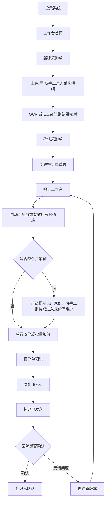
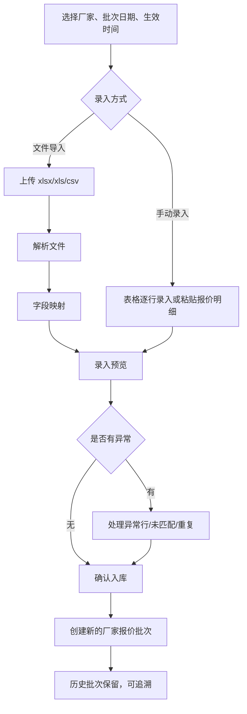
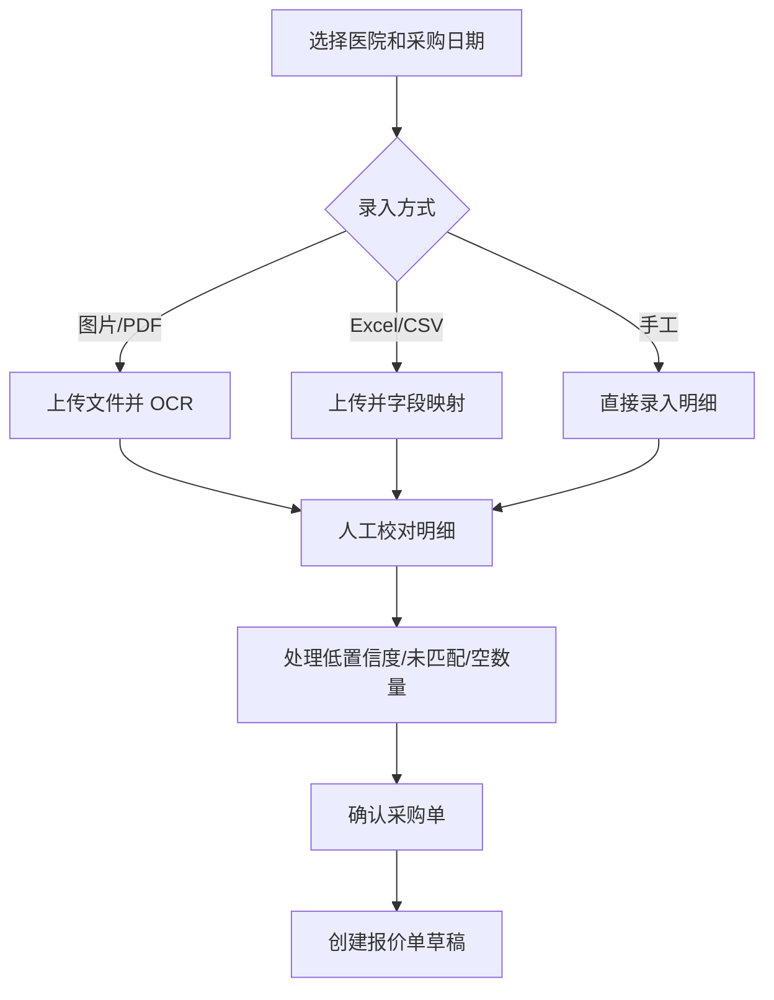
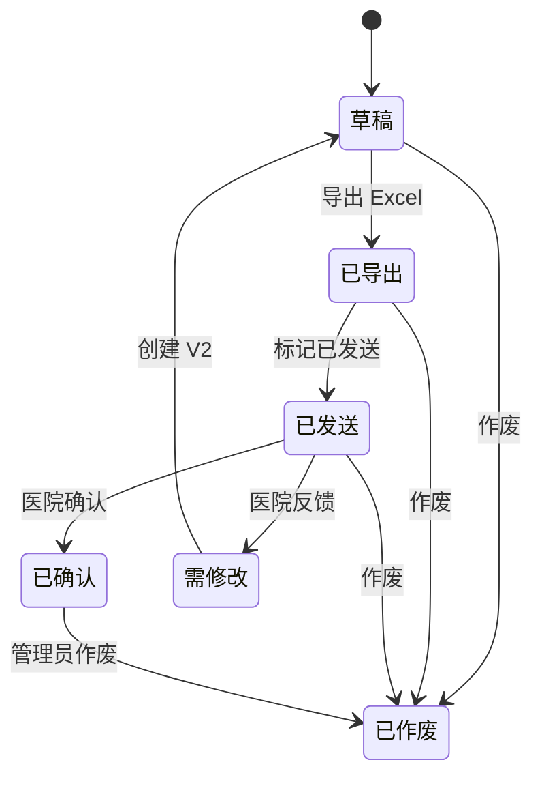

# 中药饮品报价系统首版原型设计

版本：v0.1  
日期：2026-07-04  
来源：`product-manager` agent + `desigen-engineer` agent 协作输出  
依据文档：`docs/quote-system-prd.md`

## 1. 原型目标

本原型用于验证 A 方案 MVP：销售员内部使用的中药饮品报价系统。

首版原型要帮助业务方和开发方确认：

- 销售员能否快速完成“采购单录入 -> 创建报价单 -> 比价调价 -> 预览导出”的每日高频闭环。
- 报价工作台是否能在同一个页面充分展示关键价格参考。
- 风险提示是否足够明显，能降低低价、错价、漏价、覆盖版本等操作风险。
- 采购单校对、批量加价、创建新版本、带风险导出等高频动作是否顺手。
- 厂家报价导入是否作为低频价格库维护入口存在，并在无报价、报价过期、缺少品类价格时被清晰提示。

原型形态建议：

- 第一阶段：低保真线框 + 页面交互说明。
- 第二阶段：中保真可点击原型。
- 第三阶段：前端可运行交互原型。

本文档是第一阶段交付物，可直接作为第二阶段原型和前端页面实现输入。

## 2. 范围边界

### 2.1 覆盖范围

首版原型覆盖完整 MVP 主链路：

1. 登录。
2. 工作台首页。
3. 采购单录入和校对。
4. 创建报价单草稿。
5. 报价工作台比价和调价。
6. 报价单预览。
7. Excel 导出。
8. 标记已发送、已确认。
9. 医院反馈后创建新版本并重新报价。

首版原型同时覆盖厂家报价导入作为低频维护路径：

- 系统首次无有效厂家报价库。
- 厂家发布新月份报价单。
- 报价工作台提示厂家报价过期。
- 某个采购品类缺少厂家价。

### 2.2 不覆盖范围

首版原型不设计：

- 医院采购员端。
- 厂家报价员端。
- 医院在线填写采购单链接。
- 医院在线确认报价。
- 厂家在线接单和发货。
- 库存、物流、发票、回款。
- 销售提成和复杂 CRM。
- 报价模板可视化设计器。
- 自动计算税点和抽点。
- 强制主管审批流程。
- 小程序端复杂表格编辑。

### 2.3 设计原则

- 这是内部销售操作系统，不是营销网站。
- 第一屏应直接进入工作台，不做宣传型首页。
- 工作台首页的主操作是「新建采购单」，不是「上传厂家报价」。
- 表格是核心，不追求大卡片、大留白、大视觉图。
- 价格参考必须在报价工作台主视野中可见。
- 风险状态必须行级可见，不能只依赖弹窗或 toast。
- OCR 和智能匹配都必须经过人工确认。
- 已发送后的报价修改必须通过创建新版本表达。

## 3. 信息架构

采用后台管理式布局：

```text
左侧主导航 + 顶部全局栏 + 主内容区
```

### 3.1 左侧导航

| 一级导航 | 子功能 | 说明 |
| --- | --- | --- |
| 工作台 | 首页、待办、最近记录 | 销售员登录后的默认页。 |
| 采购单 | 采购单列表、新建采购单、采购单编辑 | 承载医院采购需求录入。 |
| 报价单 | 报价单列表、报价工作台、报价预览 | 承载报价生成、调价、导出和状态流转。 |
| 厂家报价库 | 报价批次列表、上传厂家报价 | 管理厂家全品类报价。 |
| 医院客户 | 医院档案、医院历史报价 | MVP 可做基础列表和详情入口。 |
| 基础资料 | 厂家管理、品类基础库、别名库 | 主管/管理员为主，销售员按权限查看。 |
| 系统管理 | 用户管理、系统设置 | 仅管理员可见。 |

### 3.2 顶部全局栏

元素：

- 全局搜索：医院名称、采购单号、报价单号、品名。
- 主快捷按钮：`新建采购单`。
- 次快捷按钮：`继续处理采购单`、`继续编辑报价单`。
- 维护入口：`上传厂家报价`。
- 用户信息：姓名、角色、退出登录。

角色差异：

- 销售员：只能看到自己的客户、采购单、报价单。
- 销售主管：可按销售员筛选全量报价数据。
- 管理员：可进入用户管理、系统设置。

## 4. 主要用户流程

### 4.1 MVP 主流程



厂家报价导入不是每日主流程前置步骤，而是从工作台或厂家报价库进入的维护路径。

### 4.2 厂家报价导入流程



### 4.3 采购单录入流程



### 4.4 报价版本流程



## 5. 页面原型

### 5.1 登录页

目的：

- 让内部用户进入系统。
- 隔离未授权访问。

布局：

```text
┌──────────────────────────────────────┐
│ 中药饮品报价系统                     │
│                                      │
│ 登录账号 / 手机号                    │
│ [________________________]           │
│ 密码                                 │
│ [________________________]           │
│ [ 登录 ]                             │
│                                      │
│ 登录失败提示区                       │
└──────────────────────────────────────┘
```

字段：

- 登录账号/手机号。
- 密码。

校验：

- 账号不能为空。
- 密码不能为空。
- 禁用用户不能登录。
- 登录失败只提示“账号或密码错误”，不泄露具体密码信息。

跳转：

- 登录成功进入 `/dashboard`。
- 未登录访问业务页时跳转 `/login`。

### 5.2 工作台首页

目的：

- 让销售员进入系统后直接开始采购单录入、校对和报价工作。
- 展示待处理采购单、草稿报价单、需修改报价单。
- 展示厂家报价库健康状态，但不把报价导入作为每日主流程前置步骤。

布局：

```text
┌──────────────────────────────────────────────────────────┐
│ 工作台                         新建采购单 继续处理采购单 继续编辑报价 │
├──────────────────────────────────────────────────────────┤
│ 今日采购单  待校对采购单  草稿报价  需修改报价  报价库状态：正常    │
├──────────────────────────────┬───────────────────────────┤
│ 待处理事项                    │ 高频操作                    │
│ - 待校对采购单                │ [新建采购单]                │
│ - 待创建报价单                │ [继续处理采购单]            │
│ - 草稿报价单                  │ [继续编辑报价单]            │
│ - 需修改报价单                │ [查看需修改报价]            │
├──────────────────────────────┴───────────────────────────┤
│ 厂家报价库维护                                             │
│ 厂家 | 月份 | 状态 | 有效行 | 异常行 | 上传时间 | 操作       │
└──────────────────────────────────────────────────────────┘
```

核心组件：

- 指标卡：今日采购单数、待校对采购单数、草稿报价数、需修改报价数、报价库状态。
- 待办列表：待校对采购单、待创建报价单、草稿报价单、需修改报价单。
- 高频操作按钮：新建采购单、继续处理采购单、继续编辑报价单。
- 厂家报价库维护区：最近厂家报价批次、报价库缺失/过期/异常提醒、上传厂家报价入口。

状态：

- 无待办：显示“暂无待处理事项”，主按钮保留 `新建采购单`。
- 无有效厂家报价库：工作台顶部或维护区提示“当前无有效厂家报价库，创建报价单后需手工报价或先维护报价库”，不阻断 `新建采购单`。
- 厂家报价过期：显示“报价库可能过期”，提供 `上传厂家报价`，不阻断采购单录入。
- 厂家批次失败：在维护区显示失败状态，操作入口为 `查看错误`。

### 5.3 厂家报价库

目的：

- 查看厂家报价批次。
- 进入厂家报价导入向导。

布局：

```text
┌──────────────────────────────────────────────────────────┐
│ 厂家报价库                                  上传厂家报价 │
├──────────────────────────────────────────────────────────┤
│ 筛选：厂家 [ ] 批次日期 [ ] 状态 [ ] 来源 [ ] 上传人 [ ] │
├──────────────────────────────────────────────────────────┤
│ 批次号 | 厂家 | 批次日期 | 生效时间 | 来源 | 状态 | 有效 | 异常 | 操作 │
└──────────────────────────────────────────────────────────┘
```

表格列：

- 厂家。
- 批次号。
- 报价批次日期。
- 生效时间。
- 来源：文件导入、手动录入。
- 状态：导入中、有效、失败、已作废。
- 总行数。
- 有效行。
- 异常行。
- 未匹配行。
- 上传人。
- 上传时间。
- 操作：查看批次、下载异常行、录入新批次、作废错误批次。

### 5.4 厂家报价导入向导

目的：

- 通过文件导入或手动录入，把厂家报价转成可比价、可追溯的报价库批次。

步骤条：

```text
基本信息 -> 录入报价 -> 预览校验 -> 异常处理 -> 确认入库 -> 完成
```

#### 步骤 1：基本信息

布局：

```text
厂家报价导入
[步骤条]

厂家：       [选择厂家]
批次日期：   [2026-07-04]
生效时间：   [2026-07-04 09:00]
录入方式：   ( ) 文件导入  ( ) 手动录入

[取消] [下一步：录入报价]
```

校验：

- 厂家必填。
- 批次日期必填。
- 录入方式必填。
- 选择文件导入时，文件必填。
- 文件类型只允许 `.xlsx`、`.xls`、`.csv`。
- 文件大小不超过 20MB。

#### 步骤 2A：文件导入字段映射

布局：

```text
系统字段              Excel 列              是否必填
厂家原始品名          [品名 v]              必填
规格                  [规格 v]              可选
产地                  [产地 v]              可选
单位                  [单位 v]              必填
含税单价              [含税价 v]            必填
含抽点单价            [含抽点价 v]          可选
用于比价厂家价        [含税含抽点价 v]      必填
备注                  [备注 v]              可选

[上一步] [生成录入预览]
```

交互：

- 系统自动推荐列映射，但用户可手工调整。
- 必填字段未映射时，`生成录入预览` 禁用。
- 下方展示前 5 行数据预览。

#### 步骤 2B：手动录入报价

布局：

```text
手动录入厂家报价

[新增行] [批量粘贴] [复制选中行] [删除选中行]

原始品名 | 标准品名 | 规格 | 产地 | 单位 | 含税单价 | 含抽点价 | 用于比价厂家价 | 备注

[上一步] [生成录入预览]
```

交互：

- 支持逐行新增。
- 支持从 Excel 复制多行后粘贴。
- 支持行内编辑和批量删除。
- 必填字段缺失时，单元格红色提示。
- 手动录入也必须进入预览校验，不允许直接入库。

#### 步骤 3：录入预览

布局：

```text
录入预览
总行数 10000 | 有效 9820 | 异常 80 | 重复 50 | 未匹配 50

Tab：全部 / 异常行 / 重复行 / 未匹配

行号 | 原始品名 | 匹配品类 | 单位 | 厂家价 | 状态 | 原因 | 操作

[上一步] [处理异常] [确认入库并创建新批次]
```

说明：

- 文件导入和手动录入在入库前都必须显示预览。
- 异常行不能作为有效报价入库。
- 正常行可先导入，但异常行必须可查看或下载。

#### 步骤 4：异常处理

异常类型：

| 异常 | 界面处理 |
| --- | --- |
| 价格为空 | 单元格红色，提示“价格为空，不能入库”。 |
| 价格非数字 | 单元格红色，支持直接编辑。 |
| 品名未匹配 | 提供搜索标准品类、创建品类、加入别名。 |
| 重复报价 | 选择保留某一条，或保留多条并填写差异备注。 |

新批次确认提示：

```text
即将创建新的厂家报价批次。

厂家：厂家 A
批次日期：2026-07-04
生效时间：2026-07-04 09:00
来源：文件导入/手动录入

说明：新批次不会覆盖旧批次，历史所有批次均可追溯。系统查询“厂家最新价”时会按生效时间、批次日期、创建时间取最新有效批次。

[取消] [确认创建新批次]
```

#### 步骤 5：完成

展示：

- 厂家。
- 批次号。
- 报价批次日期。
- 生效时间。
- 来源方式。
- 总行数。
- 有效行。
- 异常行。
- 未匹配行。

操作：

- 查看批次详情。
- 下载异常行。
- 返回厂家报价库。

### 5.5 采购单列表

目的：

- 管理销售员创建的医院采购单。
- 快速进入编辑或创建报价单。

布局：

```text
┌──────────────────────────────────────────────────────────┐
│ 采购单                                      新建采购单    │
├──────────────────────────────────────────────────────────┤
│ 筛选：医院 [ ] 日期 [ ] 状态 [ ] 来源 [ ] 创建人 [ ]      │
├──────────────────────────────────────────────────────────┤
│ 采购单号 | 医院 | 日期 | 来源 | 明细数 | 状态 | 创建人 | 操作 │
└──────────────────────────────────────────────────────────┘
```

操作：

- 查看/编辑。
- 创建报价单。
- 取消采购单。

状态：

- 草稿。
- 已确认。
- 已报价。
- 已取消。

### 5.6 采购单编辑页

目的：

- 将医院采购需求转成可用于报价的采购明细。

布局：

```text
┌──────────────────────────────────────────────────────────┐
│ 采购单编辑：XX 医院 / 2026-07-04 / 草稿                  │
│ 保存草稿  确认采购单  创建报价单                         │
├───────────────────────┬──────────────────────────────────┤
│ 原始文件预览           │ 采购明细表格                      │
│ 图片/PDF/Excel 信息    │ 原始品名 标准品名 规格 数量 单位... │
│ OCR 状态               │                                  │
└───────────────────────┴──────────────────────────────────┘
```

顶部字段：

- 医院。
- 采购日期。
- 来源类型：图片/PDF/Excel/手工。
- 状态。

主操作：

- 上传文件。
- 新增行。
- 复制行。
- 删除行。
- 批量匹配。
- 保存草稿。
- 确认采购单。
- 创建报价单。

表格列：

| 列 | 交互 |
| --- | --- |
| 原始品名 | 可编辑，不能为空。 |
| 标准品名 | 搜索选择标准品类，可绑定别名。 |
| 规格 | 可编辑。 |
| 数量 | 可编辑，可为空但提示。 |
| 单位 | 可编辑/下拉选择。 |
| 备注 | 可编辑。 |
| OCR 置信度 | 低于 0.8 高亮。 |
| 匹配状态 | 已匹配、别名匹配、未匹配。 |
| 操作 | 复制、删除、查看匹配详情。 |

关键规则：

- OCR 结果不能直接生成正式采购单，必须人工确认。
- 品名为空的明细不能保存。
- 未确认采购单不能创建报价单。
- 数量为空可以保存，但导出报价单前需提醒金额无法计算。

低置信度样式：

```text
党参    OCR 0.63    黄色背景    提示：请核对识别结果
```

未匹配样式：

```text
原始品名：炙甘草片
标准品名：未匹配
操作：搜索绑定 / 新建品类 / 暂不处理
```

### 5.7 报价单列表

目的：

- 查看报价单状态。
- 进入工作台、预览、导出记录和新版本。

布局：

```text
┌──────────────────────────────────────────────────────────┐
│ 报价单                                                   │
├──────────────────────────────────────────────────────────┤
│ 筛选：医院 [ ] 销售员 [ ] 状态 [ ] 日期 [ ] 报价单号 [ ] │
├──────────────────────────────────────────────────────────┤
│ 报价单号 | 医院 | 采购单号 | 版本 | 状态 | 金额 | 风险 | 操作 │
└──────────────────────────────────────────────────────────┘
```

操作：

- 继续编辑。
- 预览。
- 查看导出记录。
- 创建新版本。
- 标记已发送。
- 标记已确认。
- 作废。

风险数：

- 未匹配。
- 无厂家价。
- 低于基准价。
- 低于医院历史最低价。
- 数量为空。

### 5.8 报价工作台

目的：

- 销售员在一个页面完成比价、调价、风险检查和导出前准备。

整体布局：

```text
┌────────────────────────────────────────────────────────────────────┐
│ XX 医院 | BJ-20260704-HOSP01-001 | V1 | 草稿 | 风险 5             │
│ 保存草稿  批量加价  预览报价单  导出 Excel                         │
├────────────────────────────────────────────────────────────────────┤
│ 批量加价：范围[全部可报价行] 方式[按比例] 参数[10%]                 │
│ 预览影响  应用  撤销本次批量操作                                   │
├────────────────────────────────────────────────────┬───────────────┤
│ 报价明细表格                                        │ 当前行价格参考 │
│                                                    │ 厂家报价       │
│                                                    │ 医院历史       │
│                                                    │ 改价记录       │
│                                                    │ 匹配信息       │
└────────────────────────────────────────────────────┴───────────────┘
```

#### 5.8.1 头部区域

展示：

- 医院名称。
- 报价单编号。
- 版本号。
- 状态。
- 采购单号。
- 报价日期。
- 销售员。
- 风险汇总。

风险汇总示例：

```text
风险 5：未匹配 1 / 无厂家价 1 / 低于基准价 2 / 数量为空 1
```

主操作：

- 保存草稿。
- 预览报价单。
- 导出 Excel。
- 标记已发送。
- 标记已确认。
- 创建新版本。

状态控制：

- 草稿：可编辑。
- 已导出：可创建新版本、标记已发送。
- 已发送：不可直接编辑，需创建新版本。
- 已确认：只读。
- 已作废：只读。

#### 5.8.2 报价明细表格

固定左侧列：

| 列 | 说明 |
| --- | --- |
| 勾选 | 用于批量加价。 |
| 序号 | 行号。 |
| 风险 | 图标/标签显示异常类型。 |
| 原始品名 | 来自采购单。 |
| 标准品名 | 可人工修改。 |

主体列：

| 列 | 说明 |
| --- | --- |
| 规格 | 采购单规格。 |
| 数量 | 采购数量。 |
| 单位 | 采购单位。 |
| 厂家 A 最新价 | 价格 + 批次号 + 生效时间。 |
| 厂家 B 最新价 | 价格 + 批次号 + 生效时间。 |
| 最新厂家最低价 | 当前所有启用厂家最新批次最低价。 |
| 历史厂家最低价 | 历史所有有效厂家报价最低价。 |
| 该医院上次报价 | 最近一次同医院报价。 |
| 建议基准价 | 默认取最新厂家最低价。 |
| 本次报价 | 可编辑，销售员最终报价。 |
| 加价金额 | 本次报价 - 建议基准价。 |
| 加价率 | 加价金额 / 建议基准价。 |
| 金额 | 数量 * 本次报价。 |
| 备注 | 导出报价单备注。 |

固定右侧列：

- 查看详情。
- 行操作。

行级状态：

| 状态 | 样式 | 行为 |
| --- | --- | --- |
| 未匹配 | 红色标签 | 阻止导出，需绑定标准品类。 |
| 无厂家价 | 橙色标签 | 允许手工报价，导出前提醒。 |
| 仅 1 家报价 | 灰色/蓝色标签 | 提醒参考价来源不足。 |
| 低于基准价 | 红色价格 | 导出前二次确认。 |
| 低于医院历史最低价 | 黄色价格 | 导出前二次确认。 |
| 数量为空 | 黄色标签 | 金额为空，导出前提醒。 |

#### 5.8.3 右侧价格参考侧栏

侧栏随当前选中行变化。

Tab 1：厂家报价

| 厂家 | 批次号 | 生效时间 | 单位 | 厂家价 | 含税 | 含抽点 |
| --- | --- | --- | --- | --- | --- |

Tab 2：医院历史

| 日期 | 报价单号 | 版本 | 报价 | 状态 |
| --- | --- | --- | --- | --- |

Tab 3：改价记录

| 时间 | 操作人 | 修改前 | 修改后 | 原因 |
| --- | --- | --- | --- | --- |

Tab 4：匹配信息

- 原始品名。
- 标准品名。
- 匹配方式：标准名/别名/归一化/人工。
- 可加入别名库。

#### 5.8.4 批量加价

入口：

- 报价工作台顶部固定操作栏。

字段：

- 选择范围：全部可报价行、当前筛选行、已选中行。
- 加价方式：按比例、固定金额、目标毛利率。
- 参数输入：百分比/金额/毛利率。

预览影响弹窗：

```text
批量加价预览

影响行数：36
跳过行数：2（无厂家价 1，未匹配 1）
平均涨幅：8.6%
低于基准价行数：0
预计总金额变化：+ 2,350.00

[取消] [确认应用]
```

应用后：

- 表格更新本次报价。
- 顶部显示 `撤销本次批量操作`。
- 保存前允许撤销。

### 5.9 报价预览页

目的：

- 在导出前按正式报价单样式检查。

布局：

```text
┌──────────────────────────────────────────────────────────┐
│ 报价单预览：XX 医院 / BJ-... / V1                       │
│ 返回编辑  导出 Excel  标记已发送                         │
├──────────────────────────────────────────┬───────────────┤
│ 正式报价单预览                            │ 版本信息       │
│ 医院名称                                  │ 导出记录       │
│ 报价日期                                  │ 状态流转       │
│ 明细表                                    │ 风险汇总       │
└──────────────────────────────────────────┴───────────────┘
```

预览内容：

- 医院名称。
- 报价日期。
- 报价单编号。
- 销售员姓名和联系方式。
- 报价明细：序号、品名、规格、单位、数量、单价、金额、备注。
- 备注条款。

操作：

- 返回编辑。
- 导出 Excel。
- 标记已发送。
- 标记已确认。

导出前规则：

- 有未匹配品类：阻止导出。
- 本次报价为空：阻止导出。
- 无厂家价但已手工报价：允许确认后导出。
- 低于建议基准价：允许确认后导出。
- 低于医院历史最低价：允许确认后导出。
- 数量为空：允许确认后导出，但提示金额为空。

带风险导出弹窗：

```text
导出前发现 4 类风险

阻断项：
- 未匹配品类：1 行

需确认项：
- 无厂家价但已手工报价：1 行
- 低于建议基准价：2 行
- 数量为空：1 行

请先处理阻断项后再导出。

[返回处理]
```

当只有需确认项：

```text
导出前发现 3 类风险

- 无厂家价但已手工报价：1 行
- 低于建议基准价：2 行
- 数量为空：1 行

[返回处理] [确认导出 Excel]
```

### 5.10 创建新版本弹窗

触发场景：

- 已发送报价单需要修改。
- 需修改报价单重新报价。

弹窗：

```text
创建报价单新版本

当前版本：V1
新版本：V2

修改原因：
[医院反馈部分品类价格偏高，需要调整报价________________]

说明：新版本会继承 V1 的报价明细，V1 保留为历史版本。

[取消] [创建 V2 并编辑]
```

规则：

- 修改原因必填。
- 创建后进入 V2 报价工作台。
- 原版本不可被覆盖。

## 6. 状态、空态、错误态

### 6.1 状态标签

采购单：

- 草稿。
- 已确认。
- 已报价。
- 已取消。

报价单：

- 草稿。
- 已导出。
- 已发送。
- 需修改。
- 已确认。
- 已作废。

厂家批次：

- 导入中。
- 有效。
- 已作废。
- 失败。

### 6.2 空态

| 场景 | 文案 | 主操作 |
| --- | --- | --- |
| 无采购单 | 暂无采购单 | 新建采购单 |
| 无厂家报价 | 当前无有效厂家报价，报价工作台无法自动比价；仍可录入采购单并手工报价 | 上传厂家报价 |
| 无医院历史报价 | 暂无该医院历史报价 | 无，不阻断报价 |
| 无导入异常 | 暂无异常行 | 确认入库 |
| 无待办 | 暂无待处理事项 | 新建采购单 |

### 6.3 错误态

| 场景 | 行为 |
| --- | --- |
| 文件格式错误 | 提示支持 `.xlsx/.xls/.csv/.jpg/.png/.pdf`，按业务场景区分。 |
| 文件超过大小 | 提示 20MB 限制。 |
| 字段映射缺失 | 高亮缺失字段，禁用下一步。 |
| OCR 服务不可用 | 提示服务不可用，保留手工录入入口。 |
| 导出失败 | 保留草稿，显示失败原因和重试按钮。 |
| 权限不足 | 提示无权限访问，返回工作台。 |

## 7. 关键弹窗

### 7.1 删除采购明细

```text
确认删除该采购明细？
删除后不可恢复。

[取消] [确认删除]
```

### 7.2 作废厂家报价批次

```text
确认作废该厂家报价批次？
作废后该批次不再参与“厂家最新价”计算，但仍保留历史追溯。

作废原因：
[________________________________]

[取消] [确认作废]
```

### 7.3 作废报价单

```text
确认作废该报价单？
作废后不可编辑，仅保留历史查看。

作废原因：
[________________________________]

[取消] [确认作废]
```

### 7.4 标记已确认

```text
确认将报价单标记为已确认？
标记后该版本不可编辑。

[取消] [确认]
```

### 7.5 未保存修改

```text
当前报价单存在未保存修改。
请先保存草稿后再预览或导出。

[取消] [保存并继续]
```

## 8. 低保真线框

### 8.1 应用框架

```text
┌──────────────┬──────────────────────────────────────────────┐
│ 中药报价系统 │ 顶部栏：全局搜索 / 新建采购单 / 继续编辑报价 / 用户 │
├──────────────┼──────────────────────────────────────────────┤
│ 工作台        │ 页面标题                                      │
│ 采购单        │ 筛选区 / 操作区                                │
│ 报价单        │ 主表格或表单                                  │
│ 厂家报价库    │                                              │
│ 医院客户      │                                              │
│ 基础资料      │                                              │
│ 系统管理      │                                              │
└──────────────┴──────────────────────────────────────────────┘
```

### 8.2 厂家报价导入

```text
┌──────────────────────────────────────────────────────────┐
│ 厂家报价导入                                             │
│ 基本信息 -> 录入报价 -> 预览校验 -> 异常处理 -> 完成       │
├──────────────────────────────────────────────────────────┤
│ 厂家：[厂家 A v]       批次日期：[2026-07-04] 生效：[09:00] │
│ 录入方式：(●) 文件导入  ( ) 手动录入                       │
│ 文件：[上传报价单.xlsx]  手动录入时显示可编辑报价表格        │
├──────────────────────────────────────────────────────────┤
│ 系统字段              Excel 列                            │
│ 原始品名              [品名 v]                            │
│ 单位                  [单位 v]                            │
│ 用于比价厂家价        [含税含抽点价 v]                    │
│ 手动表格：品名 规格 单位 含税价 含抽点价 用于比价价 备注     │
├──────────────────────────────────────────────────────────┤
│ 总行 10000 | 有效 9820 | 异常 80 | 重复 50 | 未匹配 50     │
│ 行号 品名 单位 厂家价 状态 原因 操作                       │
└──────────────────────────────────────────────────────────┘
```

### 8.3 采购单编辑

```text
┌──────────────────────────────────────────────────────────┐
│ 采购单：XX 医院 / 2026-07-04 / 草稿                       │
│ 保存草稿  确认采购单  创建报价单                          │
├───────────────────────┬──────────────────────────────────┤
│ 原始文件预览           │ 采购明细                          │
│ [采购单图片/PDF]       │ 原始品名 标准品名 规格 数量 单位    │
│ OCR 状态：已识别       │ 党参     党参     -   10   kg      │
│                        │ 炙甘草片 未匹配  -    5   kg      │
└───────────────────────┴──────────────────────────────────┘
```

### 8.4 报价工作台

```text
┌────────────────────────────────────────────────────────────────────┐
│ XX 医院 | BJ-20260704-HOSP01-001 | V1 | 草稿 | 风险 5              │
│ 保存草稿  批量加价  预览报价单  导出 Excel                          │
├────────────────────────────────────────────────────────────────────┤
│ 批量加价：范围[已选中行] 方式[按比例] 参数[10%] 预览影响 应用 撤销    │
├──────────────────────────────────────────────────┬─────────────────┤
│ 风险 品名 标准名 数量 厂A价 厂B价 最低价 历史价 本次报价 │ 当前行参考     │
│ 红  炙甘草 未匹配 5   -     -     -     -     [ ]      │ 厂家报价       │
│ 黄  党参   党参   10  12.00 11.80 11.80 12.50 [12.90] │ 医院历史       │
│                                                  │ 改价记录       │
│                                                  │ 匹配信息       │
└──────────────────────────────────────────────────┴─────────────────┘
```

### 8.5 报价预览

```text
┌──────────────────────────────────────────────────────────┐
│ 报价单预览：XX 医院 / V1                 返回编辑 导出Excel │
├──────────────────────────────────────────┬───────────────┤
│ 正式报价单                                │ 版本：V1       │
│ 医院：XX 医院                             │ 状态：草稿     │
│ 报价日期：2026-07-04                      │ 风险汇总       │
│ 序号 品名 规格 数量 单位 单价 金额 备注     │ 导出记录       │
└──────────────────────────────────────────┴───────────────┘
```

## 9. 样例数据要求

原型样例数据必须包含：

- 2 个厂家：厂家 A、厂家 B。
- 2 家医院：XX 中医院、YY 人民医院。
- 20 个标准品类。
- 采购单中至少包含：
  - 可自动匹配品类。
  - 通过别名匹配品类。
  - 无法匹配品类。
  - 无厂家报价品类。
  - 数量为空品类。
- 报价工作台中至少包含：
  - 本次报价低于建议基准价的行。
  - 本次报价低于医院历史最低价的行。
  - 仅 1 家厂家报价的行。
  - 已手工改价并有改价记录的行。

## 10. 原型验收清单

首版原型完成后，应满足：

- 工作台首页默认主操作是 `新建采购单`。
- 从工作台首页能直接进入采购单录入、校对和后续报价工作。
- 工作台首页提供 `继续处理采购单`、`继续编辑报价单` 等高频入口。
- 厂家报价导入作为报价库维护入口存在，但不作为每日主流程前置步骤。
- 厂家报价导入是分步向导，不是单按钮上传。
- 录入预览能看到有效行、异常行、重复行、未匹配行。
- 异常行有明确处理入口。
- 无有效厂家报价库时，系统不阻断新建采购单，只在工作台和报价工作台提示风险。
- 采购单支持文件上传和手工录入两种体验。
- OCR 低置信度和未匹配品类有醒目标识。
- 采购单必须确认后才能创建报价单。
- 报价工作台能同时看到厂家价、最低价、历史价和本次报价。
- 报价工作台支持单行改价和批量加价。
- 批量加价前有影响范围预览。
- 导出前有风险汇总确认。
- 已发送后修改通过创建新版本表达。
- 原型不出现医院端、厂家端、发货、库存、回款页面。

## 11. 待确认但不阻塞首版原型

以下问题不阻塞当前原型，但中保真定稿前建议确认：

1. 系统文案使用「中药饮品」还是「中药饮片」。
2. 厂家报价中的“含抽点”是否已经是最终成本价。
3. 医院正式报价单是否必须显示数量和金额。
4. 是否已有固定 Excel 报价单模板。
5. 销售员是否能查看其他销售员的客户历史价。
6. 低于厂家基准价时未来是否需要主管审批。
7. 移动端一期是否只做查看，不做复杂表格编辑。
8. 厂家数量一期展示 A/B 两家，但实现和原型结构应保留多厂家扩展空间。

## 12. 下一步建议

建议下一步按以下顺序推进：

1. 业务方审阅本文档，确认页面范围和主流程。
2. `product-manager` agent 根据反馈修订 PRD 或本原型文档。
3. `desigen-engineer` agent 基于本文档输出中保真页面原型。
4. 确认视觉和交互后，再进入前端可运行原型或正式开发。
